[简体中文](README.md) | **English**

# NGB PC Native Port (Ninja Gaiden Black · native PC loader)

An unofficial native Windows port of *Ninja Gaiden Black* (original Xbox): the original US release, and the basic
edition va-zh-x2 and the Hurricane editions vb-zh-x2.1 / vb-jp-x2.1 made from it.

The game program (`Ninja Gaiden Black.exe`; for 2004 `Ninja Gaiden.exe`) loads your own `default.xbe` and runs the original x86 game code directly on the PC; the Xbox kernel,
Direct3D 8, DirectSound and the other system parts are reimplemented on the PC by the loader (HLE). The game code is
not interpreted instruction by instruction, and it is never modified on disk.

This project is a fork of [black-pc](https://github.com/Spark198rus/black-pc) (the native port of BLACK); it adds
support for the Ninja Gaiden main program and the programs it launches to that loader. The original BLACK NTSC-U
support is kept.

**You need your own copy of the game.** This repository contains no game code or data and no Microsoft XDK code.

## Smoothness settings

The goal is a smooth experience in every setup; choose the one that matches your display and habits.

**High refresh display, exclusive fullscreen (recommended)**

- 120 / 240 Hz: Steady game speed on, V-Sync on, "60 Hz with V-Sync" off, Low-latency present off.
- 144 / 165 Hz: Steady game speed on, V-Sync on, "60 Hz with V-Sync" on, Low-latency present off.

**60 Hz display, exclusive fullscreen**

- Display: exclusive fullscreen
- Steady game speed: on
- V-Sync: on
- Low-latency present: off
- "60 Hz with V-Sync": off (it does nothing on a 60 Hz display)

**60 Hz display, windowed / borderless**

- Display: windowed or borderless
- Steady game speed: off
- V-Sync: on
- "60 Hz with V-Sync": off

Windowed / borderless goes through Windows' desktop composition (DWM) and does not switch the display mode.

## Screenshots

From the game's own attract demo (it plays when the title screen is left alone) and from saves, rendered at 1440 lines and scaled down.

**Title screens** (16:9)

Ninja Gaiden Black, Hurricane vb-zh-x2.1 · Ninja Gaiden Black, original US release · Ninja Gaiden (2004)

<p>
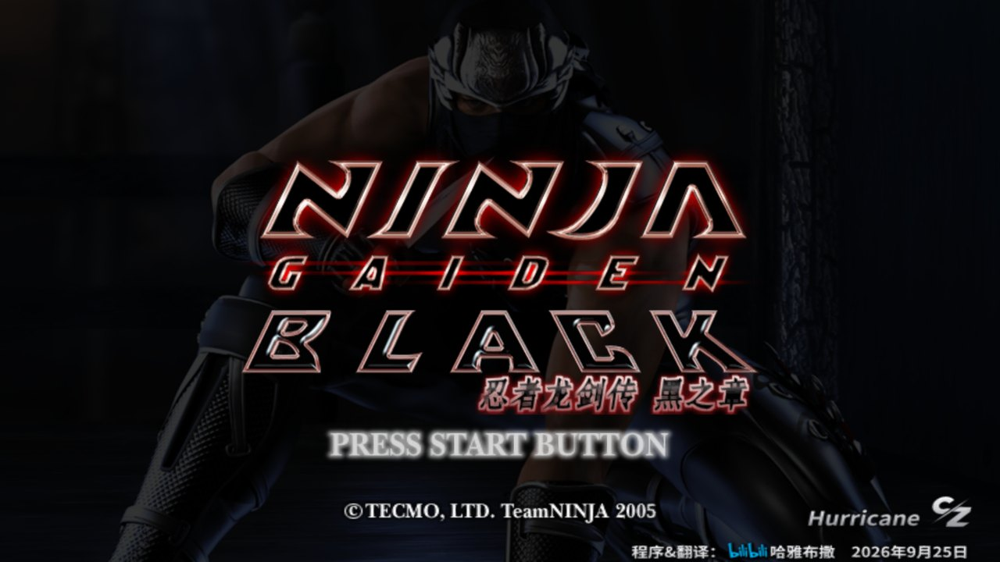
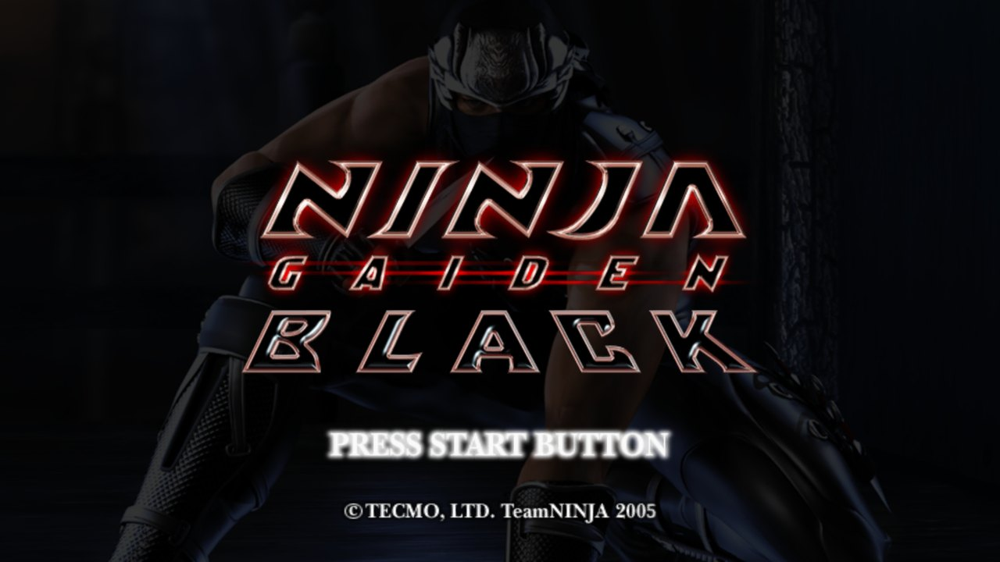
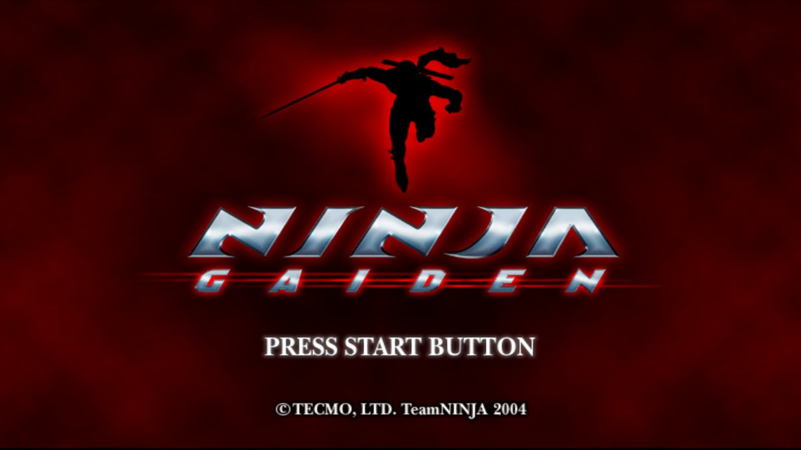
</p>

**Ninja Gaiden Black** (16:9)

<p>
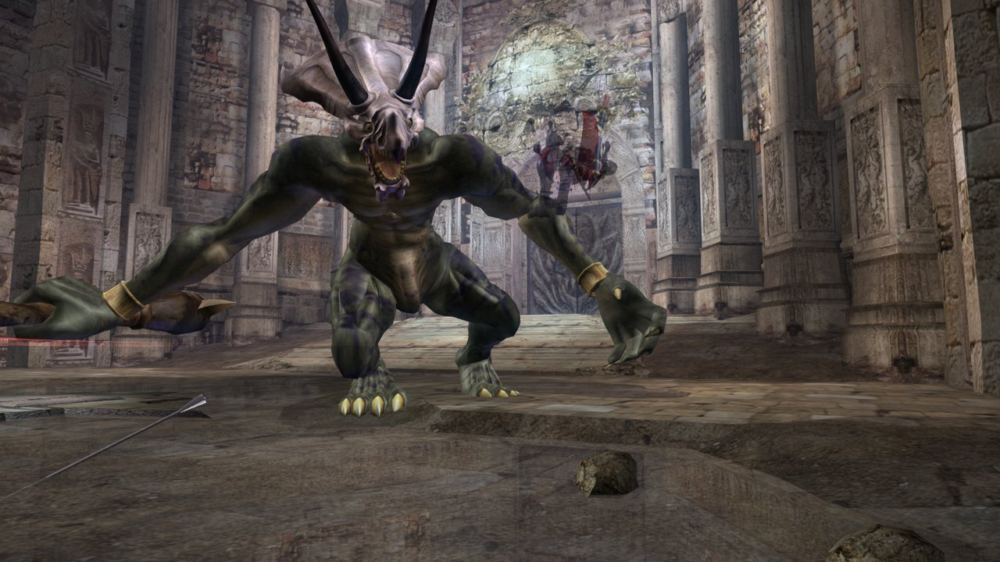
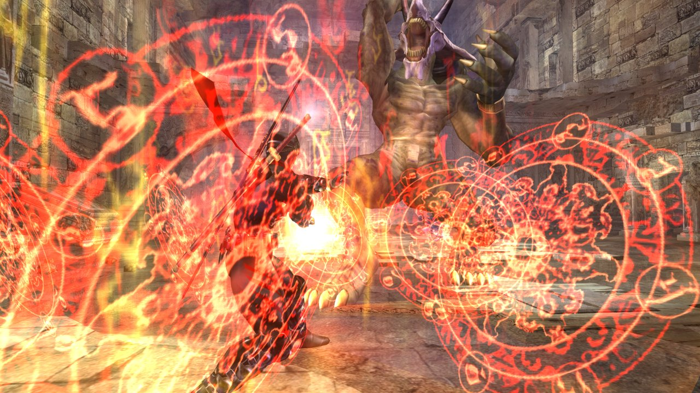
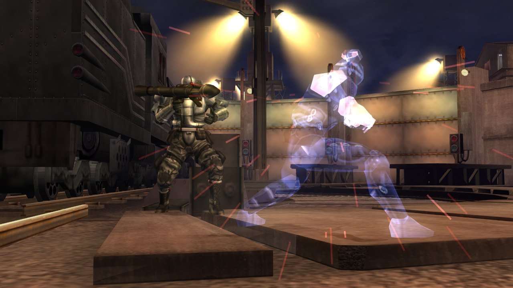
</p>

**Screen shapes** (Ninja Gaiden Black, the same moment): 4:3, 16:9, 16:10, 21:9. At 16:10 and 21:9 the picture is wider and the HUD sits at the sides.

4:3 · 16:9

<p>
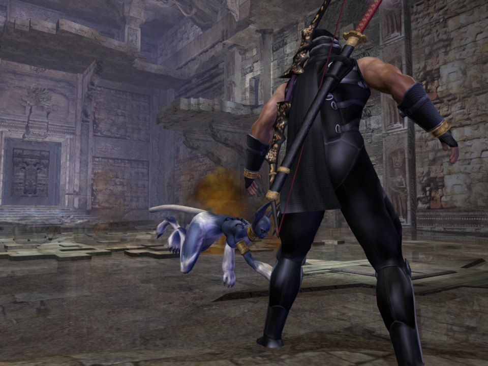
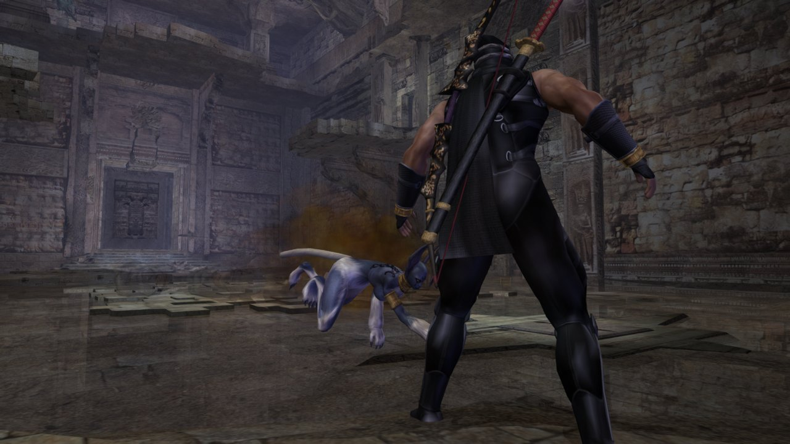
</p>

16:10 · 21:9

<p>
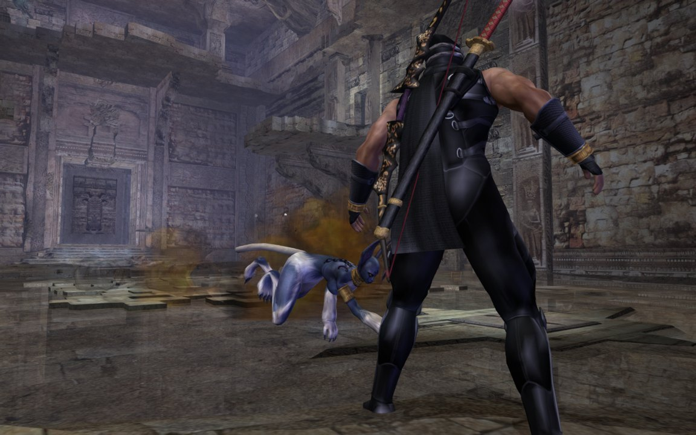
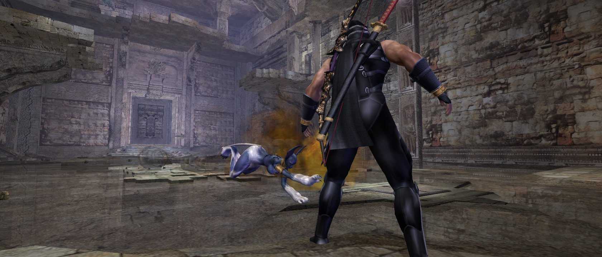
</p>

**Ninja Gaiden (2004)**: 16:9, 4:3, 21:9 and the menu.

16:9 · 4:3

<p>
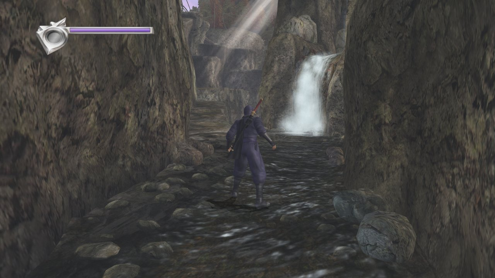
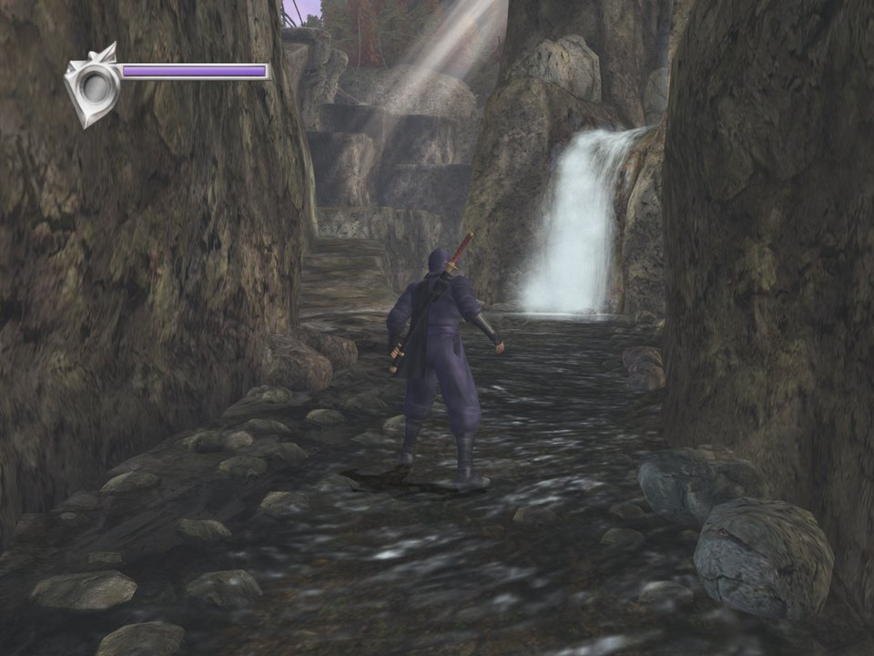
</p>

21:9 · Menu

<p>
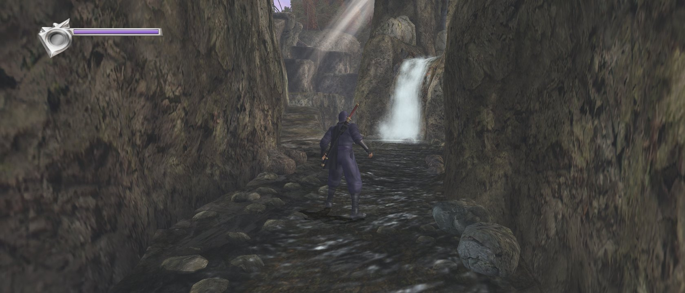
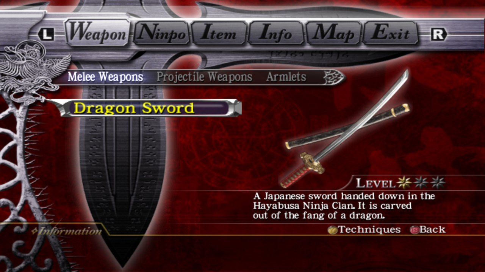
</p>

## Supported builds

The loader identifies the build by the XBE's SHA-256 and does not run any other. Four disc images are supported: the
original US release and three editions made from it by 哈雅布撒 (Hayabusa).

| Main program `default.xbe` | Language | Bundled programs | SHA-256 |
|---|---|---|---|
| Original US release NINJA GAIDEN BLACK (NTSC-U) | English | 2 arcade | `df1d2af0154d771f42b77ec4df03a862417ac457ff0d39fec846c40cb55ffbda` |
| Basic edition va-zh-x2 | Chinese / English | 2 arcade | `00cef52546618eb0149d7895f9042403e95f361b5483aac38933e799c67a50e1` |
| Hurricane edition vb-zh-x2.1 | Chinese / English | 2 arcade + 2 SNES | `aa3c5bec2923f83ccb37fe6a63ea5516b26d477b53c679a1620d19e4a8e4e8f6` |
| Hurricane edition vb-jp-x2.1 | Japanese / English | 2 arcade + 2 SNES | `535778c8a4623195c8f320b85d2d139f20ff13c020d40150adaed54cfdeffc38` |

The three editions are the US `default.xbe` patched: the same sections at the same addresses, the Direct3D, DirectSound
and other library sections byte for byte identical, and no change at an address the loader uses, so all four share
the same tables and fixes. The bundled programs are identical in every build:

| Bundled program | SHA-256 |
|---|---|
| `NinjaTomoe.xbe` (bundled with the original release, Japanese) | `2aff93ad098b3b5762d294d9c17a44c36d04bfa31843e413cf5e2963f14282ff` |
| `NinjaTrilogy.xbe` (bundled with the original release, US) | `31f8efd073abba2ac339ee44f4b13011844afc470b166f826dc12f6b79ff5621` |
| `NinjaFCJ.xbe` (SNES trilogy, Japanese, added by the Hurricane editions) | `b5b8754e6008f3b2e773c1eb9afe50ee9decebf0eadb945a9953369b1b9f4f31` |
| `NinjaFCU.xbe` (SNES trilogy, US, added by the Hurricane editions) | `9fac4bb5162b8a99c65c0fbb6289ee81db4c42bdbd253807e74261a68e3399b1` |

The launched programs are entered from the main menu's arcade and SNES entries: the game calls `XLaunchNewImage`, and
the loader restarts itself with the same options and loads the target XBE.

## Ninja Gaiden (2004)

From 2.0.0 the port also runs the first Ninja Gaiden (2004, the US disc 1.02.04) and its Hurricane Packs. Switch the
launcher to "2004" at the top left; the game installs into a folder of its own, apart from Black.

| Program | What | SHA-256 |
|---|---|---|
| `default.xbe`, disc 1.02.04 | runs without the Hurricane Packs | `bea2a85eea7e6e0ba6c3e201966a46b24b27e25b3307a29bc3de5b4254791308` |
| `$u\default.xbe`, update 1.06.04 | installed with the packs; runs instead once installed (as on the console) | `86475ba502c0e7f147334b167041c3fd310f8fb34f9e77b0ee6e6866e0764ee3` |
| `downloader.xbe`, disc / update | the Xbox Live downloader behind "NEW NOTICE!" in the Master Ninja Tournament | `fcce4a17…` (disc) / `a99574a8…` (update) |
| `NinjaTomoe.xbe` / `NinjaTrilogy.xbe` | the bundled SNES trilogy | `d2aeab80…` / `18eaadc5…` |

Redump's "Ninja Gaiden (USA, Asia) (En,Ja)" runs too: the same 1.02.04 with one byte of the XDK start-up check in each program as signed (the files above have it changed to skip the check). Its `default.xbe` is `86c23d787ecf9f6400b9378544a49b62cfdd478dc04d6ef01ceed2a6429e84c0`, and its downloader, trilogy and updater have their own; updating to 1.06 online works the same.

- **Hurricane Packs**: on the launcher's Install page, the Hurricane Packs card takes the installer's folder ("Ninja
  Gaiden DLC Installer") and installs it onto the game's hard disk; the game then starts with update 1.06. The same
  card's Uninstall list shows what is installed (update 1.06, packs 1 and 2, notices downloaded in the game) and
  deletes the one chosen after asking. Export copies the installed update and all content into a folder in the
  installer's layout; another player chooses that folder on the same card to install it.
- **Updating to 1.06 online**: without the Hurricane Packs, the Master Ninja Tournament asks for the update; yes runs
  the disc's Xbox Live updater, which downloads update 1.06 from Insignia, installs it and goes back to the game
  (from 2.0.1). The updater draws with the Xbox dashboard's fonts, copied the first time from the xemu hard disk
  image registered on the Online page. If the update fails, OK goes back to the game.
- **Master Ninja Tournament**: needs online play (Insignia, as in Black; see "Online" below). The packs are signed for
  this PC when the game starts, so packs installed elsewhere work too.
- **NEW NOTICE!**: opens the Xbox Live downloader, which downloads notices and other content from Insignia and goes
  back to the game. The downloader has no sound.
- **Exit game**: the title menu has a last row, EXIT GAME (its letters cut from the menu's own words), that asks "Exit
  the game?" in the game's own box.
- Black's fixes (widescreen, 16:9 movies on 21:9, the load timing) apply to 2004 as well.

## Status

Each item's verdict and evidence are in `project/docs/06_功能验证矩阵.md` (feature verification matrix).

- **Localization**: title, main menu, save / load pages, pause menu / weapons / move lists, chapter title cards,
  opening CG and in-engine cutscene subtitles, results screen, items / shop / map / dialogue: all verified.
- **Hurricane features**: both modes of 交差之法, the Armlet of Tranquility (宁静腕轮), costume selection with the
  left trigger, the Kitetsu blade's health drain (妖刀鬼彻), a second playthrough keeping the golden scarabs, the
  Talisman of Rebirth switch (还魂护符), bow crosshair / view, Mission Mode: all verified in play.
- **Launched programs**: the arcade and SNES versions are playable from the main menu.
- **Exit game**: the main menu has a last row, 退出游戏 (EXIT GAME on the English menus), that asks "Exit the game?" in
  the game's own confirmation box: Ⓐ yes returns to the desktop, Ⓑ no goes back to the menu.
- **Online leaderboards (optional)**: with a console and account registered with Insignia, the game's Ranking menu signs
  in and shows the real leaderboards (tested). The console can be imported from xemu, or made and registered in the port
  without xemu (from 2.2.0). Off by default; see "Online" below.
- **Saves**: saving, loading and loading back the same slot verified. Saves are in the standard Xbox format; copied
  into xRevive's save folder they load directly (tested). Saves are signed with the same console key whether online
  play is on or off, so switching it no longer shows Damaged Game. The launcher's Saves page re-signs saves from
  another Xbox, from xemu, from another player, or made with online play on in earlier versions, for this PC (backed
  up first).
- **Sound**: a software DirectSound mixer on XAudio2, with reverb.
- **Performance**: in a chapter 1 battle, an average frame time of 10.45 ms on Intel Iris Xe integrated graphics
  (the 60 fps budget is 16.68 ms; r178, `project/docs/05_音频输入存档.md`).
- **Input**: Xbox and other XInput controllers, plus PS3 / PS4 / PS5 controllers, the Switch Pro Controller, Joy-Cons and DirectInput pads (through SDL3); all with rumble.
- **System language**: the launcher's Display page (Console) offers the original Xbox's nine system languages (English by default); games pick their default text from it. It applies to Black and 2004, every image. Keep English for the Chinese editions.
- **Audio settings**: the same Console card has all of the original Xbox dashboard's audio options: mono / stereo (default) / Dolby Surround (the rear matrixed into the two channels, for a Pro Logic receiver), and the digital output's Dolby Digital and DTS (5.1 out: front left / right, centre, LFE, back left / right; Windows folds it for fewer speakers). Black's original plays its music and movie sound almost silent on 5.1 (its volumes multiplied by ten); the port fixes that.

### Original-game defects fixed

These also happen on the Xbox; the port fixes them. Each fix can be switched back live for comparison
(`project/docs/07_证据盘点.md`, the evidence ledger):

- Chapter 2 water: black / white jagged edges, and stretched stripes when the camera is at the water line (a
  per-vertex division moved to per pixel).
- Lava rooms: a black bar down the right (the screen copy one column short), a white blob in the heat haze, and a
  blurred band at the right edge.

### Smoothness: no hitch the first time an area shows (2.2.31)

Before, after every start, the first time an area or a cutscene showed cost a hitch (one frame of 30-280 ms). Each
cause was found and handled on its own; each can be switched off to compare. Tested on an RTX 3060 and on Iris Xe
integrated graphics (D3D9On12) with the attract demo and the performance recorder, every setting at least twice,
interleaved; changes to the picture also checked at high render scales (x8 on the RTX 3060, x4 on the Iris Xe).

| Cause | What the port does | Switch | Result |
|---|---|---|---|
| A shader compiled the first time it is used (2-40 ms each) | the package carries a shader seed, `shader_seed.bin` (429 entries), made at start | - | a new player's first start: worst frame 282 -> 113 ms (Iris Xe) |
| The game's own vertex programs (translated game code, not shippable) | only where they are in `default.xbe`, `vertex_programs.bin` (7 programs, checked in all 7 builds); at start they are read from the player's own copy and compiled | - | the attract demo's first scene: 17-23 ms of compiling gone |
| The graphics driver builds an internal program at a draw state's first draw (NVIDIA's fixed-function pipeline above all) | the draw states the game uses are recorded and all drawn once at start on a 16x16 target, `draw_states.bin` (8,339 states) | `--no-draw-warm` | area entry 47-52 -> 26 ms (RTX 3060); at x8 the 49-54 ms hitch gone |
| The driver stalling when a burst of new textures is made (34-40 ms) | a texture pool by size and format (24 MB) made ahead and refilled in the idle wait for vblank | `--no-tex-pool` | texture time in those frames 32-36 -> 1.3-3.5 ms (RTX 3060) |
| D3D9On12 waiting for new memory at the first 3D scene | the draw ring buffers are three sets used in turn and written at device creation; a forced rebuild remakes only the targets that changed | `--ring-discard` (old way) | worst frame 55-138 -> 40-45 ms (Iris Xe) |
| The port's own pixel shaders compiled at every start | through the shader cache and in the seed | - | area entry 43 -> 29 ms (Iris Xe) |
| A cutscene's first frame computing 10 ripple textures on the CPU (2.5 ms each) | kept by their arguments in `cache\cpu_textures.bin`, then copied; byte for byte the game's own | `--no-cpu-tex`, `--cpu-tex-verify` | that frame 38-56 -> 9 ms (RTX 3060), 35-36 -> under 24 ms (Iris Xe) |
| New shaders the seed does not have | an optional compile budget: shaders past it compile on background threads and their draws wait | `--compile-budget MS` (off) | cold cache worst frame 237 -> 98 ms, but about 4 frames miss pieces, so off by default |

**Where the seeds come from**: the title, the attract demo, and a recorded play of chapters 1-2 by the author (33
minutes, 2026-11-15). In that play only two frames took over 50 ms: one shader the seed did not have then (now in it),
and the game tidying its hard-disk cache on leaving the main menu (see Known issues). Checked against that play's
records, all three seeds cover 100%. Chapter 3 on has not been recorded yet; anything the seed lacks costs one hitch the
first time, then the player's own cache keeps it.

**Cost**: every start spends a little longer drawing the states (NVIDIA keeps no such D3D9 programs on disk, so it is
done at every start). Start to frame 60: RTX 3060 about 3.03 -> 3.33 s, Iris Xe about 1.9 -> 2.1 s. Frame times in play
(median, p99) are as before.

**Tools** (for development): `tools/make_shader_seed.py`, `tools/make_vsh_seed.py`, `tools/make_draw_seed.py`,
`tools/make_texture_seed.py` make the seeds; `--check` tells how much of a test run a seed covers. Changing a shader
generator's HLSL text (even a space) makes players' caches and the seed miss: run `make_shader_seed.py --check` on a
fresh cache before a release.

### Other changes (2.2.31)

- The saved volumes at a cold start: before, every start put the music, effects and voice volumes back to the default
  60, and a player who had changed them was asked "Apply changes to the sound settings?" at the title every time. Now
  the saved volumes apply from the start (after ngbrecomp 0.9.54 #182). `--no-saved-volumes` keeps the console's way.

### 2.2.32: the seeds completed, a new player's last first-start spike, what was looked into

**What changed**

| Item | What the port does | Switch / tool | Measured |
|---|---|---|---|
| A new player's last fixed first-start spike: the game computing 10 ripple textures on the CPU before a cutscene (a frame of ~40 ms) | the package carries a ripple texture seed, `cpu_textures.bin` (data the game's code computes, no code; the author agreed); read before the player's own file | `tools/make_cputex_seed.py`; `--no-cpu-tex` still turns the whole cache off | from an empty cache: frames over 33 ms 1 a run -> 0, worst 40-41 -> 28-32 ms (RTX 3060). The five Black builds and NG2004's disc and title update have the same constants and share these 10 |
| MSAA players learning the seed's states again (the records held the sample count and the multisampled depth format) | draws on multisampled targets recorded as without MSAA; the merge tool converts older recordings the same way | - | experiment: with MSAA 2x, replaying only the non-MSAA forms kept the area entry smooth (RTX 3060 no frame over 33 ms, 3 without the replay; Iris Xe no difference): the drivers' programs do not depend on MSAA. Since: the attract demo with MSAA learns 19 new states (20 without); a chapters 1-4 MSAA recording had 4,417 of the seed's |
| The port's own shaders missing for some settings (MSAA's copy, the resolves at other scales: 12) | a test option compiles every variant once into the seed | `--compile-port-shaders` | MSAA 2/4/8 and scale 8 compile none any more; box resolve AT 5 needs 655 of ps_2_a's 512 slots and goes to the old resolve as designed, its "does not compile" record is in the seed |
| NG2004's title update (the one the Hurricane Packs use) not covered by the vertex program seed | that program given to the tool too | `tools/make_vsh_seed.py --xbe` | title update 0 of 7 -> 7 of 7 |
| NG2004 not applying its saved volumes at a cold start (Black's problem, other encoding and save offsets) | the signature takes both encodings and works the offsets out | `--no-saved-volumes` | one place each in the disc, the title update and the six Black builds; a volume set to 39 read back at the next cold start (60 before), no question at the title (the author) |
| Seam fill | off by default (the author's choice) | launcher / `black.ini seamfill = 1` | players whose black.ini already holds seamfill keep it |
| The compile budget (2.2.31's command-line option) | an experimental switch as the launcher's last Graphics row, off by default (the author's choice); on, a frame compiles at most 4 ms at once and the rest go to background threads, their draws waiting | launcher / `black.ini compile_budget = 4` (`-1` off); `--compile-budget` still wins | a first visit to what the seed does not cover (2004, later chapters) stutters less, but a few frames may miss pieces (about 4 measured) |

**The seeds now**: 441 shaders, 16,679 draw states, 194 texture shapes (the 24 MB cap), 7 game vertex programs, 10 ripple textures. From the
title, the attract demo and the author's plays of chapters 1-2 (11-15) and 1-4 (11-16, MSAA 2x); each source checked with `--check`: 100%.
Cost at start, to frame 60: RTX 3060 about 3.0 -> 3.1 s, Iris Xe about 2.2 -> 2.3 s; frame times in play unchanged (Iris Xe, 3 runs each,
interleaved).

**Looked into, not the port or ruled out** (each measured, 2026-11-16):
- Every graphics setting (MSAA 2/4/8, soft shadows, FXAA, seam fill, render scale 1/2/8, native, effects at Xbox size, shadows 1/16, 21:9 /
  16:10 / 4:3, anisotropic filtering, vsync, the overlay) run from an empty cache: no game shader compiled, no frame over 50 ms. (A first
  sweep ran every configuration with the defaults, because `--background` reads no black.ini; withdrawn, rerun with `--set`, each run's
  settings checked in its log.)
- The small hitches left: after the replay, 10-20 draw calls of 1-11 ms per 170 s (frames of 20-32 ms, none over 33 ms), nearly all
  fixed-function. Ruled out: states the replay missed (every one "replayed at start"), new textures (mostly uploaded hundreds of frames
  before, the slowest had none bound), low GPU clocks (locked at 1,800 MHz they stayed, the GPU 10-20% busy), the driver's program cache
  overflowing (replaying only the 1,865 states used gave the same as all 16,679). Taken as the NVIDIA driver's own work. Without the
  replay: 50 of them and 3 frames over 33 ms.
- A few 50-108 ms hitches in the sweep: none in 6 reruns of those settings nor in 20+ default runs; interference during the tests.
- One 40-60 ms frame early on the Iris Xe: the performance recorder (`--perf-at`) starting on the render thread; players never use it.

**Test options** (new in 2.2.32): `--set key=value` (any black.ini setting, also in background runs; the settings line in the log now
gives soft shadows and MSAA too), `--compile-port-shaders`. `--hitch-detail` writes each slow draw's replay status and how many frames ago
its textures were uploaded; its GPU timestamps show when the driver handed the GPU its commands, not the GPU's work.

**Recording seeds while playing**: add to launcher.ini in the game folder
`args = --vsh-record "<game folder>\vsh_record.bin" --hitch-detail`, play, then give the author `cache\shaders\`,
`cache\draw_states.bin`, `cache\texture_pool.txt`, `cache\cpu_textures.bin`, `vsh_record.bin` and `logs\black.log` -- **before
updating to a new version**: a new version drops the draw states learned locally.

### 2.2.37.6: 60 Hz exclusive tick uses the timer

- 60 Hz exclusive fullscreen no longer uses kernel vblank as the game tick;
- the tick is the fixed 59.94 Hz timer;
- windowed 60 Hz still uses DwmFlush;
- high refresh / Steady game speed still use the timer;
- kernel vblank is no longer a game-time source.

### 2.2.37.5: 60 Hz exclusive vblank source fix

- 60 Hz exclusive fullscreen no longer falls back to DwmFlush when kernel vblank is unavailable;
- exclusive fullscreen falls back to the fixed 59.94 Hz timer;
- kernel retries every 300 ticks and after a display-mode change;
- the log records the kernel failure reason and every vblank source change;
- sparse CG / menu presentation still needs Presenter / frame pacing.

### 2.2.37.4: 2.2.37.3-t promoted to a release

- The Start page has a **Steady game speed** switch; on, the game clock stays at 59.94 Hz instead of following the screen;
- `black.ini` supports `timer_vblank`;
- `--timer-vblank` wins over `black.ini`;
- the zip includes Chinese / English smoothness guides;
- with the switch off, the game behaves like 2.2.37.3.

### 2.2.37.3: the stable branch without 2.2.35

This build takes **2.2.34's presentation clock** as its base and merges only the features of 2.2.36, 2.2.36.1,
2.2.36.2, 2.2.36.3 and 2.2.37.

It does **not** include 2.2.35's:

- n-th-refresh pacing at 120/180/240 Hz;
- FLIPEX / Present Statistics;
- present_early's deadline / miss / back-off;
- 2.2.35's VRR check.

So:

```text
60 Hz      -> follows the screen (2.2.34 behaviour)
120/240    -> 59.94 Hz timer (2.2.34 behaviour)
144/165    -> 59.94 Hz timer
VRR        -> no longer sped up or slowed by n x 60
```

Cost:

- the evenness at 120/240 Hz is back to 2.2.34;
- 2.2.35's "wait past a too-soon refresh" is absent, but the timer path did not need it;
- 2.2.34's low-latency present still presents early unconditionally, without 2.2.35's deadline check.

This is the "stable first, no 2.2.35" build; the presenter architecture is separate work.

The launcher's Start page now has a **Steady game speed** switch: turn it on when CG, cutscenes or combat clearly run
fast or slow. It pins the game clock to 59.94 Hz, stops following the screen, and does not cap the render rate; it
applies from the next start.

### 2.2.37: a program for each game; the launcher renamed

- **New names**: the launcher is `Ninja Gaiden Black&2004 PC Launcher.exe`; the `Ninja Gaiden Black Any.exe` both games shared is
  now `Ninja Gaiden Black.exe` (Black) and `Ninja Gaiden.exe` (2004), one program built twice, both on the `blackrt.dll` beside them.
- **Double-clicking a game program** starts its own game, the one the launcher installed (before, a double-click always meant
  Black). If it finds the other game it says which program to use instead of running it; with nothing installed it says how to
  install, with the path in the program's folder (it showed the current folder's). A game given on the command line runs as given.
- **Launcher**: starts the program of the game chosen at the top left (online setup and the dashboard too); the graphics
  preference is set for both programs; updating from an older release, a preference set for the old program is carried over.
- An old `Ninja Gaiden Black Any.exe` left in the folder still works; it can be deleted.

### 2.2.36.3: what went wrong when the game cannot start; Windows / Linux notes

- **No crash when Direct3D cannot start**: when the drawing device could not be made the game ran on and crashed at its first
  clear, with no message (seen by the author in Wine without the 32-bit graphics libraries). Now a message says which step
  failed (making Direct3D 9 itself, or the device on the card), both tries' error codes and what they mean, the card's name /
  vendor / driver version, Windows or Wine and its version, and what to do in that case (under Wine which 32-bit driver
  packages to install, which setting to remove when Wine has no 3D renderer at all; on Windows out of video memory, the driver,
  Remote Desktop); then the game exits with code 3.
- **Error boxes show only their English part on a system without a Chinese font** (in Wine the Chinese came out as boxes); the
  log keeps both. The same for the existing "game not found" and "unsupported build" messages.
- The READMEs have a new "Running on Windows and Linux" section: where the log is, the graphics preference, what has been
  tested on Linux, 32-bit drivers, Chinese fonts, a broken cache.

### 2.2.36.2: "not enough free blocks" and box characters in the launcher under Linux / Wine

- **With no free space from the system, a 1 MB test write decides**: a Batocera (Wine) player was told "not enough free blocks"
  at every start; the system had said 0 free on a 461 GB disk. 0 may be a full disk or a file system that gives no figure, and
  the call cannot tell. Now, only when the system says 0 or the query fails, 1 MB is written to a temporary file next to the save
  folders and removed at once: it fits, and the answer is as before; it does not, and 0 is reported (the game's own "not enough
  free blocks", then true). The launcher's space check for an install from an image likewise. With a figure from the system,
  everything is as in 2.2.36.1.
- **No box characters in the launcher without a Chinese or icon font**: Wine has neither YaHei nor Windows' icon fonts. The launcher
  now takes a Chinese font the system has (SimHei, SimSun, Noto, Source Han, WenQuanYi...), else shows in English and leaves the
  icons out. On Windows every page matches 2.2.36.1 pixel for pixel.

### 2.2.36.1: "Screen flashes" off works at 16:9 and 4:3 too; a file failing over and over no longer fills the log

- **Screen flashes off did nothing at 16:9 and 4:3**: the switch needs 3D drawn this frame and read the ultrawide HUD's count, which is
  kept only when the picture is not 16:9. It now keeps its own count and works at every shape (the author at 16:9: move glows and event
  white covers left out). On, nothing changes.
- **A file failing to open over and over grew the log without end**: NG2004's Master Ninja Tournament shop asked again and again for
  `d:\NG`, which does not exist (the black screen is taken as the game's own), and the log reached 191 MB. Each name now has its own count
  (safe with files opened from several threads), and its 1st..20th failure in a row is logged, then every 10000th.
- The Screen flashes log line gives the HUD's state right at 16:9 too; the version has a fourth part (2.2.36.1 in the file properties).

### 2.2.36: a "Screen flashes" switch, the flash and the NG2004 cutscene at 21:9

- **New switch "Screen flashes"** (launcher Graphics page, `black.ini move_flash`, on by default = the original): off, the white the whole
  screen flashes for the wall-run slash, techniques, item pickups and chests is left out; the moves keep their blur, light and rays, and
  menus, fades and normal play are not affected. In Black the flash is the glow added over the whole screen, one of three pictures laid
  over the scene (left out one by one, it alone dazzled); NG2004 adds a white layer over the whole screen. The white a move or an
  event lays over the whole screen (Black's event 0x63 on entering the next area, NG2004's event 0x40) goes too (added when the
  release was replaced on its day); the fades of ordinary scene changes stay. Told by how it is drawn (the whole screen after the
  frame's 3D, added on, or white laid over during a move or event); tested in Black, the NG2004 disc and title update 1.06.04. On,
  nothing is changed.
- **At 21:9 the flash of the wall-run slash and other moves covered only the 16:9 middle**: fixed, it fills the picture. The
  shop's backdrop is still kept to 16:9 (black sides), told by the game's HUD routine's own reason word (0xFFFF = a menu) together
  with "no 3D drawn yet this frame", both measured.
- **NG2004 title update: the prologue cutscene was stretched at 21:9**: fixed, kept 16:9 like the other movies. Older return
  addresses left on the stack came before the movie player's; it now counts among the first three. The underwater ripples' check
  had the same weakness and is changed too.
- Diagnostics (`--hud-trace`): F8 traces the next frame with its render targets; the log gives full-screen plain quads, full-screen
  pictures not taken for a movie and the HUD routine's three tests.

### 2.2.35: an even picture on 120 Hz screens, the occasional few seconds of stutter fixed, the low-latency present redone (still off by default)

> 2.2.37.3 does not include this release; the section below is history.

With the low-latency present off (the default), input lag and the way frames go out are as in 2.2.34; this release changes how
the game's beat lines up with the screen.

- **Windowed on 120 / 180 / 240 Hz screens**: the beat follows every n-th refresh of the screen (it was a 59.94 Hz timer). RTX
  3060 driving the screen, 120 Hz windowed, 150 s: frames staying the wrong time about 3,490 -> 15-100. 144 and 165 Hz are
  unchanged (60 frames a second cannot be even there).
- **The occasional 5-10 s of repeated and skipped frames**: after a beat woke late the next refresh looked "too soon", the beat
  fell back to the timer and stayed off the screen for seconds; now that refresh is waited past. 60 Hz windowed at 8x: beats off
  the screen 0-273 a minute -> 0, repeat+skip pairs 0-69 -> 0. Older versions had it too.
- **Exclusive fullscreen with a variable refresh (G-SYNC / FreeSync)**: the screen's refresh follows the pictures and the beat
  drifted slow (51-52 frames a second at 120 Hz). When 60 of 600 beats are not a whole number of refreshes apart the timer takes
  over (found within 11-13 s); judged in exclusive fullscreen only.
- **The low-latency present redone**: windowed frames go out by flip (FLIPEX), the program reads which refresh showed each one
  and learns how long after the beat a frame may still go out; without such statistics a fixed 10 ms. A frame sent early that was
  still late no longer drops the deadline to the bottom, and switching back and forth backs off. 60 Hz windowed, 150 s, repeat +
  skip counted from a screen capture: RTX 3060 driving the screen off 0-7 / on 0 (about 40-84% of the frames early); the
  dedicated GPU under hybrid graphics on 0, 7; Iris Xe off about 4 / on about 6 (2.2.33 about 136; about 21% early).
  Recommended with a dedicated GPU driving the screen; about the same as off at 120 Hz, nothing windowed at 144 / 165 Hz; AMD
  and Steam Deck untested.
- On, while the window is dragged to a new size the picture is stretched and rebuilt about 20 frames after it stops.

Full notes, tables and things to know: [2.2.35 release notes](https://github.com/akirahayabusa/ngb-pc-native-port-release/releases/tag/v2.2.35).

### 2.2.34: exclusive fullscreen on a high-refresh screen without judder, its clock from the display

**The low-latency present is off by default again (experimental)**: a player on a 60 Hz display with integrated graphics
found windowed play less smooth with it on. 2.2.33's measurements covered the game's pacing and when pictures were sent,
not what the screen showed: sent as soon as it is drawn, a frame only has until the desktop compositor's deadline before
the next vblank instead of a whole frame, so a heavy one can miss it (the last picture shown twice) and then two frames
land in one composition (one never shown). A likely cause, not measured yet. While it was on by default, 2.2.33 and the
first 2.2.34 wrote `present_early = 1` into every player's black.ini, so the setting is `low_latency_present` now
(default 0) and `present_early` is not read; players who want it turn "Low-latency present" on again on the launcher's
Graphics page. It also waits for frame 300 (about 5 s): around frame 30 at the boot (the opening files loading, a black
screen) it now and then made a frame 50-56 ms (6 of 31 starts with it, 0 of 30 without, Iris Xe).

**60 Hz with V-Sync (on by default)**: the game makes 60 frames a second. On a 120, 144 or 165 Hz screen exclusive
fullscreen kept the desktop's refresh, and V-Sync could only line frames up with it: at 165 Hz each frame stayed for 3, 3,
3, 2 refreshes in turn (18 / 12 ms), a judder. Now exclusive fullscreen with V-Sync on a desktop outside 59-61 Hz takes a
60 Hz mode of the same size (if the screen has one), and each frame is shown exactly once. The launcher's Graphics page "60
Hz with V-Sync" turns it off, `black.ini exclusive_60hz = 0`; windows, borderless fullscreen and V-Sync off are not affected.
Costs: entering or leaving exclusive fullscreen (Alt+Tab too) changes the display mode, about 1.4-1.8 s more of black; a
picture waits for a 60 Hz refresh, a few ms later than at 165 Hz (worked out, not measured).

**At 60 Hz in exclusive fullscreen the game's clock follows the display's vblank**: at 60 Hz the game's beat followed the
desktop's composition (DwmFlush), which is not reliable under an exclusive device: in a cutscene movie (1.3 MB uploaded a
frame) the beat fell to 53.9 Hz, movie frames took 50-65 ms, 18 hitches over 50 ms. **Players with a 60 Hz desktop using
exclusive fullscreen had this in 2.2.33 and before.** Exclusive fullscreen now waits for the display's own vblank
(`D3DKMTWaitForVerticalBlankEvent`); windows are unchanged.

| Foreground, exclusive with V-Sync, attract demo 160 s | Game speed | Hitches | Beat |
|---|---|---|---|
| Iris Xe 60 Hz, the old sync | 93.7% | 18 | 53.9 Hz in the first minute |
| Iris Xe 60 Hz, this release | 93.7% | 1 | 3600 of 3600 from the display, 60.008 Hz |
| Iris Xe 165 Hz (this switch off) | 93.7% | 1 | 59.94 Hz timer |
| RTX 3060 60 Hz, this release (the panel is on the Iris Xe) | 93.7% | 1, worst frame 20.9 ms | 60.008 Hz |
| RTX 3060 165 Hz | 93.7% | 1, worst frame 28.1 ms | timer |

A device Reset (Alt+Tab's and Alt+Enter's path) took 153 ms and stayed at 60 Hz; a new device drew again after 3.6 s, still
synced. The log's settings line names `exclusive_60hz`. A testing note: automated runs with `--background` leave the
window inactive, and an inactive exclusive device at 60 Hz took two refreshes a frame (speed 57-86%), a test artifact
players do not get; exclusive fullscreen is measured with foreground runs.

**Seeds**: the author's 4-minute Black play of 11-17 morning added 12 draw states and 1 shader (8,493 / 447).

### 2.2.33: low-latency present, the seed's duplicates gone, NG2004 in the seed

**Low-latency present (on by default in this release; off again from 2.2.34, see above)**: the game runs on the console's beat, 60 frames a second: each frame reads the pad
at its start, is worked out and drawn, then waits for the next beat. A finished frame also waited for that beat before it
went to the screen, a dozen milliseconds for nothing; now it goes as soon as it is drawn and the wait comes after. The
game's own timing is exactly as before, only the picture comes out sooner (after ngbrecomp 0.9.70's presentation,
`docs/TECHNICAL.md` "Presentation"). The launcher's Graphics page "Low-latency present" turns it off,
`black.ini present_early = 0`; the log's settings line names `present_early`.

| From the game reading the pad to the picture going out (median) | Before | Now |
|---|---|---|
| windowed, Iris Xe / RTX 3060, 3x and 4x / 8x | 16.2-16.9 ms | 2.3-2.6 ms |
| exclusive fullscreen at 165 Hz, vsync on or off | about 18 ms | 8.1-8.5 ms |
| NG2004 (title update) | 17.5 ms | 1.5 ms |

Late frames (6.7%, the attract demo's loads and movie), game speed and the 30 fps movie's pacing are unchanged; windowed
the frame time's average is the same or lower (Iris Xe 4x 4.91 -> 4.44 ms) and the presents' spacing varies about
0.15 ms more (the desktop shows them on its refresh: not visible); exclusive, the p99 frame time is 20 -> 24 ms (the
Present's wait for its flip now comes before the beat's wait; no frame is later for it). Presenting at a steady time
after the frame's start (ngbrecomp's pace_target) was tried too: 4-12 ms only, and exclusive 60-160 more late frames a
run, so not taken. Measured with `--hitch-detail`, which logs a `[lat]` line every 600 frames.

**The seed's duplicates gone, NG2004 shares Black's seed**: a draw-state record held which elements of the view and world
matrices were exactly 0 or 1, and these follow the camera and the object, so one way of drawing was recorded many times:
Black's 16,679 records were 6,818 states, and the author's 2,958-record NG2004 play matched none of Black's (the author
found that odd; this was why). Those two are recorded as a plain affine matrix's now (the projection and texture
matrices stay: they do shape the driver's program), older files merged the same way when read. Measured (attract demo,
empty caches, 4-5 interleaved runs each): replaying only the 6,818 left no more draws for the driver to build than the
16,679 (Iris Xe 26 against 33 a run, RTX 3060 20 against 23); this build with the new seed against 2.2.32: Iris Xe
average frame 4.61 / 4.65 ms and 1.2 / 1.2 hitches, RTX 3060 4.16 / 4.13 ms and 0 / 0.

**The seeds now**: 8,481 draw states (Black's 6,818 + the author's NG2004 chapter 1 and half of 2 + more Black; 32% of
the NG2004 states are Black's too, 0% before), 446 shaders, 194 texture-pool shapes, the game's 7 vertex programs, 10
ripple textures. NG2004's title update replays all 8,481 at start, none left out.

## Known issues
- Now and then a frame of 20-32 ms (one dropped) on entering an area or a scene: the NVIDIA driver spending 1-11 ms in a few draw calls, inside the driver (see 2.2.32 above).
- Entering play from the main menu can hold the picture about 0.6 s: the game is deleting earlier chapters' cutscene
  packs from its hard-disk cache (`rtm_*.afs`); its CRI file system advances a step a frame (60 Hz) and each file takes
  two. The console does the same; not the port (found with `--trace`, 2026-11-15).

- Mirror: seen close up in first person, a dark band with horizontal streaks runs down the right of the screen. This
  is an original-game defect (the reflection camera does not cover that part of the mirror); investigated and left
  unfixed (`project/docs/07_证据盘点.md`).
- Sound: since 2.2.21 the reverb, 3D sound and Dolby Surround use the console's own DSP programs (word for word the same
  as an emulator running the originals); the voice processing before them (interpolation, HRTF filtering and so on)
  follows the console's structure and parameters in floating point, so the lowest bits are not identical. Not yet
  compared section by section with recordings from a real Xbox (`project/docs/05_音频输入存档.md`).
- Opening the Xbox Live dashboard from Ninja Gaiden 2004's Master Ninja Tournament and coming back to the game has not
  been tested yet (Black's Ranking has).
- Ninja Gaiden 2004's Xbox Live downloader has no sound.
- Running the SNES trilogy's `NinjaFCJ.xbe` / `NinjaFCU.xbe` directly, not from the main menu, crashes: without the launch
  data the main menu passes, the program's own code uses an object it has not made yet (a null read at 0x1AD7ED), the
  original program's behaviour. Entering from the main menu never takes this path; the arcade version runs fine on its own.
- A few anti-virus engines flag the game program as a trojan (on VirusTotal 2.2.22's game program scores 5/71, all
  machine-learning or generic heuristics such as Elastic, Malwarebytes and VBA32, none naming a malware family). It is
  a false positive: the game program is only a small stub holding the Xbox's memory range, the original code is put
  there and patched at run time, and nothing is code-signed, so it looks like a packed program. The game program now
  has Data Execution Prevention (DEP) on and a manifest asking for normal rights only, to cut these false positives
  ([issue #6](https://github.com/akirahayabusa/ngb-pc-native-port-release/issues/6)).
- On some Wine / Linux setups the CG movies stand still with only the subtitles moving (one Batocera player); the opening movie plays fine in standard Wine 10, cause still under investigation.
- Emulation rules still being verified are listed in the progress section of `project/docs/07_证据盘点.md`.

## Running

**Requirements**: Windows 10 or 11 (64-bit is fine; the program itself is 32-bit), a Direct3D 9 graphics card
(integrated graphics work too), and your own game image (one of the four above). Nothing else to install: Direct3D, XAudio2 and
XInput come with Windows, and the C++ runtime is built into the programs.

**With the launcher (recommended)**:

1. Extract the release zip. Its `NGB-Hurricane\` folder can go anywhere:

   ```
   NGB-Hurricane\
     Ninja Gaiden Black&2004 PC Launcher.exe   the launcher: start here (for Black and 2004)
     Ninja Gaiden Black.exe                    Black's game program
     Ninja Gaiden.exe                          2004's game program (both use blackrt.dll beside them)
     game\                                     where Black is installed (by the launcher)
     game_ng04\                                where 2004 is installed
     savedata\                             the Xbox hard disk: saves and the game's settings (made on the first run)
   ```

2. Open the launcher; on the Install page choose your game image (`.iso`) and install it to the game folder (by default
   `game` beside the launcher). The install checks the game programs and can move the image to the Recycle Bin. A
   game already extracted: choose its folder on the same page.
   Once installed, double-clicking a game program starts it too: `Ninja Gaiden Black.exe` for Black, `Ninja Gaiden.exe`
   for 2004 (each finds the game the launcher installed for it).
   Upgrading from 2.2.36.3 or earlier: the launcher is now `Ninja Gaiden Black&2004 PC Launcher.exe` and the game program is two, `Ninja Gaiden Black.exe` (Black) and `Ninja Gaiden.exe` (2004). After extracting over the old folder you can delete the old `Ninja Gaiden Black Any.exe` and `Ninja Gaiden Black Any Launcher.exe`; point desktop shortcuts and non-Steam games in Steam at the new launcher. Saves and settings are kept; the launcher carries the graphics preference over from the old program. Windows Firewall may ask once more for the new programs when you play online.
   Upgrading from 1.1.12 or earlier: the programs were renamed (they were `Ninja Gaiden Black Hurricane.exe` / `…Hurricane
   Launcher.exe`); after extracting over the old folder you can delete those two, and make desktop shortcuts again. Saves
   and settings are kept.
3. Adjust the Display, Graphics and Controls pages if you like (changes apply once saved; each "?" explains its
   setting), then start from the Play page.

The Saves page backs up and restores saves and imports from / exports to xRevive; About has the version and the legal note; Support has the author's WeChat Pay and Alipay codes (giving is entirely optional).

**With run.bat (for development)**: `run.bat` in the repository root starts the game directly, without the launcher,
from this layout:

```
ngb-pc-native-port\
  run.bat
  build\RelWithDebInfo\Ninja Gaiden Black.exe   the build, with blackrt.dll (see "Building")
  game\x21\default.xbe                                       your own extracted x2.1 image (all of its files)
  savedata\                                                  the Xbox hard disk
  logs\                                                      the log black.log, screenshots shots\, the command file presses.txt
```

Check that the hash of `default.xbe` matches the table above: `Get-FileHash game\x21\default.xbe -Algorithm SHA256`.
If the program or the game is missing, `run.bat`'s window says what is missing.

In the game, **Alt+Enter** switches between window and fullscreen, and the setting is saved. Fullscreen is either
exclusive (`fullscreen = 2` in `black.ini`) or borderless (`fullscreen = 1`); the launcher's Display page chooses.

On a slow machine, set **Fullscreen size** on the Display page to "Window size" (`fullscreen_res = window`, default
`screen`): fullscreen and borderless then show the picture at the window size (the screen's shape, shrunk to fit it)
and scale it up over the screen with linear filtering, so the last full-screen passes of each frame have fewer pixels;
with the render resolution at "Window size" the 3D picture is drawn at that size too. The display's resolution stays:
borderless, Windows scales it; exclusive, the graphics card does before showing it. Measured on integrated graphics
(1920x1200 screen, 3x render, 1280x720 window): borderless 9.37 -> 8.47 ms a frame on average.

**Graphics card**: the dedicated one by default, the integrated one where there is none. On its first run, if Windows'
graphics settings have no preference for the program yet, it registers "high performance" for itself; to change it
later, use the launcher's Graphics page or Windows Settings > System > Display > Graphics, and the program never
overrides that choice. The log line
`host: Direct3D 9 device ... on '<card>'` names the card in use.

**Other locations**: drop `default.xbe` onto `run.bat`, or set the paths in a command prompt first:

```bat
set EXE=D:\ngb\Ninja Gaiden Black.exe
set GAME=D:\ngb\x21\default.xbe
set HDD=D:\ngb\savedata
set LOGDIR=D:\ngb\logs
run.bat
```

**Saved games** are in `savedata\Partition1\`: `UDATA\5443000d\` holds the save slots, `TDATA\5443000d\system.dat` the
system save. To back them up, copy the whole `savedata` folder.

**Screenshots**: append a line `shot:name` to `logs\presses.txt`, and the next frame is saved as `logs\shots\name.png`.
More commands under "Diagnostics".

**Graphics settings** (the launcher's Graphics page, or `black.ini`): `shadow` scales the shadow map (1 = the Xbox's
128x128, default 4 = 512x512, up to 16); `vsync = 1` waits for the display's refresh in exclusive fullscreen (no
tearing; a window or borderless fullscreen never tears anyway; measured at almost no cost; off by default); `perfhud = 1` shows FPS, average and maximum frame interval, input-to-present latency, GPU/CPU/RAM/disk model and total use, the game's own use, the busiest thread and the system's busiest core; the panel keeps a fixed size and does not scale with the window (off by default); `aniso` anisotropic texture filtering (1 = off, 2-16). On the command line: `--vsync`,
`--perfhud`, `--aniso N`; command-line values hold for that run only and are not written back to `black.ini`.

**Picture shape**: with `widescreen = 1`, `aspect = 16:9` (default), `16:10` or `21:9` (experimental), on the command
line `--aspect W:H`; `widescreen = 0` is 4:3. At 21:9 the 3D view widens (the height stays), at 16:10 it is a little
narrower; the HUD, text, menus, the title screen and the intro movie keep a 16:9 shape (black at the sides at 21:9, above
and below at 16:10); at 21:9 screens such as the shop and game over have not all been checked yet. Ninja Gaiden Black
itself only: the bundled SNES / arcade programs stay 16:9. Most ultrawides are not exactly 21:9: the launcher's
aspect list has `64:27` (5120×2160, 2560×1080), `43:18` (3440×1440) and `12:5` (3840×1600), and with the matching one
the 3D picture fills the screen (the HUD and menus stay a 16:9 part in the middle); "Match the monitor" writes this PC's
main monitor's shape to `aspect`. Shapes wider than 16:9 are experimental; 1.5:1 to 2.5:1 are supported, wider ones
such as 32:9 are not.

**Keyboard and controller**: the game itself reads only its controller; each key presses one controller input (by
default WASD to move, arrows for the camera, J / K to attack, L to jump, O for the left trigger, Q for the
right, B for Start...). The launcher's Controls page changes them and can remap the controller's buttons. In `black.ini`: `kb_<input> = Key[,Key]` and
`padmap_<input> = <input>`. Keys do not reach the game while Alt is held.

**Supported controllers**: Xbox and other XInput controllers are read through Windows' XInput; the rest through the
built-in SDL3 (zlib licence, linked into `blackrt.dll`), with no DS4Windows or similar needed: PS4 / PS5 controllers
(USB or Bluetooth), the Switch Pro Controller, Joy-Cons (a pair as one controller, or one held sideways), DirectInput pads
and USB adapters for PS1 / PS2 pads (whether an adapter rumbles depends on the adapter). A PS3 controller needs its
driver first (DsHidMini, for example). Buttons follow the Xbox layout by position: bottom A, right B, left X, top Y, so
the button marked B on a Nintendo pad is A; a PlayStation pad's touchpad click is Back. Several controllers can be
plugged in at once and all drive the same character. `--no-sdl-pads` keeps to XInput.

**Shader cache**: the first time the program meets a shader it compiles it on the spot, which can stutter; the result
is kept in `cache\shaders\` next to the program and read into memory at the next start, so it stutters no more.
The Graphics page's "Clear shader cache" button removes it after a confirmation; deleting the folder by hand is also safe.

The command `run.bat` runs (you can also type it yourself):

```
"Ninja Gaiden Black.exe" --windowed --hdd savedata --log logs\black.log --screenshot logs\shots --shot-every 100000000 --press-file logs\presses.txt game\x21\default.xbe
```

- `--shot-every 100000000` keeps timed screenshots from ever happening; screenshots are taken only on a `shot:`
  request. The default of 60 is one a second, which makes the game stutter.
- `"Ninja Gaiden Black.exe" --help` lists every option. Some of them (field of view, auto-aim, the PC SETTINGS menus and others) are
  BLACK-only and have no effect on Ninja Gaiden.

**Online (Insignia leaderboards, optional)**

The port keeps a "console" of its own in the save folder (`savedata\`): `online_eeprom.bin` is its identity and
`online_accounts.bin` its network settings, machine account and gamer accounts. The game goes online with these two
files only, not xemu's, and its own online code runs unchanged, as on a real Xbox. There are two ways to get a console
that can go online, both on the launcher's Online page ("How to register" has the same steps):

**A. Played online in xemu before: import from xemu** (the simplest)

1. Close xemu.
2. In the Import from xemu card, choose xemu's EEPROM (`eeprom.bin`) and hard disk image (`xbox_hdd.qcow2`) with
   "Choose file…". Both files are only read.
3. Press Import. The first time brings xemu's console over with its accounts; later imports add only the accounts not
   here yet (A and D here, A, B and C in xemu: A, B, C and D after). Accounts from another console can be imported too:
   they are encrypted again with this console's key.
   Players who had online play on in an earlier version get one import automatically the first time 2.2.0 goes online.

**B. Never used xemu: make and register a console in the port**

You need:

- Insignia's Setup Assistant, `Insignia-Setup.iso`, from Insignia's website.
- Microsoft's Xbox dashboard (updated to 5960, as Insignia asks). The port reads the Xbox Live dashboard's files from it
  and changes nothing. It is Microsoft's and cannot come with the port; any one of these will do:
  - an xemu hard disk image with the official dashboard, `xbox_hdd.qcow2` (registered with Insignia or not);
  - an image of your own Xbox's hard disk (made with XboxHDM, FATXplorer and the like);
  - a modded Xbox's whole C: copied off by FTP: choose its `xboxdash.xbe` when asked, and the port takes `xodash`,
    `fonts` and `xboxdash.xbe` from that folder.

  The ready-made image on xemu's website has no Microsoft dashboard (it has a simple stand-in) and does not work.

1. On the This console row, press New console: a new console (random serial number) is made in the save folder.
2. Press Register and choose `Insignia-Setup.iso`. In the Setup Assistant choose Register Xbox, then Quit when it succeeds.
3. Press Xbox Live (the first time it asks for the hard disk image or `xboxdash.xbe` above). In the dashboard, run the connection test in
   NETWORK SETUP: once it passes, the console has its machine account and can sign in. With a proxy's TUN on this step
   fails; see "If it cannot connect" below.
4. Still in the dashboard, make a gamertag with NEW ACCOUNT (fill it in as Insignia's instructions say).

**In the game**: select On, press Save. Main menu → Ranking, pick your gamertag to sign in, and view the leaderboards.
When it connects, the picture's bottom-right corner says so. The Ranking choices that go to the Xbox dashboard (a new
account, network settings, recovering a gamertag) open the same Xbox Live dashboard and come back to the game.

The page writes `black.ini` next to the game program (`online = 1` and so on), which you can also edit by hand.

**The accounts file's backup**: each run, before it first changes `online_accounts.bin`, the old one is kept as
`online_accounts.bak`; a missing or damaged `online_accounts.bin` is read back from it. To back up, copy the whole
`savedata` folder. When the console's files are damaged beyond that, the This console row offers Rebuild: the old files
are kept as `.old` and a new console is made, to be registered again.

**With xemu running**: a console imported from xemu is the same console as xemu's, so the game stays offline while xemu
runs (one console cannot sign in twice); a console made in the port is not affected.

**Do you need InsigniaDNS.exe?** Not by default. First, two things with nearly the same name:

- **Insignia's public DNS**: Insignia's DNS server on the internet (`46.101.64.175`); nothing to install.
- **Local InsigniaDNS.exe**: a small program from Insignia running on your PC; it answers on that PC's LAN address.

The Online page's DNS "Lookups" choose between them:

- **Insignia public DNS** (the default, recommended): the port sends every DNS lookup of the game to it (change the
  address with `online_dns = …`), whatever xemu was set to, with no InsigniaDNS.exe. Only inside the port; the
  console's files are not changed.
- **Local InsigniaDNS.exe**: every lookup goes to a PC running InsigniaDNS.exe, at the InsigniaDNS.exe address entered.
  "This PC" finds InsigniaDNS.exe running on this PC and fills in its address. It listens on the LAN address
  (`192.168.x.x`) only; `127.0.0.1` does not work. The address is kept in the port's settings, not taken from the DNS
  entered in xemu, so on another PC or network change it here. Use it with a proxy's TUN on (see below).

The DNS in use row shows the DNS the game will actually use: "Automatic 46.101.64.175 (Insignia's public DNS)" or
"Manual 192.168.x.x (local InsigniaDNS.exe)", following the choice above. The DNS entered in the console's setting in xemu is not used and
no longer shown: the port sends every DNS lookup of the game to the address shown here.

**If it cannot connect:**

- Press Check network on the Online page first. It asks for `AS.XBOXLIVE.COM` the way the lookups are set:
  - an address: DNS works;
  - `198.18.x.x`: a proxy's (Clash etc.) TUN / fake-ip mode captures DNS;
  - no answer: check the network, or the InsigniaDNS.exe on that PC.

  To keep TUN on: **turn TUN off, start InsigniaDNS.exe, turn TUN back on**, then choose "Local InsigniaDNS.exe".
  InsigniaDNS.exe on a LAN address (`192.168.x.x`) is not captured by TUN. Or just turn TUN off and use Insignia's
  public DNS.
- With TUN on and Insignia's public DNS, Register still succeeds (it goes over HTTPS, which reaches Insignia through the
  proxy), but the dashboard's connection test fails and no machine account is made. So the launcher checks DNS before it
  opens the dashboard and, when lookups are captured, says so instead; it also says so when the dashboard closes and
  the console still has no machine account.
- The game also shows why it cannot connect in the bottom-right corner: DNS captured, DNS not answering, xemu running,
  files not valid.
- In the game's "cannot connect" / "repair gamertag" boxes, Ⓐ opens the Xbox Live dashboard; without the dashboard's
  files (Xbox Live never pressed in the launcher and no xemu hard disk image chosen) Ⓐ cancels like Ⓑ.
- In `black.log`, search for `online:` and `[net]` to see whether the identity was read and what DNS answered.

**How online play works (in plain words)**

The original Xbox Live closed long ago. Insignia is a replacement run by the community: its servers act as the old Xbox
Live so that old games can go online again. To reach it, the port does four things:

1. **The game's own online code.** The game already has everything for going online (signing in, leaderboards,
   encrypted traffic). The port rewrites none of it and lets it run as it is, so to the game this is Xbox Live as it
   always was.
2. **A pretend network card.** A real Xbox has a network card; a PC port has none. The port imitates the Xbox's card in
   software: what the game sends to it, the port hands to Windows to send on the internet, and the servers' replies go
   back into the card for the game. The game posts letters in its own mailbox; the port is the postman.
3. **The identity of a registered console.** Insignia only accepts registered Xboxes. The port keeps a virtual Xbox of
   its own in the save folder: its identity card (console serial and keys) in `online_eeprom.bin`, the accounts in
   `online_accounts.bin`. It can be brought over from the one you registered in xemu, or made new and registered with
   Insignia's own Setup Assistant. A console brought from xemu cannot sign in from xemu and the port at the same time, as
   one ID card cannot be shown in two places at once.
4. **Another phone book (DNS).** The first step online is looking up where the Xbox Live servers are: DNS, a phone book.
   In an ordinary phone book, Xbox Live's numbers were disconnected long ago; Insignia's phone book points those names at
   Insignia's own servers. Whichever book the game asks, the port asks Insignia's instead: "Insignia public DNS" uses
   the one Insignia keeps on the internet; "Local InsigniaDNS.exe" uses the one the small program on your PC keeps, for
   when a proxy captures lookups.

So the game believes it reached the old Xbox Live, and Insignia believes a real Xbox (the one you registered) is calling;
the two match, and you can sign in and see the leaderboards.

In one sentence: the game stays as it is; the port gives it a network card and a registered console's identity, and
swaps the phone book for Insignia's.

Details and evidence: `project/docs/09_联网_Insignia.md`.

## Running on Windows and Linux

### Windows

- **Needs**: Windows 10 or 11 (64-bit; the program itself is 32-bit), a graphics card with Direct3D 9 (an integrated one will
  do), and your own game image. Nothing else to install.
- **Graphics card**: at the first start, if you have not set a Windows "graphics preference" for the game program, it sets
  "high performance", so a laptop with a dedicated card uses it. A preference you set is left alone.
- **Log**: started from the launcher, `logs\black.log`; started by double-clicking a game program (`Ninja Gaiden Black.exe` / `Ninja Gaiden.exe`), `black.log`
  next to it. Please attach it to a report.
- **When the game cannot start** it says why (from 2.2.36.3): when Direct3D cannot start, for example, which step failed, what the
  error code means, the card and its driver version, and what to try - then it exits instead of crashing.
- A few anti-virus programs give false alarms; see "Known issues".

### Linux (Wine / Proton)

There is no separate Linux build: the Windows one runs in Wine or Proton.

**Tested so far**:

| Setup | State |
|---|---|
| Standard Wine 10.0 (WineHQ's own packages, Ubuntu 24.04; the author, 2026-11-18, 2.2.36.2 / 2.2.36.3) | Start, the opening movie, the title, the main menu and leaving from the main menu all fine, with no error. Through Wine's own Direct3D translation (wined3d), rendered in software under WSL, so speed was not measured |
| Batocera (Wine 10, AMD A8-7500 / GT640; one player, 2.2.36.x) | Plays. 2.2.36.2 fixed "not enough free blocks" at every start and the launcher's boxes; **some CG movies stand still with only the subtitles moving - under investigation** (the opening movie plays fine in standard Wine 10) |
| Steam Deck, Proton 11.0-2 (a player, 1.1.x) | Ran; two differences between Proton and Windows were fixed then (1.1.3 a "dirty disc" message at start, 1.1.4 a crash after the warning screen); no Deck report on later versions yet |

**Steam Deck**:

1. In desktop mode, unpack the archive.
2. Steam -> "Add a Game" -> "Add a Non-Steam Game", choose `Ninja Gaiden Black&2004 PC Launcher.exe`.
3. Right-click it -> "Properties" -> "Compatibility", tick "Force the use of a specific Steam Play compatibility tool" and choose Proton (11.0-2 was tried; Experimental works too).
4. Start it, install the game or choose its folder in the launcher, then play. Later, start it from the library in game mode.
5. In Proton the Deck's controls are an Xbox pad. The screen is 16:10: choose "Widescreen (16:10 monitor)" under the launcher's aspect setting.

**Other Linux (Wine, Lutris, Bottles, Batocera...)**:

1. Use Wine 10 or newer. **The program is 32-bit, so the card's 32-bit drivers are needed**, for example:
   - Debian / Ubuntu: `sudo apt install libgl1-mesa-dri:i386 mesa-vulkan-drivers:i386` (NVIDIA's own driver: its 32-bit libraries)
   - Arch: `lib32-mesa` and `lib32-vulkan-radeon` / `lib32-vulkan-intel` / `lib32-nvidia-utils`

   Without them the game shows what failed and what to install, and exits (from 2.2.36.3).
2. Run the launcher: `wine "Ninja Gaiden Black&2004 PC Launcher.exe"`, install the game, set things up and play; or run
   `wine "Ninja Gaiden Black.exe"` (Black) or `wine "Ninja Gaiden.exe"` (2004) directly. With Steam, Proton as in steps 2-4 for the Deck works too.
3. Batocera and similar systems: try another Wine runner, or switch DXVK on or off. DXVK turns Direct3D 9 into Vulkan and is usually
   faster than Wine's own translation (not measured by the author); outside Batocera, `winetricks dxvk`.

**Good to know on Linux**:

- **Chinese in the launcher and in error boxes**: Wine usually has no Chinese font. From 2.2.36.2 the launcher then shows in
  English with no icons; from 2.2.36.3 error boxes show their English part only. For Chinese, copy any Chinese font (Windows'
  `msyh.ttc`, `NotoSansCJK-Regular.ttc`, WenQuanYi) into the Wine prefix's `drive_c/windows/Fonts`. The game's own Chinese
  comes from its own font and is not affected.
- **Free space**: some file systems tell Wine nothing about free space (0). From 2.2.36.2 the program then writes 1 MB to see
  whether the disk is full, instead of a false "not enough free blocks".
- **A crash when a character loads**: most likely a cache written wrong (an old build killed, or the machine switched off, while it
  hung). Delete what is in `savedata`'s `Partition4` and `Partition5` (only the cache, the game rebuilds it; **leave `Partition1`,
  your saves, alone**). The first start after that rebuilds the cache and the opening movie may be garbled once; then it is fine.
- **Shaders**: the game compiles shaders with Wine's / Proton's own `d3dcompiler_47`; if things are missing from the picture, try
  `winetricks d3dcompiler_47`.
- Online play (Insignia) has not been tried under Wine.
- Please send the log (see Windows above) with an issue.

## Building

The project is built with Visual Studio 2017 (x86 C++ tools) and CMake, as a 32-bit program:

```
cmake -S loader -B build -G "Visual Studio 15 2017" -A Win32
cmake --build build --config RelWithDebInfo
```

This produces `Ninja Gaiden Black.exe`, `Ninja Gaiden.exe`, the launcher and `blackrt.dll` in `build\RelWithDebInfo\`. `loader/CMakePresets.json` also has upstream's
Visual Studio 2022 / 2026 presets.

**SDL3**: at configure time CMake downloads the SDL3 3.4.18 source release (SHA256 checked) and builds it with the
program; `-DNGB_SDL3_DIR=<path>` builds from an unpacked copy instead.

**Icon**: both programs carry `launcher/art/icon.ico` (the Dragon Sword, see "Legal") by default. For another icon or
none, configure with `-DPORT_ICON=<path to .ico>` or `-DPORT_ICON=`.

**Release zip**: run `tools\make_release.ps1 -Bin <build folder>\RelWithDebInfo` for
`dist\ngb-hurricane-pc-<version>-win32.zip` (the launcher, the game program, `blackrt.dll`, both READMEs, LICENSE) and
a symbols zip. The script checks that the game program carries its icon.

## Diagnostics

Started with `--press-file <file>`, the game runs each line appended to that text file at once:

| Command | Effect |
|---|---|
| `shot:name` | capture the next whole frame as `name.png` |
| `trace` / `trace:N` | log every draw of the next frame (or the next N): states, textures, vertices, callers, the constants the vertex program reads; dump the render targets |
| `cfg:pixwatch:X,Y` | in a traced frame, read one screen pixel back before every draw and log the draws that change it |
| `cfg:pixwatchrt:address` | the same for a render target (by its data address) |
| `cfg:skipcaller:address` | skip the draws with that return address on the call stack, to find who draws something |
| `cfg:<switch>:0` / `:1` | turn a fix off / on live to compare with the original, e.g. `rhwedge`, `edgemirror`, `vsdivide`, `rhwoffset` |

The start option `--debug-frame N` names a frame to trace.

Start options for tracking down performance and hitches:

| Option | Effect |
|---|---|
| `--hitch-detail` | a frame over 50 ms gets lines saying where its time went: draw calls, buffer locks, texture create / decode / upload, shader compiles, each thread's CPU, GPU time |
| `--perf-at S:D` | record performance for D seconds from second S into `perf\` (with samples of the game's code in frames over 20 ms); the report is written only when the time is up |
| `--vsh-record file` | record the game's vertex programs used, for `tools/make_vsh_seed.py` |
| `--trace` | log every kernel call (a large log) |
| `--log-vsh` | write each vertex program's disassembly |
| `--compile-budget MS` | the compile budget (off by default; see Smoothness above) |
| `--set key=value` | any black.ini setting from the command line (background test runs read no black.ini) |
| `--compile-port-shaders` | every variant of the port's own shaders compiled into the cache at start, for the seed |
| `--no-draw-warm` / `--no-tex-pool` / `--no-cpu-tex` / `--ring-discard` | turn the matching smoothness change off, to compare |
| `--cpu-tex-verify` | the game still computes every ripple texture, compared byte for byte with the kept one |
| `--ffp-vs` / `--ffp-vs-check N` | generated vertex shaders instead of D3D9's fixed-function pipeline (off) / both drawn and compared per pixel |

## Layout

| Path | Contents |
|---|---|
| `loader/` | loader source: `kernel/` kernel HLE; `d3d/` Direct3D 8 → 9, with NV2A vertex programs and register combiners translated to HLSL; `audio/` DirectSound mixing; `input/`; `ngb/` Ninja Gaiden address tables and patches |
| `project/docs/` | project documents (Simplified Chinese): inputs, toolchain, static analysis, loader and kernel, graphics, audio / input / saves, verification matrix, evidence ledger |
| `project/tools/` | analysis and comparison scripts: XBE census, function tables, image comparison, xemu save export and more |
| `launcher/` | the launcher (in progress, see `project/docs/08_PC启动器计划.md`): install from a disc image, choose the game folder, start the game; `art/` holds its background art |
| `notes/` | upstream's analysis results for BLACK |

Decompiler and disassembler output, game files and test-run folders stay local and are not in the repository.

## How it works

Each game program (`Ninja Gaiden Black.exe` / `Ninja Gaiden.exe`, one source built twice) is a small stub linked at the XBE's base address, so that it holds that address range before Windows can
put anything there. `blackrt.dll` maps `default.xbe` into the range, provides the Xbox kernel functions the game
imports, and patches the entry points of the Xbox libraries (Direct3D 8, DirectSound, XAPI) to go to PC
implementations.

The game program runs with Data Execution Prevention (DEP) on: the original code only runs from memory `blackrt.dll`
marks executable itself (the XBE range, contiguous memory, thunk pages); all other memory is not executable.

The Ninja Gaiden main program is an LTCG build (register arguments, inlined functions), so its library function
table was checked address by address; the launched programs use plain D3D8, and their tables are generated from
XbSymbolDatabase's results. Every emulation rule needs a basis: the original program, xemu / documentation, hardware
specifications or a measured comparison. The bases are recorded in `project/docs/07_证据盘点.md`.

## Legal

This project is not affiliated with or endorsed by Koei Tecmo, Team NINJA or Microsoft. Ninja Gaiden is a trademark
of Koei Tecmo; Xbox is a trademark of Microsoft. The repository contains no game code or data and no code from the
Microsoft Xbox Development Kit. Please use your own legally obtained copy of the game.

The exceptions are the pictures in `launcher/art/`: the launcher's background art, taken from the author's own
website (its Ryu Hayabusa key art is Koei Tecmo's), and the programs' icon, the game's Dragon Sword texture. Both are
used only as the interface of this non-commercial fan port; the sources are in `launcher/art/SOURCES.md`. The author's own
two payment codes are there too.

This project is free software under the GNU General Public License, version 2 or (at your option) any later version.
See `LICENSE`.

## Thanks

- [black-pc](https://github.com/Spark198rus/black-pc) (Spark198rus): the loader this project is built on.
- [ngbrecomp](https://github.com/gamboozino/ngbrecomp) (GPL-2.0): the D3D symbol table of the Ninja Gaiden main
  program; these approaches also follow it (each reimplemented in this project's own structure, no code copied; taken
  from its latest version at the time):
  - a shader seed in the package (`packaging/d3d-seed.bin`, `docs/renderer.md`), 2.2.31.
  - the game's vertex programs shipped only as where they are in `default.xbe` and read from the player's copy at
    start (the same idea as `d3d-seed.bin`), 2.2.31.
  - the saved volumes applied at a cold start (0.9.54 #182, `src/sound_boot.c`), 2.2.31.
  - the compile budget: shaders past it compile in the background, cached ones are always made at once (0.9.68 #94,
    #21), 2.2.31, as an option that is off by default.
  - presenting a picture as soon as it is drawn, not on the beat (0.9.70 `docs/TECHNICAL.md` "Presentation"), 2.2.33's
    low-latency present; its steady-time present (pace_target) was tried too and gave more late frames under this
    project's D3D9 exclusive fullscreen, so it was not taken.
  - ngbrecomp also ships a draw-state warm-up table (`packaging/shader-seed/states.bin`); this project's draw-state
    replay was worked out by measuring the D3D9 drivers (lights' shapes, the matrices' 0/1 structure, ...), with its
    own format and method.
  - earlier releases: the HUD's in-play test (`src/hud.c`, 2.2.27), the chapter-2 pond's NaN LOD bias as -16 (#16,
    2.2.18), the load meter (#50, #96).
- [xemu](https://xemu.app) and [Cxbx-Reloaded](https://github.com/Cxbx-Reloaded/Cxbx-Reloaded): references for how
  the Xbox kernel and the NV2A behave (no code copied).
- [genma-pc](https://github.com/w1284603830/genma-pc): a similar native Xbox port, a reference for CLIPPLANE and other
  behaviour.
- [XbSymbolDatabase](https://github.com/Cxbx-Reloaded/XbSymbolDatabase): identifies the Xbox library functions in the
  game.
- [SDL3](https://libsdl.org) (zlib licence, linked into `blackrt.dll`): reads the controllers beyond XInput and their
  rumble.

Developed by 哈雅布撒 (Bilibili) with Claude Code.
