**简体中文** | [English](README.en.md)

# NGB PC Native Port（忍者龙剑传 黑之章 · PC 原生加载器）

《忍者龙剑传 黑之章》（初代 Xbox）的非官方 Windows 原生移植。支持美版原版，以及基本版 va-zh-x2、飓风版 vb-zh-x2.1 / vb-jp-x2.1。

游戏程序（`Ninja Gaiden Black.exe`，2004 是 `Ninja Gaiden.exe`）读取你自己的 `default.xbe`，把原版 x86 游戏代码直接放在 PC 上运行；Xbox 内核、Direct3D 8、DirectSound
等系统部分由加载器在 PC 上重新实现（HLE）。游戏代码不经模拟器逐条解释，也不在磁盘上修改。

本项目从 [black-pc](https://github.com/Spark198rus/black-pc) 分支而来。black-pc 是 BLACK 的原生移植：BLACK 中文名
《黑煞》，是 Criterion / EA 2006 年的第一人称射击游戏，**不是《忍者龙剑传 黑之章》**。本项目在它的加载器上加入了忍龙主程序与
附带程序的支持，原有的《黑煞》（BLACK）NTSC-U 支持仍然保留。

**需要自备游戏。** 本仓库不含任何游戏代码、数据或 Microsoft XDK 代码。

## 流畅度设置

游戏速度在任何设置下都正确：屏幕是 60 / 120 / 240 Hz 一类时，游戏时钟对准屏幕的刷新（和 59.94 Hz 最多差 0.4%），其他刷新率下固定
59.94 Hz，时钟从不等待屏幕。下面的设置只影响画面是否均匀、是否撕裂。

| 显示器 | 推荐显示模式 | 垂直同步 | 全屏时用 60 Hz | 稳定游戏速度 | 低延迟呈现 |
|---|---|---|---|---|---|
| 60 Hz | 任意 | 真全屏：开或关都行 | 无影响 | 关 | 想要更低延迟：真全屏 + 垂直同步下开 |
| 120 / 240 Hz | 任意 | 真全屏：开 | 无影响 | 关 | 无影响 |
| 144 / 165 Hz | 无边框或真全屏 | 真全屏：开 | 开（默认） | 关 | 关 |
| 开了 G-SYNC / FreeSync | 无边框或真全屏，保持默认 | 开或关都行 | 开（默认，最均匀）；想保留高刷就关 | 关 | 关 |

144 / 165 Hz 屏幕用窗口时仍是每帧 3 次 / 2 次刷新交替（窗口不能单独改屏幕刷新率），想均匀请把 Windows 刷新率改成 60 Hz。
详细说明见发布包里的 `Smoothness-Settings-CN.md`。

## 截图

截图来自游戏自带的待机演示（标题画面不按键时自动播放）和存档，渲染 1440 线后缩小。

**标题画面**（16:9）

黑之章 飓风版 vb-zh-x2.1 · 黑之章 美版原版 · 忍者龙剑传（2004）

<p>
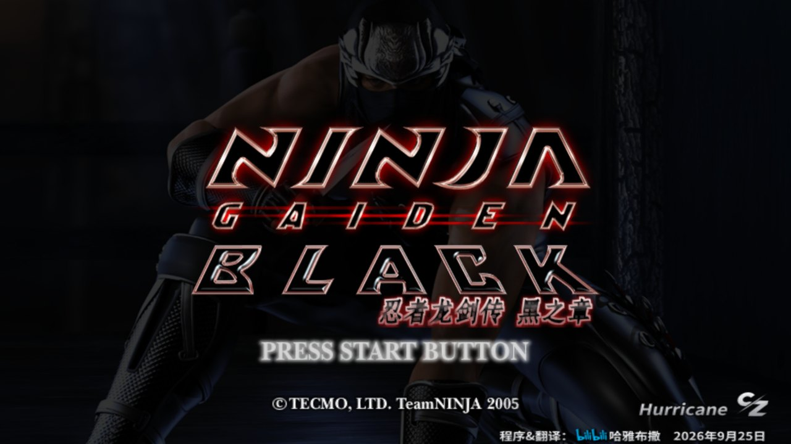
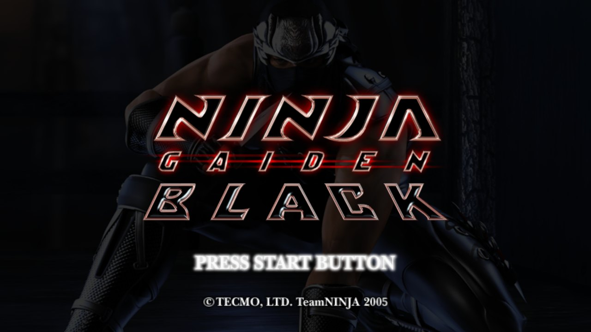
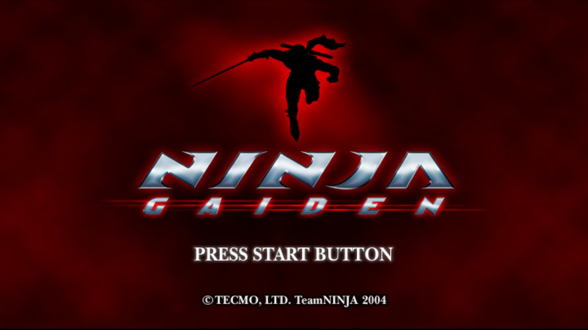
</p>

**忍者龙剑传 黑之章**（16:9）

<p>
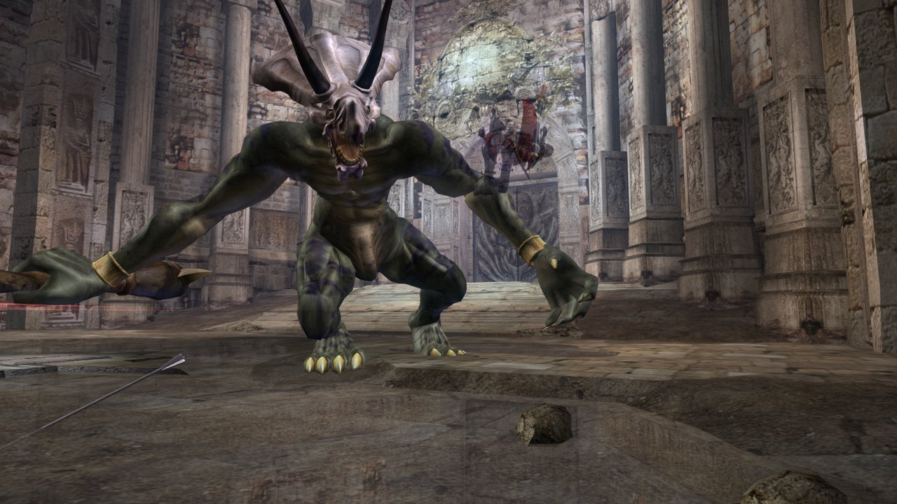
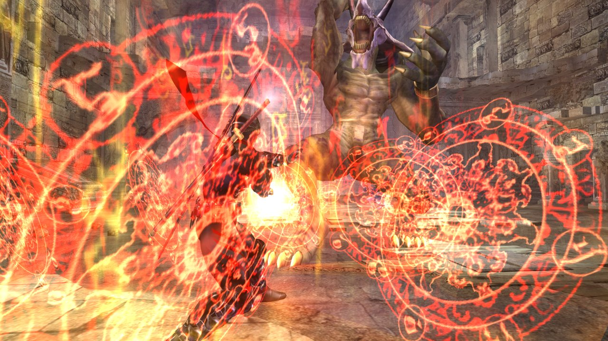
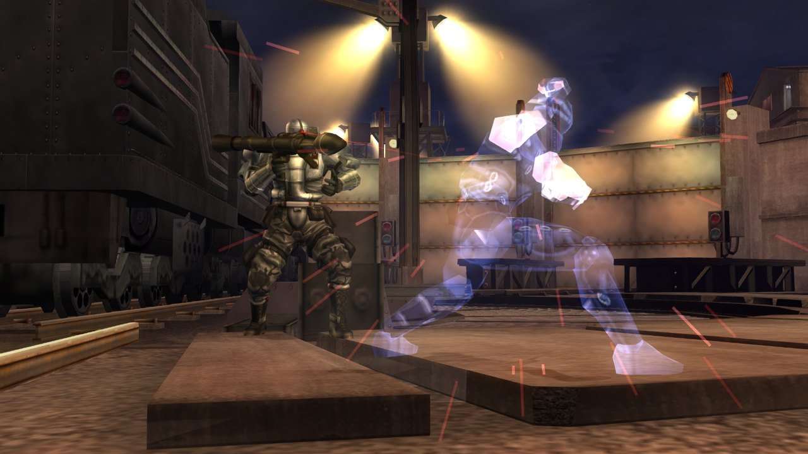
</p>

**不同显示比例**（黑之章，同一画面）：4:3、16:9、16:10、21:9。21:9 的画面加宽，血条等界面放在两侧；16:10 保持 16:9 的界面布局。

4:3 · 16:9

<p>
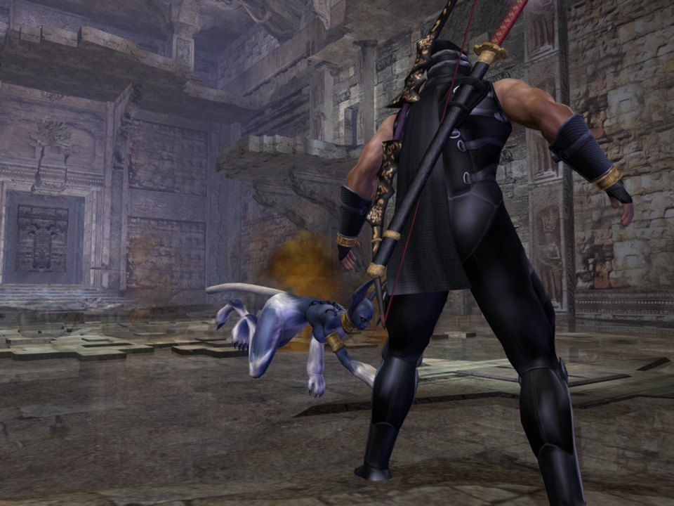
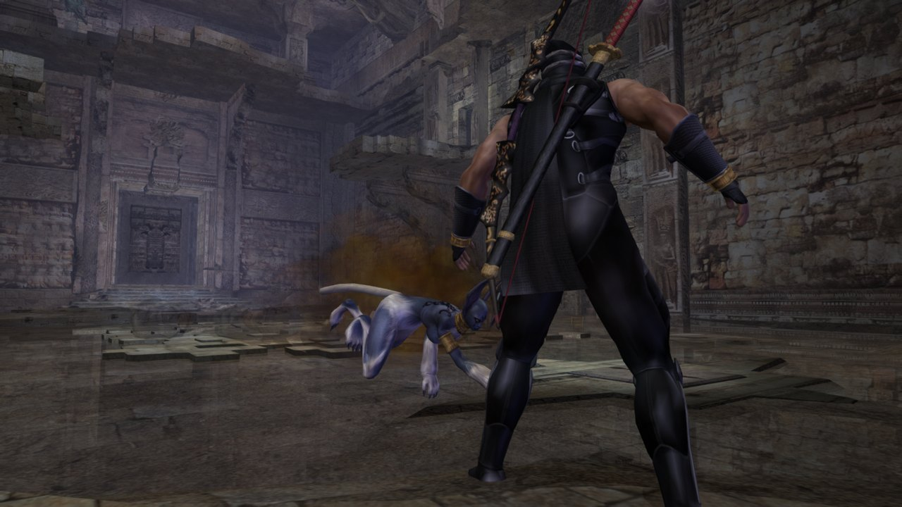
</p>

16:10 · 21:9

<p>
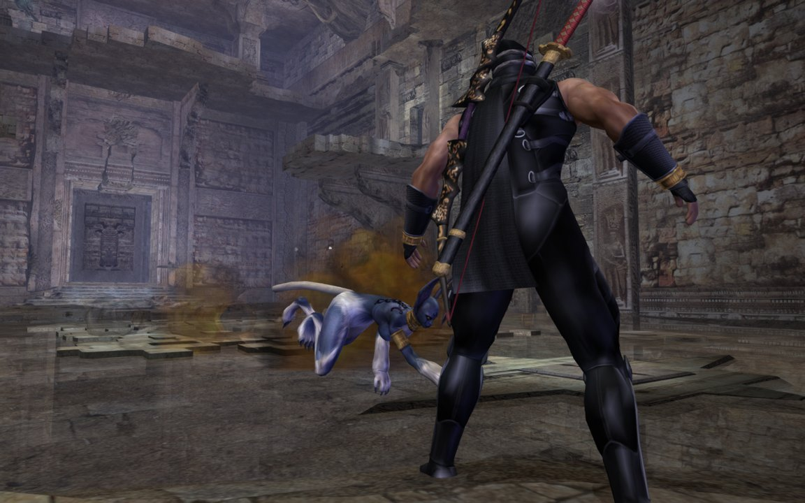
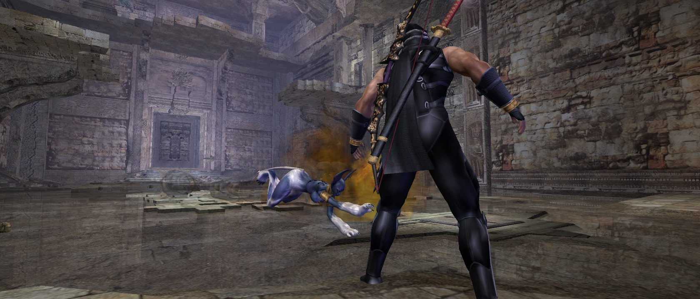
</p>

**忍者龙剑传（2004）**：16:9、4:3、21:9 与菜单。

16:9 · 4:3

<p>
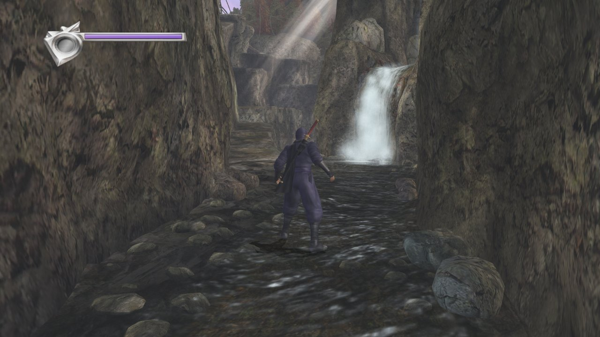
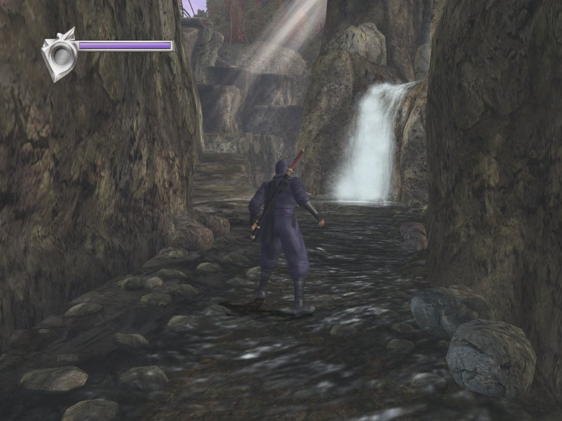
</p>

21:9 · 菜单

<p>
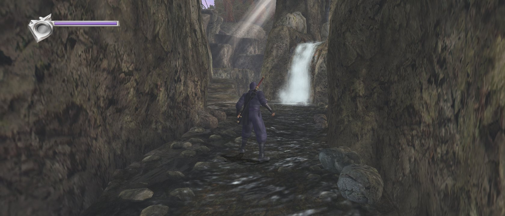
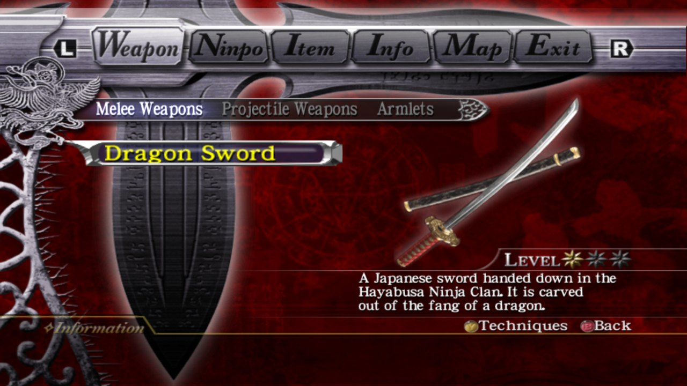
</p>

## 支持的版本

加载器按 XBE 的 SHA-256 识别版本，其他版本不运行。支持四种光盘镜像：美版原版，以及哈雅布撒在它基础上做的三个改版。

| 主程序 `default.xbe` | 语言 | 附带程序 | SHA-256 |
|---|---|---|---|
| 美版原版 NINJA GAIDEN BLACK（NTSC-U） | 英文 | 街机版 2 个 | `df1d2af0154d771f42b77ec4df03a862417ac457ff0d39fec846c40cb55ffbda` |
| 基本版 va-zh-x2 | 中英 | 街机版 2 个 | `00cef52546618eb0149d7895f9042403e95f361b5483aac38933e799c67a50e1` |
| 飓风版 vb-zh-x2.1 | 中英 | 街机版 + SFC 共 4 个 | `aa3c5bec2923f83ccb37fe6a63ea5516b26d477b53c679a1620d19e4a8e4e8f6` |
| 飓风版 vb-jp-x2.1 | 日英 | 街机版 + SFC 共 4 个 | `535778c8a4623195c8f320b85d2d139f20ff13c020d40150adaed54cfdeffc38` |

三个改版都是在美版 `default.xbe` 上打的补丁：各段地址相同，Direct3D、DirectSound 等库逐字节相同，改动的地方都不碰加载器用到的
地址，所以四个版本共用同一套表和修复。附带程序在各版本里完全相同：

| 附带程序 | SHA-256 |
|---|---|
| `NinjaTomoe.xbe`（原版附带程序，日版） | `2aff93ad098b3b5762d294d9c17a44c36d04bfa31843e413cf5e2963f14282ff` |
| `NinjaTrilogy.xbe`（原版附带程序，美版） | `31f8efd073abba2ac339ee44f4b13011844afc470b166f826dc12f6b79ff5621` |
| `NinjaFCJ.xbe`（SFC 三部曲，日版，飓风版加入） | `b5b8754e6008f3b2e773c1eb9afe50ee9decebf0eadb945a9953369b1b9f4f31` |
| `NinjaFCU.xbe`（SFC 三部曲，美版，飓风版加入） | `9fac4bb5162b8a99c65c0fbb6289ee81db4c42bdbd253807e74261a68e3399b1` |

附带程序从主菜单的"街机版忍者龙剑传"和"SFC忍者龙剑传"进入：游戏调用 `XLaunchNewImage`，加载器以同样的参数重启并
载入目标 XBE。

## 忍者龙剑传（2004）

2.0.0 起也支持初代《忍者龙剑传》（2004，美版光盘 1.02.04）和它的飓风包。启动器左上角切换到「2004」，游戏装在另一个目录，
和黑之章互不影响。

| 程序 | 说明 | SHA-256 |
|---|---|---|
| `default.xbe` 光盘版 1.02.04 | 没装飓风包时运行 | `bea2a85eea7e6e0ba6c3e201966a46b24b27e25b3307a29bc3de5b4254791308` |
| `$u\default.xbe` 更新版 1.06.04 | 随飓风包安装；装了就自动运行它（和原机一样） | `86475ba502c0e7f147334b167041c3fd310f8fb34f9e77b0ee6e6866e0764ee3` |
| `downloader.xbe` 光盘版 / 更新版 | 大师锦标赛「NEW NOTICE!」的 Xbox Live 下载程序 | `fcce4a17…`（光盘）/ `a99574a8…`（更新） |
| `NinjaTomoe.xbe` / `NinjaTrilogy.xbe` | 附带的 SFC 三部曲 | `d2aeab80…` / `18eaadc5…` |

Redump 的「Ninja Gaiden (USA, Asia) (En,Ja)」也支持：同一个 1.02.04，只是各程序里 XDK 启动检查处的 1 个字节保持签名时的原样（上表那套在这里被改成了跳过检查）。它的 `default.xbe` 是 `86c23d787ecf9f6400b9378544a49b62cfdd478dc04d6ef01ceed2a6429e84c0`，下载程序、三部曲、更新程序也各有对应的一份；联网更新到 1.06 同样可用。

- **飓风包**：启动器「安装」页的飓风包卡片选择安装包文件夹（「Ninja Gaiden DLC Installer」），一键装到游戏硬盘；装好后
  开始游戏就是 1.06 更新版。同一张卡片的「卸载内容」列出硬盘上已装的东西（更新 1.06、飓风包 1 / 2、在游戏里下载的通知等），
  选一项确认后删除。「导出」把已装的更新和全部内容按安装包的结构导出到一个文件夹，别的玩家在这张卡片里选这个文件夹
  就能安装。
- **联网更新到 1.06**：没装飓风包时进入忍者大师锦标赛，游戏会提示更新；确认后运行光盘上的 Xbox Live 更新程序，从 Insignia
  下载并装上 1.06 更新，完成后自动回到游戏（2.0.1 起）。更新程序要用 Xbox 系统字体，第一次运行时从「联网」页登记的 xemu
  硬盘镜像里复制。更新失败时按 OK 回到游戏。
- **忍者大师锦标赛**：需要联网（和黑之章一样用 Insignia，见下文「联网」）。飓风包内容在游戏启动时按这台电脑重新签名，
  所以别处装的也能用。
- **NEW NOTICE!**：大师锦标赛里的「NEW NOTICE!」会进入 Xbox Live 下载程序，可以从 Insignia 下载通知等内容，退出后回到游戏。
  下载程序没有声音。
- **退出游戏**：标题菜单最下面多了一项 EXIT GAME（字形取自游戏自己的菜单字），用游戏自己的确认框问「Exit the game?」。
- 宽屏、21:9 下 CG 保持 16:9、读盘计时修正等黑之章的修复，2004 版本也有。

## 现状

逐项结论与证据见 `project/docs/06_功能验证矩阵.md`。

- **汉化**：标题、主菜单、存读档页、暂停菜单 / 武器 / 招式表、章节标题卡、开场 CG 与实时过场字幕、结算画面、道具 /
  商店 / 地图 / 对白，均已验证。
- **飓风版功能**：交差之法两种模式、宁静腕轮、扳机选服装、妖刀鬼彻扣血、带金圣甲虫二周目、还魂护符开关、弓箭准星 /
  视角、任务模式，均已实际游玩验证。
- **附带程序**：街机版与 SFC 版从主菜单进入可以游玩。
- **退出游戏**：主菜单最下面多了一项「退出游戏」，选中后用游戏自己的确认框问「要退出游戏吗？」，Ⓐ是退回桌面，Ⓑ否回到菜单。
- **联网排行榜（可选）**：用 Insignia 的主机与账号，在游戏的「排行榜」里登录并查看真实榜单（已实测）。主机可以从 xemu
  导入，也可以在移植版里新建并注册，不用 xemu（2.2.0 起）。默认关闭，打开方法见下文「联网」。
- **存档**：存档、读档、存后读回同一格均已验证。存档是标准 Xbox 格式，复制到 xRevive 的存档目录后可以直接读取（已实测）。
  开不开联网，存档都用同一把主机钥匙签名，不会再因为切换联网显示 Damaged Game。启动器「存档」页的「一键重签」把别的 Xbox、
  xemu、别的玩家的存档，以及旧版本开着联网时存的档，重新签成这台电脑的（先自动备份）。
- **声音**：软件 DirectSound 混音器，经 XAudio2 输出，带混响。
- **性能**：第 1 章战斗场景在 Intel Iris Xe 核显上平均帧时间 10.45 ms（60 fps 的预算是 16.68 ms；r178，
  `project/docs/05_音频输入存档.md`）。
- **输入**：Xbox 与其他 XInput 手柄，以及 PS3 / PS4 / PS5 手柄、Switch Pro 手柄、Joy-Con、DirectInput 手柄（经 SDL3）；震动都有。
- **系统语言**：启动器「显示」页的「主机设置」里可以选初代 Xbox 的 9 种系统语言（默认 English），游戏按它决定默认的菜单文字等；对黑之章和 2004 的所有镜像都生效。汉化版请保持 English。
- **音频设置**：同一张「主机设置」卡片里有初代 Xbox 仪表盘的全部音频选项：单声道 / 立体声（默认）/ 杜比环绕（后方声道编码进两路，接 Pro Logic 功放可解出），以及数字输出 Dolby Digital、DTS（开启后按 5.1 声道输出：前左、前右、中置、低音、后左、后右；音箱不足 6 声道时由 Windows 往下混）。黑之章原版开 5.1 时背景音乐和过场声音几乎听不见（音量多乘了 10），移植版已修正。

### 修过的原版缺陷

以下问题原机上同样存在，移植版修掉了。每项修正都可以用开关即时切回原样对照（`project/docs/07_证据盘点.md`）：

- 第 2 章水面：边缘的黑 / 白锯齿；镜头贴着水面时的拉长条纹（顶点上的除法改为逐像素除法）。
- 熔岩房间：右边的黑条（画面复制少画一列）、热浪效果的白斑、右边缘的模糊条。

### 流畅度：第一次进入场景不再卡一下（2.2.31）

以前每次启动后，第一次进入一个区域、第一次播一段过场，都会卡一下（单帧 30–280 ms）。原因逐个查清后分别处理，
每一项都能用开关关掉对照。测试用 RTX 3060（独显）和 Iris Xe（核显，D3D9On12），待机演示配合性能记录器，
每种设置交替各跑两次以上；画面相关的改动也在高倍渲染（独显 ×8、核显 ×4）下核对过。

| 卡顿来源 | 做法 | 开关 | 效果 |
|---|---|---|---|
| 着色器第一次用到时现场编译（每个 2–40 ms） | 发布包带着色器种子 `shader_seed.bin`（429 条），启动时先建好 | — | 新玩家第一次启动，最差帧 282 → 113 ms（核显） |
| 游戏自己的顶点程序（是游戏代码的翻译，不能随包发） | 只发它们在 `default.xbe` 里的位置 `vertex_programs.bin`（7 个，7 个镜像版本都核对过），启动时从玩家自己的镜像读出来编译 | — | 待机演示第一个场景少了 17–23 ms 的编译 |
| 显卡驱动在第一次画某种状态组合时现编内部程序（NVIDIA 固定管线尤其明显） | 记录游戏用过的绘制状态，启动时在一张 16×16 的小图上全部画一遍 `draw_states.bin`（8,339 种） | `--no-draw-warm` | 进区域 47–52 ms → 26 ms（独显）；×8 时 49–54 ms 的卡顿消失 |
| 一批新贴图同时创建时驱动卡住（34–40 ms） | 按尺寸和格式提前建好贴图池（24 MB），在等垂直同步的空闲里补充 | `--no-tex-pool` | 进区域那几帧的贴图时间 32–36 → 1.3–3.5 ms（独显） |
| 核显（D3D9On12）第一个 3D 画面等新内存 | 绘制缓冲改为三组轮换并在建设备时就写好；强制重建只重做变了的渲染目标 | `--ring-discard`（恢复旧做法） | 最差帧 55–138 → 40–45 ms（核显） |
| 移植层自己的像素着色器每次启动都现编 | 走着色器缓存，并收进种子 | — | 进区域 43 → 29 ms（核显） |
| 过场第一帧游戏在 CPU 上算 10 张水波纹贴图（每张 2.5 ms） | 结果按参数缓存在 `cache\cpu_textures.bin`，之后直接复制；与游戏自己算的逐字节一致 | `--no-cpu-tex`、`--cpu-tex-verify` | 过场那一帧 38–56 → 9 ms（独显）、35–36 → 24 ms 以下（核显） |
| 种子覆盖不到的新着色器 | 可选的编译预算：超出预算的着色器放到后台线程编译，期间这个绘制先不画 | `--compile-budget MS`（默认关） | 冷缓存时最差帧 237 → 98 ms，但会有 4 帧左右缺东西，所以默认不开 |

**种子从哪来**：标题画面、待机演示，以及作者实际游玩第 1–2 章（33 分钟，2026-11-15）时记录下来的数据。那次游玩里超过
50 ms 的帧只有两个：一个是当时种子里还没有的着色器（已收进种子），另一个是游戏从主菜单进入时清理硬盘缓存（见「已知问题」）。
用那次游玩的记录核对现在的种子，三份都是 100% 覆盖。第 3 章以后还没有专门记录；遇到种子里没有的东西，只在第一次卡一下，
之后玩家自己的缓存会记住。

**代价**：每次启动多花一点时间把这些状态画一遍（NVIDIA 驱动不把 D3D9 的这类程序存到磁盘，所以每次启动都要做）。实测启动到
第 60 帧：RTX 3060 约 3.03 → 3.33 s，Iris Xe 约 1.9 → 2.1 s。游戏过程中的帧时间（中位数、p99）与之前相同。

**工具**（开发用）：`tools/make_shader_seed.py`、`tools/make_vsh_seed.py`、`tools/make_draw_seed.py`、`tools/make_texture_seed.py`
生成种子，`--check` 核对一次测试运行有多少被种子覆盖。改动着色器生成器的 HLSL 文字（哪怕一个空格）会让玩家的缓存和种子
对不上，发版前要用空缓存跑一遍 `make_shader_seed.py --check`。

### 其他改动（2.2.31）

- 冷启动时用存档里的音量：以前每次启动音乐、音效、语音都回到默认的 60，改过音量的玩家每次在标题都会被问
  「要套用声音设置的更改吗？」。现在一启动就按存档里的音量（参照 ngbrecomp 0.9.54 #182）。`--no-saved-volumes` 恢复主机原样。

### 2.2.32：种子补全、新玩家第一次启动的最后一处卡顿、彻查记录

**改了什么**

| 项目 | 做法 | 开关 / 工具 | 实测 |
|---|---|---|---|
| 新玩家第一次启动时的最后一处固定卡顿：过场前游戏在 CPU 上算 10 张水波纹贴图（约 40 ms 一帧） | 发布包附带水波纹贴图种子 `cpu_textures.bin`（游戏代码算出来的数据，不是代码；作者同意），启动时先读种子再读玩家缓存 | `tools/make_cputex_seed.py`；`--no-cpu-tex` 仍可关掉整个缓存 | 空缓存起步：超过 33 ms 的帧每次 1 帧 → 0，最差帧 40–41 → 28–32 ms（独显）。黑之章 5 个镜像版本和 2004 光盘版、更新补丁版的常量完全相同，共用这 10 张 |
| 开 MSAA 的玩家把种子里已有的状态当成新的重学一遍（记录里带着采样数和多重采样深度格式） | 多重采样目标上的绘制按不开 MSAA 的形式记录；合并工具也这样换算旧录制 | — | 实验：开 MSAA 2x 时，只回放不开 MSAA 的形式，进区域同样不卡（独显 0 帧超过 33 ms，不回放时 3 帧；核显无差别），说明驱动程序不区分 MSAA。修复后开 MSAA 待机演示只学到 19 种新状态（不开时 20 种），之前一份 4 章的录制里有 4,417 种是种子已有的 |
| 移植层自己的着色器按设置不同而缺失（MSAA 复制、各倍数下的缩放滤镜等 12 个） | 测试参数一次性生成全部版本收进种子 | `--compile-port-shaders` | MSAA 2/4/8、8 倍渲染不再现编；`AT 5` 版本超出 ps_2_a 指令上限（655 > 512），程序本来就会改用旧缩放滤镜，种子里存它“编不了”的记录 |
| 2004 更新补丁版（飓风包用的那个）没有被顶点程序种子覆盖 | 生成种子时也给工具这个程序 | `tools/make_vsh_seed.py --xbe` | 更新补丁版 0 of 7 → 7 of 7 |
| 2004 冷启动不读存档音量（和黑之章同一个问题，但指令编码和存档偏移不同） | 特征码兼容两种编码，存档偏移从后面的共同指令推算 | `--no-saved-volumes` | 2004 光盘版、更新补丁版、黑之章 6 个镜像各只匹配一处；改音量后冷启动读到 39（之前 60），标题不再询问（作者实测） |
| 接缝填补 | 默认改为关（作者决定） | 启动器 / `black.ini seamfill = 1` | 已经写过 `seamfill` 的老玩家保持原来的设置 |
| 编译预算（2.2.31 的命令行选项） | 启动器「图形」页最后一行加了「编译预算（实验性）」开关，默认关（作者决定）；开 = 每帧当场编译最多 4 ms，超出的放到后台编译、期间先不画 | 启动器 / `black.ini compile_budget = 4`（`-1` 关）；`--compile-budget` 仍优先 | 种子没覆盖的内容（2004、后面的章节）第一次进入时卡得更短，代价是可能有几帧缺东西（实测约 4 帧） |

**种子现在的内容**：着色器 441、绘制状态 16,679、贴图池 194 种尺寸（24 MB 上限）、游戏顶点程序 7、水波纹贴图 10。来源：标题、待机演示、
作者游玩第 1–2 章（11-15）和第 1–4 章（11-16，开 MSAA 2x）。每份原始数据都用 `--check` 核对为 100% 覆盖。启动代价：到第 60 帧
RTX 3060 约 3.0 → 3.1 s，Iris Xe 约 2.2 → 2.3 s；游戏过程的帧时间（核显交替测 3 次）不变。

**彻查过、确认不是移植问题或已排除的**（每项都有实测，2026-11-16）：
- 各种图形设置（MSAA 2/4/8、柔和阴影、FXAA、接缝填补、渲染倍数 1/2/8、原生分辨率、特效原尺寸、阴影 1/16、画面比例
  21:9/16:10/4:3、各向异性、垂直同步、性能显示）逐一从空缓存跑待机演示：游戏着色器 0 个现编，0 次超过 50 ms 的卡顿。
  （第一轮扫描曾因 `--background` 不读 `black.ini` 而全部用了默认设置，结果作废；`--set` 修正后重跑并逐项核对日志。）
- 剩下的偶发小顿：回放后每 170 秒仍有 10–20 次 1–11 ms 的绘制调用（帧 20–32 ms，0 帧超过 33 ms），几乎都是固定管线。
  已排除：种子缺状态（全部“启动时回放过”）、贴图刚上传（多为几百帧前上传，最慢一次没绑贴图）、显卡降频（锁到 1,800 MHz
  照样出现，显卡 10–20% 占用）、驱动程序缓存溢出（只回放用到的 1,865 种与回放 16,679 种结果相同）。判断为 NVIDIA 驱动内部的
  行为。不回放时则是 50 次、3 帧超过 33 ms。
- 扫描里几次偶发 50–108 ms 的卡顿：同样设置重跑 6 次都没有复现，默认设置二十多次也没有，属测试期间的系统干扰。
- 核显开机某一帧 40–60 ms：是性能记录器（`--perf-at`）自己启动时占用渲染线程，玩家不会用到。

**测试参数**（2.2.32 新增）：`--set 键=值`（任何 `black.ini` 设置，后台模式下也生效，日志的设置行现在也写出柔和阴影和 MSAA）、
`--compile-port-shaders`。卡顿明细（`--hitch-detail`）会写出每个慢绘制的回放状态和所绑贴图距上次上传的帧数；它的显卡时间戳
反映的是驱动把命令交给显卡的时机，不等于显卡工作量。

**玩家帮忙录种子**：在游戏文件夹的 `launcher.ini` 里加一行
`args = --vsh-record "<游戏文件夹>\vsh_record.bin" --hitch-detail`，正常玩，然后把 `cache\shaders\`、`cache\draw_states.bin`、
`cache\texture_pool.txt`、`cache\cpu_textures.bin`、`vsh_record.bin` 和 `logs\black.log` 交给作者。**要在更新到新版本之前交**：
换版本时本地学到的绘制状态会被清掉。

### 2.3.0：新的帧节拍时钟，各种显示模式下画面都均匀

- **游戏时钟对准屏幕的刷新**：屏幕是 60 / 120 / 240 Hz 一类（59.94、60、60.1 Hz 都算）时，游戏的节拍对准屏幕的 vblank，
  每帧显示的刷新次数完全相同；速度和 59.94 Hz 最多差 0.4%，时钟从不等待屏幕。屏幕的刷新时刻从扫描线或 Windows 桌面合成的
  时间戳读出，读不到时退回固定 59.94 Hz。
  - 60 Hz 真全屏 + 垂直同步：以前约每 17 秒一帧多显示一次（实测每 150 秒 51–72 次），现在 3–5 次。
  - 无边框：以前开头几秒有一串重复和丢帧，现在 0。
- **144 / 165 Hz 屏幕的无边框也切到 60 Hz**：和真全屏一样，进入无边框时把这台显示器切到同分辨率的 60 Hz（启动器「全屏时用
  60 Hz」，默认开），最小化、回到窗口或退出时切回。实测 0 次重复。
- **G-SYNC / FreeSync 保留高刷时画面更均匀**：屏幕跟着每帧的送出刷新，而游戏每帧画完的时间不同；现在每帧对齐到固定时刻再送出，
  真全屏的帧间隔在 16.7 ± 1 ms 内的比例从 31% 升到 93%。
- **低延迟呈现只在赶得上时提前**：真全屏下，画完的帧赶得上下一次刷新才提前送，按键到画面送出约 16.6 ms → 1–5 ms，
  不多出重复或丢帧；窗口和无边框不再提前（那里会一帧重复一帧丢失）。
- **真全屏不开垂直同步时，撕裂线放到画面边缘**：节拍放在 vblank 前 1 ms，翻页落在刷新间隙或画面最上、最下，
  画面中间的撕裂从约 66% 降到约 0.4%。
- 性能不变（RTX 3060，2+2 次：游戏速度 93.70% 对 93.72%）。集成显卡还没有测。设计与全部数据见源码仓库
  `project/docs/27_帧节拍时钟_2.3.md`。

### 2.2.37.13：魂反护符触发时血条不再跳动，16:10 恢复居中的 HUD

- **魂反护符触发时血条不再左右跳**（21:9 及带鱼屏）：复活光效是一组很大的 2D 图片，以前和血条被归成同一个界面元素，
  元素中心随光效扩大而移动，血条就在左边和中间之间来回跳。现在界面上的 2D 块分三类：普通 HUD、量表、画面特效
  （高超过画面 30%、宽超过 15%）。只在同类之间归组，画面特效始终按 16:9 构图居中。章节结算面板出现时，面板上新出现的
  内容跟着面板，之前就在的 HUD 元素保持在自己那一侧。
- **16:10 下 HUD 恢复整体居中**：整套 16:9 布局居中、上下留边，和 2.2.6 以前一样；21:9 和带鱼屏仍然贴边。
- 代码整理（行为不变）：宽屏下 2D 的处理拆成“画面形状、绘制分类、压缩”几部分，不再是一个近 200 行的函数；
  每个程序明确标注所属游戏和角色（主程序、街机版、SFC、下载器、更新程序、仪表盘），各程序安装哪些补丁由一张表统一决定。
  本地 28 个程序整理前后的安装日志逐行一致。

### 2.2.37.12：Alt+Enter 依次切换窗口、无边框、窗口、全屏

- **Alt+Enter 依次切换**：窗口 → 无边框 → 窗口 → 全屏 → 窗口 …，无边框和全屏之间总隔着窗口。以前从窗口只能切到启动器里
  选的那一种全屏。
- **每次切换都有提示**：画面右下角显示约 4 秒，例如“显示模式：窗口（Alt+Enter → 全屏）”，告诉你现在是什么模式、下一次
  Alt+Enter 会切到哪里。全屏不可用而退回窗口时也会提示。
- **退出时记住**：最后的模式（`fullscreen`），以及从窗口再按 Alt+Enter 会去哪种全屏（`fullscreen_kind`），下次启动接着循环。
  游戏内 PC SETTINGS 的全屏开关遵循同一规则。
- 代码整理：原来一个变量同时表示“当前是不是独占全屏”和“Alt+Enter 去哪种全屏”，读设置时要靠专门的函数拼凑；一个函数
  包办所有进出路径。现在模式是一个枚举，切换规则只写在一处，进入、离开各一个函数。全屏正在退回窗口的那一帧内再按
  Alt+Enter 不再生效（以前那样会让记录的模式和实际不一致）。
- **从游戏进入 SFC 三部曲、街机版、仪表盘（以及返回）时，光标也会立即消失**：2.2.37.11 起启动即抓住鼠标，但这条路径上
  新程序的窗口拿到焦点时还不在前台，判断落空，光标一直显示。现在窗口启动完成时明确触发，之后第一次真正到前台时也会触发。
- **两个程序交接时，光标锁定不会再被清掉**：旧程序先放开鼠标，新程序才开始运行，顺序是确定的；以前旧程序退出时
  可能把新程序刚设好的锁定清掉。（2.2.37.12 原地替换加入这两项。）

### 2.2.37.11：启动即隐藏鼠标，Esc 放开鼠标

- **游戏启动时直接抓住鼠标**：窗口、无边框、全屏都一样，光标立即消失，不用再先点一下画面。从游戏里进入 SFC 三部曲、
  街机版或 Xbox 仪表盘（各是一个新程序）时也一样。
- **按 Esc 放开鼠标**：黑之章、NG2004、SFC 三部曲和仪表盘都可以用。放开后点一下画面重新抓住，这一下点击不会传给游戏。
- 其他行为不变：Alt+Tab 或最小化时放开，回来后点一下画面抓住；拖动窗口前先按 Esc。
- 鼠标相关代码集中到一个模块（`input/mouse`），原来分散在窗口、按键绑定和输入轮询三处。抓住鼠标那一刻正按着的鼠标键，
  松开后才会传给游戏（以前只处理左键）。
- README 注明上游 black-pc 移植的 BLACK 中文名《黑煞》（2006 年的射击游戏），不是《忍者龙剑传 黑之章》。

### 2.2.37.10：SFC 三部曲音量提高，主菜单文字下的白点修复

- **SFC 三部曲声音提高约 10 dB**（黑之章飓风版和 NG2004 自带的都算）：原版 SFC 程序本身就很小声（实测和 xemu 一样，
  约 −32 dBFS，比本体小约 11 dB），现在和本体音量接近。BGM 和所有音效一起提高，比例不变，不会爆音。这是有意偏离原版的改进；
  本体和街机版忍龙不变。
- **主菜单等界面的文字下面不再有一排小白点**（1.1.10 起出现）：2D 方块对齐像素（QuadSnap）后，线性过滤会读到字库里下一个字的
  顶端。现在采样不会超出每个方块自己的纹理范围；所有用同一方式画的文字、图标都覆盖。暂停菜单匕首中间的细线仍然没有。
  同时整理了 QuadSnap 的结构：只移动能保护的方块。
- 日志里黑之章自带的街机版不再误写成 “NES trilogy”。

### 2.2.37.9：发布包补回 README，说明改准，Alt+Enter 记住真全屏

- **发布包里补回 `README.md` / `README.en.md`**：2.2.37.4～2.2.37.8 的包里没有它们（加流畅度指南时误把复制 README 的那行替换了）。
  打包脚本现在会核对包里的 14 个文件，少一个或多一个都会停下。
- **流畅度指南、README 的“流畅度设置”和启动器说明按实际行为重写**：游戏速度在任何设置下都正确；「稳定游戏速度」只影响 60 Hz
  显示器的窗口 / 无边框；垂直同步只在真全屏下起作用；真全屏开垂直同步时约每 17 秒（120 Hz 约 8 秒、240 Hz 约 4 秒）有一帧多显示一次；
  120 Hz 以上的窗口 / 无边框画面不均匀（已知问题）。删掉了 2.2.37.6 后已不成立的说法（kernel vblank 会掉到 47、120/240 Hz 每帧正好 2/4 次刷新）。
- **Alt+Enter 记住真全屏**：从真全屏切到窗口后关闭游戏，下次再按 Alt+Enter 会回到真全屏（以前进的是无边框）。`black.ini` 新增
  `fullscreen_kind`，启动器选无边框 / 真全屏时一并写入。
- **一次游戏里改过去又改回来的设置会正确保存**：例如窗口 → 全屏 → 窗口后关闭，以前 `black.ini` 会留在“全屏”，下次一开就是全屏。
- 小修：窗口样式恢复失败时不再丢掉待办标志；去掉只写不读的焦点状态。

### 2.2.37.8：窗口 / 真全屏状态整理

- 窗口 / 独占 / 焦点 / Reset 收进单一 `WindowState`；
- 无边框全屏不再只靠 `WS_CAPTION` 推断；
- Alt+Enter 退出真全屏后，设置正确保存为窗口；
- 独占 display mode 读不到时回退窗口，`SetWindowPos` 失败时回滚；
- 真全屏 + vsync 关也统一为 `DISCARD / 2 buffers / flip`；窗口 / 无边框仍是 `COPY + DWM`。

### 2.2.37.7：Alt+Enter 立即重查 display-60

- `host3d::exclusive()` 一变化就重查 `near_60`；
- 高刷 + 60Hz 开关 + 回窗口时，不再短暂选到 165Hz DwmFlush；
- 60Hz 真全屏 tick 仍固定 timer；
- 窗口 60Hz 仍用 DwmFlush。

### 2.2.37.6：60Hz 真全屏 tick 固定用 timer

- 60Hz 真全屏不再使用 kernel vblank 作为游戏 tick；
- tick 直接固定 59.94 Hz timer；
- 窗口 60Hz 仍用 DwmFlush；
- 高刷 / 固定游戏速度仍用 timer；
- kernel vblank 不再作为游戏时间来源。

### 2.2.37.5：60Hz 真全屏 vblank 来源修复

- 60Hz 真全屏下 kernel vblank 不可用时，不再错误使用 DwmFlush；
- 独佔全屏回落到固定 59.94 Hz timer；
- kernel 每 300 tick 重试，切模式后可重新初始化；
- 日志记录 kernel 初始化失败原因和 vblank 来源切换；
- CG / 主选单的稀疏呈现仍需 Presenter / frame pacing。

### 2.2.37.4：2.2.37.3-t 转正式版

- 启动器「开始游戏」页新增「稳定游戏速度」开关；打开后游戏时钟固定 59.94 Hz，不跟屏幕；
- `black.ini` 支持 `timer_vblank`；
- `--timer-vblank` 优先于 black.ini；
- 压缩包内附中文 / 英文流畅度设置指南；
- 关闭开关时，游戏行为与 2.2.37.3 相同。

### 2.2.37.3：跳过 2.2.35 的稳定版

这一版以 **2.2.34 的呈现节拍**为基线，只合并 2.2.36、2.2.36.1、2.2.36.2、2.2.36.3、2.2.37 的功能。

**不包含** 2.2.35 的：

- 120/180/240 Hz 的 n 次刷新节拍；
- FLIPEX / Present Statistics；
- present_early 的 deadline / miss / 退避；
- 2.2.35 的 VRR 检查。

因此：

```text
60 Hz      → 跟屏幕（2.2.34 行为）
120/240    → 59.94 timer（2.2.34 行为）
144/165    → 59.94 timer
VRR        → 不再被 n×60 带快或带慢
```

代价：

- 120/240 的均匀度回到 2.2.34；
- 2.2.35 的“太早刷新多等一次”不在，但 timer 路径本来没有这个问题；
- 2.2.34 的低延迟呈现仍是“无条件提前”，没有 2.2.35 的截止判断。

这是给“先要稳定、不要 2.2.35”的版本；后续的 Presenter 架构另做。

启动器「开始游戏」页新增「稳定游戏速度」开关：CG、过场或战斗明显变快 / 变慢时打开；它把游戏时钟固定为 59.94 Hz，不跟屏幕，也不锁帧，下次开始游戏生效。

### 2.2.37：两个游戏各有自己的程序，启动器改名

- **程序改名**：启动器是 `Ninja Gaiden Black&2004 PC Launcher.exe`；原来两个游戏共用的 `Ninja Gaiden Black Any.exe` 分成
  `Ninja Gaiden Black.exe`（黑之章）和 `Ninja Gaiden.exe`（2004），同一份程序编两次，都用旁边的 `blackrt.dll`。
- **直接双击游戏程序**：各自找启动器装好的那个游戏（2004 以前双击只能进黑之章）。找到的是另一个游戏时不运行，提示该用哪个程序；
  没装时提示怎么装，路径显示程序所在的文件夹（以前显示的是当前目录）。命令行明确给的游戏照常运行。
- **启动器**：按左上角选的游戏启动对应的程序（联网设置、仪表盘也一样）；显卡首选项两个程序一起设置；从旧版升级时，旧程序上设过的
  显卡首选项自动带到新程序上。
- 旧的 `Ninja Gaiden Black Any.exe` 留在文件夹里也还能用；可以删掉。

### 2.2.36.3：启动失败时说清楚原因；Windows / Linux 运行说明

- **Direct3D 无法启动时不再崩溃**：以前绘图设备建不起来时，游戏照样往下跑，在第一次清屏时崩溃，什么提示都没有（在 Wine 里缺
  32 位图形库时作者实测到）。现在弹出说明：失败在哪一步（创建 Direct3D 9 本身，还是在显卡上创建设备）、两次尝试的错误码和含义、
  显卡名称 / 厂商 / 驱动版本、是 Windows 还是 Wine 及其版本，以及针对这种情况该怎么办（Wine 下要装哪些 32 位驱动包、Wine 没有任何
  3D 渲染时删哪个设置；Windows 下显存不足、驱动问题、远程桌面），然后以代码 3 正常退出。
- **报错框在没有中文字体的系统上只显示英文**（Wine 里中文会变成方块），日志里仍保留中英两份。“找不到游戏”“不支持的游戏版本”
  两个已有的提示也一样。
- README 新增“在 Windows 和 Linux 上运行”一节：日志位置、显卡首选项、Linux 实测情况、32 位驱动、中文字体、缓存损坏的处理。

### 2.2.36.2：Linux / Wine 下的“可用区块不足”和启动器方块字

- **系统查不到剩余空间时，实际写入 1 MB 来判断**：一位 Batocera（Wine）玩家每次开机都提示“没有足够的可用区块”，日志显示系统
  对一块 461 GB 的盘回答“剩余 0”。0 既可能是盘真满，也可能是文件系统不报剩余空间，函数本身分不出。现在只在系统回答 0 或查询
  失败时，在存档文件夹旁写 1 MB 临时文件并立即删除：写得进去就按以前的规则回答，写不进去才报 0（游戏自己提示区块不足，这时是对的）。
  启动器“从镜像安装”的空间检查同理。系统给出数字时，行为与 2.2.36.1 完全相同。
- **启动器在没有中文字体 / 图标字体的系统上不再显示方块**：Wine 里没有微软雅黑和 Windows 图标字体。现在会找系统里的中文字体
  （黑体、宋体、Noto、思源、文泉驿……），一个都没有就用英文显示，图标不画。Windows 上界面与 2.2.36.1 逐像素相同。

### 2.2.36.1：“屏幕白光”开关在 16:9 和 4:3 下也生效；日志不再被反复失败的文件撑爆

- **“屏幕白光”关闭后在 16:9 和 4:3 下没有作用**：开关要求“这一帧已经画过 3D”，读的却是带鱼屏 HUD 的计数，而那个计数只在画面比例
  不是 16:9 时才更新。现在开关有自己的计数，任何画面比例都生效（作者 16:9 实测：招式泛光与事件盖白都去掉了）。开关打开时不变。
- **同一个文件反复打不开时日志无限增长**：2004 大师锦标赛的村正商店里游戏反复请求不存在的 `d:\NG`（黑屏判断为游戏自己的问题），
  日志长到 191 MB。现在每个文件名单独计数（多个线程同时打开文件也安全），连续失败只记前 20 次、之后每 1 万次记一次。
- 日志里“屏幕白光”那一行的 HUD 状态在 16:9 下也写对了；版本号支持第四位（文件属性里显示 2.2.36.1）。

### 2.2.36：“屏幕白光”开关，21:9 下的白光和 2004 过场 CG 修正

- **新开关“屏幕白光”**（启动器「图形」页，`black.ini move_flash`，默认开启 = 原版）：关闭后去掉跳墙斩、技能、捡道具和开宝箱时
  整个画面闪的那一下白光，招式的模糊、亮光和光芒特效保留；菜单、淡入淡出和正常战斗画面不受影响。黑之章的白光是叠在场景上的
  三层图像里那层整屏加亮的泛光（逐层关掉对比后确认只有它晃眼）；2004 是整屏加亮叠一层白色。另外招式或事件进行中盖满整屏的白色
  （黑之章事件 0x63 进下一个区域时、2004 事件 0x40）也一并去掉（发布当天替换时加入）；普通场景切换的淡入淡出保留。程序按画法认
  （铺满整屏、这一帧已经画过 3D，加亮叠加，或在招式 / 事件中盖上的白色），黑之章和 2004 光盘版、更新补丁版 1.06.04 都实测过。
  开关打开时代码不做任何改动，和原版完全一样。
- **21:9 下跳墙斩等招式的白光只覆盖中间 16:9**：修好，现在铺满整个画面。村正商店的背景仍保持 16:9（两边黑）——
  按游戏 HUD 函数自己的判断（隐藏 HUD 的原因字，0xFFFF = 菜单）加上“这一帧还没画 3D”来区分，两者都实测过。
- **2004 更新补丁版的序章 CG 在 21:9 下被拉宽**：修好，和其他过场影片一样保持 16:9。原因是调用栈上残留的旧返回地址排在影片播放器
  前面；现在前三个地址里有它就算。水下波纹的识别有同样的隐患，一并改了。
- 诊断（`--hud-trace`）：按 F8 记录下一帧的全部绘制和渲染目标；日志写出整屏色块、没被当成影片的全屏画面和 HUD 函数的三个判断值。

### 2.2.35：120 Hz 屏幕画面更均匀，修好偶发几秒的“顿”，低延迟呈现重做（仍默认关闭）

> 2.2.37.3 分支不包含这一版；以下是历史记录。

低延迟呈现关闭时（默认），按键延迟和画面送出方式都与 2.2.34 相同；本版改的是游戏节拍怎样对齐屏幕。

- **120 / 180 / 240 Hz 屏幕的窗口模式**：节拍跟着屏幕每 n 次刷新走一拍（以前是 59.94 Hz 计时器）。RTX 3060 直连、120 Hz
  窗口、150 秒：显示时长不对的帧约 3,490 → 15–100。144、165 Hz 不变（60 帧在这些刷新率上无法均匀显示）。
- **偶发连续 5–10 秒“重复一帧、跳一帧”**：一拍醒得晚后，下一次刷新显得“太早”，以前会改用计时器并因此连着几秒对不上；
  现在再等一次刷新。60 Hz 窗口、8 倍渲染：每分钟脱离屏幕的节拍 0–273 → 0，重复加跳帧 0–69 → 0。旧版本也有。
- **可变刷新（G-SYNC / FreeSync）下的独占全屏**：屏幕刷新跟着画面走，节拍被拖慢（120 Hz 时每秒 51–52 帧）。600 拍里有 60 拍
  以上不是整数个刷新周期就改用计时器（实测 11–13 秒内识别），只在独占全屏下判断。
- **低延迟呈现重做**：窗口模式改用翻页呈现（FLIPEX），从系统读出每帧实际显示在哪次刷新，学出“节拍后多少毫秒内送出来得及”；
  拿不到统计时用固定 10 ms。送出很早却仍没赶上的帧不再把截止时间降到底；来回切换加了退避。60 Hz 窗口、150 秒、屏幕抓取逐帧
  数“重复 + 跳帧”：RTX 3060 直连 关 0–7 / 开 0（约 40–84% 的帧提前）；混合输出的独显 开 0、7；Iris Xe 关约 4 / 开约 6
  （2.2.33 约 136，约 21% 提前）。独显直连屏幕时推荐开启；120 Hz 基本不起作用，144 / 165 Hz 窗口不起作用；AMD、Steam Deck 未测。
- 开启后拖动改变窗口大小时，画面先拉伸，停下约 20 帧后按新大小重建。

完整说明、实测表和注意事项见 [2.2.35 发布说明](https://github.com/akirahayabusa/ngb-pc-native-port-release/releases/tag/v2.2.35)。

### 2.2.34：高刷屏独占全屏不再抖，独占全屏的游戏时钟跟随屏幕

**低延迟呈现改回默认关闭（实验性）**：有玩家在 60 Hz 显示器、集成显卡的电脑上反馈，开启后窗口模式下画面不如关闭时顺。2.2.33 的实测
只量了游戏节奏和画面送出的时刻，没有量到屏幕上实际显示的帧：画完立刻送出时，一帧只能赶到桌面合成在下一个 vblank 前的截止时刻，
而不是一整帧，较重的一帧可能赶不上（上一帧多显示一次），接着两帧挤进同一次合成（其中一帧没显示）。这是推测，尚未实测确认。
2.2.33 和最初的 2.2.34 默认开启时把 `present_early = 1` 写进了每个玩家的 `black.ini`，所以设置改名为 `low_latency_present`（默认 0），
旧的 `present_early` 不再读取；想开的玩家在启动器「图形」页「低延迟呈现（实验性）」重新打开。另外开机前 300 帧（约 5 秒）不启用它：
开机第 30 帧左右（读开场文件、黑屏）它偶尔让一帧 50–56 ms（开 6 / 31 次启动，关 0 / 30，核显）。

**垂直同步时用 60 Hz（默认开启）**：游戏每秒 60 帧。屏幕是 120、144、165 Hz 时，以前独占全屏沿用桌面的刷新率，开了垂直同步
也只能对齐屏幕的刷新：165 Hz 上每帧停 3、3、3、2 次刷新交替（18 / 12 ms），画面一顿一顿。现在独占全屏开垂直同步、桌面又不在
59–61 Hz 时，换成同分辨率的 60 Hz 模式（屏幕要支持），每帧正好显示一次。启动器「图形」页「垂直同步时用 60 Hz」可以关，
`black.ini exclusive_60hz = 0`；窗口、无边框全屏和关掉垂直同步时都不受影响。代价：进出独占全屏（包括 Alt+Tab）要切换显示
模式，多黑约 1.4–1.8 秒；画面要等 60 Hz 的刷新，比 165 Hz 时稍晚几毫秒（按原理推算）。

**独占全屏 60 Hz 下游戏时钟跟随屏幕的 vblank**：以前 60 Hz 时游戏的节拍跟着桌面合成（DwmFlush）走，可独占全屏时它不可靠——
播放过场影片（每帧上传 1.3 MB）时节拍掉到 53.9 Hz，影片帧 50–65 ms，出现 18 次超过 50 ms 的卡顿。**桌面本来就是 60 Hz、
用独占全屏的玩家，2.2.33 及之前就有这个问题。** 现在独占全屏改为直接等屏幕的硬件 vblank（`D3DKMTWaitForVerticalBlankEvent`）；
窗口模式不变。

| 前台运行，独占全屏 + 垂直同步，待机演示 160 秒 | 游戏速度 | 卡顿 | 节拍 |
|---|---|---|---|
| Iris Xe 60 Hz，以前的同步 | 93.7% | 18 | 第一分钟 53.9 Hz |
| Iris Xe 60 Hz，本版 | 93.7% | 1 | 3600 / 3600 来自屏幕，60.008 Hz |
| Iris Xe 165 Hz（关掉本开关） | 93.7% | 1 | 59.94 Hz 计时器 |
| RTX 3060 60 Hz，本版（屏幕接在核显上） | 93.7% | 1，最差帧 20.9 ms | 60.008 Hz |
| RTX 3060 165 Hz | 93.7% | 1，最差帧 28.1 ms | 计时器 |

设备重置（Alt+Tab、Alt+Enter 的路径）153 ms，之后仍是 60 Hz；重建设备 3.6 秒后恢复，仍同步。日志开头的设置行写出
`exclusive_60hz`。测试注意：带 `--background` 的自动测试窗口不在前台，独占全屏 60 Hz 时每帧占两个刷新（速度 57–86%），
那是测试方式的问题，玩家不受影响；独占全屏要用前台运行测。

**种子**：加入作者 11-17 早上游玩黑之章 4 分钟的 12 种绘制状态和 1 个着色器（8,493 / 447）。

### 2.2.33：低延迟呈现、种子去重、2004 种子

**低延迟呈现（本版默认开启；2.2.34 起改回默认关闭，见上）**：游戏按主机的节拍每秒 60 帧，每帧开头读手柄、算好画好，再等下一个节拍。以前画好的帧也要等到
节拍那一刻才送去显示，白等十几毫秒；现在画完立刻送去显示，再等节拍。游戏自己的节奏完全不变，只是画面出来得更早
（参照 ngbrecomp 0.9.70 的呈现方式，`docs/TECHNICAL.md`「Presentation」）。启动器「图形」页「低延迟呈现」可以关掉，
`black.ini present_early = 0`；日志开头的设置行会写出 `present_early`。

| 从游戏读手柄到画面送出（中位数） | 以前 | 现在 |
|---|---|---|
| 窗口，Iris Xe / RTX 3060，3× 与 4× / 8× | 16.2–16.9 ms | 2.3–2.6 ms |
| 独占全屏 165 Hz，垂直同步开或关 | 约 18 ms | 8.1–8.5 ms |
| 2004（更新补丁版） | 17.5 ms | 1.5 ms |

迟到帧（6.7%，待机演示里的加载和影片）、游戏速度、30 帧影片的节奏都不变；窗口模式帧时间平均持平或更低（核显 4× 4.91 → 4.44 ms），
呈现间隔的抖动多约 0.15 ms（桌面合成按刷新显示，看不出）；独占全屏的 99% 帧时间 20 → 24 ms（Present 等翻页的时间挪到了等节拍
之前，没有因此多出迟到帧）。另试过“在帧开始后固定时间呈现”（ngbrecomp 的 pace_target），只降到 4–12 ms，独占全屏每局多出
60–160 个迟到帧，没有采用。测量：`--hitch-detail` 时日志每 600 帧写一行 `[lat]`。

**种子去重，2004 能用上黑之章的种子**：绘制状态记录里带着观察矩阵和世界矩阵哪些元素恰好是 0 或 1，而它们随镜头和物体朝向
变化，同一种画法被重复记了很多次——黑之章的 16,679 条其实只有 6,818 种，作者玩 2004 学到的 2,958 条与黑之章一条都对不上
（作者觉得奇怪，查下来正是这个原因）。现在这两项按普通仿射矩阵记录（投影矩阵和纹理矩阵照旧，它们确实影响驱动程序），
读旧文件时也这样合并。实测（待机演示，空缓存，交替各 4–5 次）：只回放 6,818 种时驱动现编的绘制不比回放 16,679 条多
（核显每局 26 vs 33 次，独显 20 vs 23 次），本版程序加新种子对 2.2.32：核显平均帧 4.61 / 4.65 ms、卡顿 1.2 / 1.2 次，
独显 4.16 / 4.13 ms、0 / 0 次。

**种子现在的内容**：绘制状态 8,481（黑之章 6,818 + 作者 2004 第 1 章与第 2 章前半 + 之后一段黑之章；2004 的状态有 32%
与黑之章共用，之前 0%）、着色器 446、贴图池 194 种尺寸、游戏顶点程序 7、水波纹贴图 10。2004 更新补丁版启动时 8,481 条全部回放，
0 条失败。

## 已知问题

- 进区域、切场景时偶尔有一帧 20–32 ms（掉一帧）：NVIDIA 驱动在少数绘制调用里花 1–11 ms，原因在驱动内部（见上文 2.2.32 的排查）。
- 从主菜单进入游戏时，画面可能停约 0.6 秒：游戏在清理硬盘缓存里旧章节的过场数据（`rtm_*.afs`），它的 CRI 文件系统每帧
  （60 Hz）推进一步，删一个文件要两步。主机上一样，不是移植的问题（2026-11-15 用 `--trace` 查明）。
- 镜子：第一人称近看时，屏幕最右有一条带横纹的暗带。这是原版缺陷，反射镜头没有拍到镜子的这一块；已查明，决定不修
  （`project/docs/07_证据盘点.md`）。
- 声音：2.2.21 起混响、3D 音效和杜比环绕都用主机原版的 DSP 程序（与模拟器运行原程序逐字比对一致）；前面的声音处理部分
  （插值、HRTF 滤波等）按主机的结构和参数用浮点实现，最低几位不会完全相同。还没和真机录音逐段对比（`project/docs/05_音频输入存档.md`）。
- 2004 大师锦标赛里打开 Xbox Live 仪表盘、再回到游戏这条路还没实测（黑之章的排行榜已实测）。
- 2004 的 Xbox Live 下载程序没有声音。
- 不经主菜单、直接运行 SFC 三部曲的 `NinjaFCJ.xbe` / `NinjaFCU.xbe` 会崩溃：没有主菜单传来的启动数据时，程序自己的代码会用到
  一个还没建立的对象（读空指针，0x1AD7ED），属原程序的行为。从主菜单进入不会走这条路；街机版单独运行正常。
- 少数杀毒引擎会把游戏程序报成木马（VirusTotal 上 2.2.22 的游戏程序是 5/71，都是机器学习或通用启发式规则，例如
  Elastic、Malwarebytes、VBA32，没有报出具体病毒家族）。这是误报：游戏程序只是占住 Xbox 内存地址的小程序，
  运行时把原版代码放进这段内存并打补丁，又没有数字签名，看起来像加壳程序。现在游戏程序开启了数据执行保护（DEP），
  并带一份只声明普通权限的 manifest，减少这类误报（[issue #6](https://github.com/akirahayabusa/ngb-pc-native-port-release/issues/6)）。
- 部分 Wine / Linux 环境下 CG 画面不动、只有字幕在动（Batocera 一位玩家）；标准 Wine 10 下开场动画正常，原因仍在排查。
- 仍在核实中的模拟规则列在 `project/docs/07_证据盘点.md` 的核实进度里。

## 运行

**需要**：Windows 10 或 11（64 位系统即可，程序本身是 32 位），支持 Direct3D 9 的显卡（集成显卡也可以），以及你自己的
游戏镜像（上面四种之一）。不需要另外安装任何运行环境：用到的 Direct3D、XAudio2、XInput 都是 Windows 自带的，C++ 运行库已编进程序。

**用启动器（推荐）**：

1. 解压发布包。里面的 `NGB-Hurricane\` 文件夹放在哪里都可以：

   ```
   NGB-Hurricane\
     Ninja Gaiden Black&2004 PC Launcher.exe   启动器：从这里进（黑之章和 2004 都从这里开始）
     Ninja Gaiden Black.exe                    黑之章的游戏程序
     Ninja Gaiden.exe                          2004 的游戏程序（两个都用旁边的 blackrt.dll）
     game\                                     黑之章的安装位置（启动器装进来）
     game_ng04\                                2004 的安装位置
     savedata\                             Xbox 硬盘：存档与游戏设定（第一次运行时自动建立）
   ```

2. 打开启动器，在「安装」页选你的游戏镜像（`.iso`），装到「游戏安装路径」（默认是启动器旁的 `game`）。装完会逐个核对游戏
   程序，也可以选择把镜像移到回收站。已经解包过的游戏，在同一页选那个文件夹即可。
   装好后也可以直接双击游戏程序开始：`Ninja Gaiden Black.exe` 是黑之章，`Ninja Gaiden.exe` 是 2004（各自找启动器装好的那个游戏）。
   从 2.2.36.3 或更早的版本升级：启动器改名为 `Ninja Gaiden Black&2004 PC Launcher.exe`，游戏程序分成 `Ninja Gaiden Black.exe`（黑之章）和 `Ninja Gaiden.exe`（2004）。覆盖解压后可以删掉旧的 `Ninja Gaiden Black Any.exe` 和 `Ninja Gaiden Black Any Launcher.exe`；桌面快捷方式和 Steam 里添加的非 Steam 游戏要改成指向新的启动器。存档、设置不受影响；显卡首选项由启动器从旧程序带到新程序上。联网时 Windows 防火墙可能会为新程序再询问一次。
   从 1.1.12 或更早的版本升级：程序改名了（原来叫 `Ninja Gaiden Black Hurricane.exe` / `…Hurricane Launcher.exe`），覆盖解压后
   可以删掉这两个旧程序，桌面快捷方式要重新建。存档和设置不受影响。
3. 在「显示」「图形」「控制」页按需要调整（按「保存」才生效，每项旁的「?」有说明），回到「开始游戏」页开始。

「存档」页可以备份 / 还原存档、与 xRevive 互相导入导出；「关于」页有版本与法律声明；「支持作者」页有作者的微信、支付宝收款码，赞助全凭自愿。

**用 run.bat（开发用）**：仓库根目录的 `run.bat` 按下面的结构直接启动游戏，不经过启动器：

```
ngb-pc-native-port\
  run.bat
  build\RelWithDebInfo\Ninja Gaiden Black.exe   构建产物，连同 blackrt.dll（见"构建"）
  game\x21\default.xbe                                       你自己解包的 x2.1 镜像（整个镜像的文件）
  savedata\                                                  Xbox 硬盘
  logs\                                                      日志 black.log、截图 shots\、命令文件 presses.txt
```

核对 `default.xbe` 的哈希与上表一致：`Get-FileHash game\x21\default.xbe -Algorithm SHA256`。找不到程序或游戏时，`run.bat`
的窗口里会说明缺了什么。

显示模式有三种：窗口（`black.ini` 里 `fullscreen = 0`）、无边框（`fullscreen = 1`）与独占全屏（`fullscreen = 2`），
启动时的模式在启动器的「显示」页选择。游戏里按 **Alt+Enter** 依次切换：窗口 → 无边框 → 窗口 → 全屏 → 窗口 …，
无边框和全屏之间总隔着窗口；每次切换，画面右下角会提示当前模式和下一次会切到哪里。退出时记住最后的模式，
以及从窗口再按 Alt+Enter 会去哪种全屏（`fullscreen_kind`：1 无边框，2 全屏）。

配置较低的电脑可以把「显示」页的**全屏分辨率**选成「窗口大小」（`fullscreen_res = window`，默认 `screen`）：全屏与无边框时
画面按「窗口大小」输出（保持屏幕的比例，按窗口大小等比缩小），再线性放大铺满屏幕，每帧最后几道全屏处理要算的像素少了；
渲染分辨率选「跟随窗口」时，3D 画面本身也按这个尺寸画。显示器的分辨率不变：无边框由系统放大，独占全屏由显卡在交付前
放大。集成显卡实测（1920×1200 屏幕、渲染 3 倍、窗口 1280×720）：无边框平均帧时间 9.37 → 8.47 毫秒。

**显卡**：默认用独立显卡，没有独显时用集成显卡。程序第一次运行时，若 Windows 的图形设置里还没有它的偏好，就替它登记为
"高性能"；之后想换，在启动器的「图形」页，或 Windows 设置 > 系统 > 屏幕 > 显示卡（图形）里改，程序不会覆盖你的选择。日志里 `host: Direct3D 9
device ... on '显卡名'` 一行记着实际用的是哪张卡。

**放在别的位置**：把 `default.xbe` 拖到 `run.bat` 上启动；或者在命令行里先设好路径再运行：

```bat
set EXE=D:\ngb\Ninja Gaiden Black.exe
set GAME=D:\ngb\x21\default.xbe
set HDD=D:\ngb\savedata
set LOGDIR=D:\ngb\logs
run.bat
```

**存档**在 `savedata\Partition1\`：`UDATA\5443000d\` 是各存档格，`TDATA\5443000d\system.dat` 是系统存档。备份时复制整个
`savedata` 文件夹即可。

**截图**：往 `logs\presses.txt` 追加一行 `shot:名字`，下一帧存为 `logs\shots\名字.png`。更多命令见"诊断工具"。

**图形设定**（启动器「图形」页，或 `black.ini`）：`shadow` 阴影贴图倍数（1 = Xbox 原版 128×128，默认 4 = 512×512，最高
16）；`vsync = 1` 垂直同步（只在独占全屏下起作用，防撕裂；窗口和无边框全屏本来不撕裂；实测几乎不影响速度；默认关）；`perfhud = 1` 在画面右上角显示 FPS、平均帧间隔与最大帧间隔、输入到 Present 延迟、GPU/CPU/RAM/磁盘的型号与总使用率、游戏自身使用率、最大执行绪和系统最忙核心；面板为固定大小，不随窗口缩放（默认关）；`aniso` 各向异性纹理过滤（1 = 关，2–16）。命令行也可用 `--vsync`、`--perfhud`、`--aniso N`；命令行的值只用于
这一次，不会写回 `black.ini`。

**画面比例**：`widescreen = 1` 时 `aspect = 16:9`（默认）、`16:10` 或 `21:9`（实验性），命令行 `--aspect W:H`；`widescreen = 0`
为 4:3。21:9 时 3D 视野左右变宽（上下不变），16:10 时左右略窄；HUD、文字、菜单、标题画面与片头视频保持 16:9 比例（21:9
左右留黑边，16:10 上下留黑边）；21:9 下商店、游戏结束等画面尚未逐一检查。只对忍龙主程序生效，内置的 SFC / 街机程序保持 16:9。
带鱼屏多数不正好是 21:9：启动器「画面比例」里直接有 `64:27`（5120×2160、2560×1080）、`43:18`（3440×1440）、`12:5`
（3840×1600）三项，选对应的一项 3D 画面正好铺满（HUD 与菜单仍是中间的 16:9）；「跟随显示器」按这台电脑主显示器的比例写入
`aspect`。比 16:9 宽的比例都是实验性的；支持 1.5:1 到 2.5:1，32:9 等更宽的不支持。

**键盘与手柄**：游戏本身只认手柄；键盘的每个键直接按下手柄上的一个输入（默认 WASD 移动、方向键视角、J / K 攻击、L 跳、
O 为左扳机、Q 为右扳机、B 为 Start……），在启动器的「控制」页可改，也可把手柄按钮重新映射。`black.ini` 里是 `kb_<输入> = 键[,键]` 与
`padmap_<输入> = <输入>`。按住 Alt 时按键不会送进游戏。

**支持的手柄**：Xbox 手柄和其他 XInput 手柄由 Windows 的 XInput 读；其余手柄由内置的 SDL3（zlib 许可，静态编进
`blackrt.dll`）读，不用装 DS4Windows 之类的工具：PS4 / PS5 手柄（USB 或蓝牙）、Switch Pro 手柄、Joy-Con（一对合成一个
手柄，也可只用一只横握）、DirectInput 手柄与 PS1 / PS2 手柄的 USB 转接器（转接器能否震动看转接器本身）。PS3 手柄要先装
驱动（如 DsHidMini）。按键按位置对应 Xbox 布局：最下面的键是 A、右边是 B、左边是 X、上面是 Y，所以 Switch 手柄上标着 B
的键是 A；PS 手柄的触摸板按下等于 Back。几个手柄可以同时插着，都控制同一个角色。只想用 XInput 时加 `--no-sdl-pads`。

**着色器缓存**：程序第一次遇到某个着色器时要现场编译，会卡一下；编译结果存在程序旁的 `cache\shaders\`，下次启动时一次读进
内存，之后就不再卡。启动器「图形」页最下面的「清理着色器缓存」可以主动清空（确认后执行）；删掉这个文件夹没有坏处，只是会重新编译一遍。

`run.bat` 实际执行的命令（也可以自己手动输入）：

```
"Ninja Gaiden Black.exe" --windowed --hdd savedata --log logs\black.log --screenshot logs\shots --shot-every 100000000 --press-file logs\presses.txt game\x21\default.xbe
```

- `--shot-every 100000000` 让定时截图实际上不发生，只在你用 `shot:` 要求时才截。默认值 60 是每秒截一张，会造成卡顿。
- `"Ninja Gaiden Black.exe" --help` 列出全部选项。其中一部分（视野、自动瞄准、PC SETTINGS 菜单等）是《黑煞》（BLACK）专用的，对忍龙不起作用。

**联网（Insignia 排行榜，可选）**

移植版在存档文件夹（`savedata\`）里有一台自己的「主机」：`online_eeprom.bin` 是主机身份，`online_accounts.bin` 是它的网络
设置、主机账号和玩家账号。游戏联网只用这两个文件，不读 xemu 的。游戏自己的联网代码原样运行，和在真 Xbox 上登录一样。
拿到一台能联网的主机有两条路，都在启动器「联网」页做（「注册步骤」按钮里有同样的分步说明）：

**A. 以前在 xemu 里联网玩过：从 xemu 导入**（最省事）

1. 关掉 xemu。
2. 在「从 xemu 导入」卡里用「选择文件…」选 xemu 的 EEPROM（`eeprom.bin`）和硬盘镜像（`xbox_hdd.qcow2`）。两个文件只读，
   不会被修改。
3. 按「从 xemu 导入」。第一次会把 xemu 那台主机连同账号一起搬过来；以后再导入，只补进本机还没有的账号（本机已有 A、D，
   xemu 里有 A、B、C，导入后是 A、B、C、D）。别的主机上的账号也能导入，会改成用本机的钥匙加密。
   以前的版本里开过联网的玩家，第一次用 2.2.0 开联网时会自动导入一次。

**B. 没用过 xemu：在移植版里新建并注册一台主机**

要准备：

- Insignia 官网的注册程序 `Insignia-Setup.iso`。
- 微软的 Xbox 仪表板（升级到 Insignia 要求的 5960 版）。移植版从中读出 Xbox Live 仪表盘的文件，只读、不修改。这是微软的文件，
  移植版不能附带，下面三种来源任选一种：
  - 装过官方仪表板的 xemu 硬盘镜像 `xbox_hdd.qcow2`（不必注册过 Insignia）；
  - 从自己的 Xbox 导出的硬盘镜像（XboxHDM、FATXplorer 等工具做的）；
  - 用 FTP 从改机 Xbox 拷出的整个 C 盘文件夹：选择文件时选其中的 `xboxdash.xbe`，移植版会取出同一文件夹里的 `xodash`、
    `fonts` 和 `xboxdash.xbe`。

  注意：xemu 官网提供的预制硬盘镜像里没有微软仪表板（装的是一个简易的替代品），不能用。

1. 「本机主机」一行按「新建主机」：在存档文件夹里生成一台新主机（随机主机编号）。
2. 按「注册主机」，选 `Insignia-Setup.iso`。注册程序打开后选 Register Xbox，成功后选 Quit 退出。
3. 按「Xbox Live 仪表盘」（第一次会让你选上面的硬盘镜像或 `xboxdash.xbe`）。在仪表盘里进 NETWORK SETUP 做一次联网测试：通过后本机才有
   「主机账号」，才能登录。开着代理的 TUN 时这一步会失败，见下文「连不上时」。
4. 还在仪表盘里，选 NEW ACCOUNT 新建玩家代号（按 Insignia 官网的说明填写）。

**进游戏**：「联网」选「开」，按「保存」。主菜单选「排行榜」，选自己的玩家代号即可登录，然后查看榜单。连上时画面右下角会
提示「联网：已连接 Insignia」。排行榜里要去 Xbox 仪表板的选项（新建账号、网络设置、修复玩家代号）会打开同一个 Xbox Live
仪表盘，退出后回到游戏。

这一页写的是游戏程序旁边的 `black.ini`（`online = 1` 等），也可以直接改这个文件。

**账号文件的备份**：每次运行第一次改动 `online_accounts.bin` 之前，旧的一份先存为 `online_accounts.bak`；
`online_accounts.bin` 丢失或损坏时自动从它读回。备份时复制整个 `savedata` 文件夹即可。主机文件坏到读不回来时，「本机主机」
一行会出现「重建主机」：旧文件改名为 `.old` 留着，再新建一台，要重新注册。

**xemu 开着时**：从 xemu 导入的主机和 xemu 里的是同一台，xemu 开着时游戏不联网（同一台主机不能同时登录两次）；在移植版里
新建的主机不受影响。

**要不要开 InsigniaDNS.exe？** 默认不用。先分清两个名字很像的东西：

- **Insignia 公网 DNS**：Insignia 架在网上的 DNS 服务器（`46.101.64.175`），什么都不用装。
- **本地 InsigniaDNS.exe**：从 Insignia 下载、在你电脑上运行的小程序，在这台电脑的局域网地址上回答查询。

「联网」页的 DNS「查询方式」就是在这两个里选：

- **Insignia 公网 DNS**（默认，推荐）：游戏的所有 DNS 查询都由移植版转给它（地址可用 `online_dns = …` 改），不管 xemu 里
  怎么设定的，也不用开 InsigniaDNS.exe。只在移植版里生效，不改主机文件。
- **本地 InsigniaDNS.exe**：所有查询转给一台运行 InsigniaDNS.exe 的电脑，地址在「InsigniaDNS.exe 地址」里填。点「找本机」
  会找这台电脑上正在运行的 InsigniaDNS.exe 并填上它的地址。它只在局域网地址（`192.168.x.x`）上监听，填 `127.0.0.1` 不行。
  这个地址存在移植版的设置里，不看 xemu 里填的 DNS，所以换了电脑或网络只要在这里改。开着代理 TUN 时用这个（见下）。

「当前 DNS」一行显示游戏实际会用的 DNS：「自动 46.101.64.175（Insignia 公网 DNS）」或「手动 192.168.x.x（本地 InsigniaDNS.exe）」，随上面的选择变化。
xemu 主机设定里填的 DNS 不用，也不再显示：移植版会把游戏的每个 DNS 查询都改发到这里显示的地址。

**连不上时：**

- 先按「联网」页的「检查网络」。它会用当前的查询方式问一次 `AS.XBOXLIVE.COM`：
  - 答出地址：DNS 正常；
  - 答出 `198.18.x.x`：代理软件（Clash 等）的 TUN / fake-ip 模式截走了 DNS；
  - 没有回应：检查网络，或那台电脑上的 InsigniaDNS.exe。

  被 TUN 截走时，不想关 TUN 也行：**先关 TUN，启动 InsigniaDNS.exe，再开 TUN**，然后查询方式选「本地 InsigniaDNS.exe」。
  局域网地址（`192.168.x.x`）上的 InsigniaDNS.exe 不会被 TUN 截走。也可以直接关掉 TUN，用 Insignia 公网 DNS。
- 开着 TUN、用 Insignia 公网 DNS 时，「注册主机」照样会成功（它走 HTTPS，经过代理也能到），但仪表盘的联网测试过不了，
  建不出主机账号。所以启动器打开仪表盘前会先检查一次 DNS，被截走时不打开并提示；仪表盘关掉后还没有主机账号，也会提示。
- 游戏里也会在右下角提示连不上的原因：DNS 被截走、DNS 没有回应、xemu 正在运行、文件无效等。
- 游戏的「无法连接 / 修复玩家代号」框里，Ⓐ 打开 Xbox Live 仪表盘；还没有仪表盘的文件时（没按过启动器的「Xbox Live
  仪表盘」，也没选 xemu 硬盘镜像），Ⓐ 和 Ⓑ 一样是取消。
- 日志 `black.log` 里搜 `online:` 和 `[net]`，能看到身份是否读成功、DNS 问到了什么。

**联网是怎么做到的（通俗版）**

初代 Xbox 的官方联网服务 Xbox Live 早已关闭。Insignia 是玩家社区搭的替代服务器，专门扮成当年的 Xbox Live，让老游戏重新
能联网。移植版要连上它，办了四件事：

1. **联网功能用游戏原来的那一套。** 游戏里本来就有完整的联网代码（登录、排行榜、加密通信），移植版一行没重写，让它原样
   运行。对游戏来说，它就是在像当年一样连 Xbox Live。
2. **给它一块「假网卡」。** 真 Xbox 里有网卡，PC 上没有。移植版用软件模拟了一块 Xbox 网卡：游戏往网卡发的数据，移植版交给
   Windows 送上网；服务器的回信，再塞回这块网卡给游戏。就像游戏把信投进自家信箱，移植版当邮递员。
3. **带一台「已登记的主机」的身份。** Insignia 只认登记过的 Xbox。移植版在存档文件夹里放了一台自己的虚拟主机：身份证
   （主机编号和密钥）在 `online_eeprom.bin`，账号在 `online_accounts.bin`。这台主机可以从你在 xemu 里注册过的那台搬过来，
   也可以新建一台，再用 Insignia 自己的注册程序去登记。从 xemu 搬来的主机不能同时在 xemu 和移植版里登录，就像一张身份证
   不能同时在两处刷。
4. **换一本「电话簿」（DNS）。** 联网第一步是查「Xbox Live 的服务器在哪」，这叫 DNS，相当于查电话簿。普通电话簿里 Xbox Live
   的号码早停机了；Insignia 的电话簿把这些名字指到 Insignia 自己的服务器。不管游戏去查哪本，移植版都换成 Insignia 的：
   「Insignia 公网 DNS」查 Insignia 放在网上的那本；「本地 InsigniaDNS.exe」查你电脑上那个小程序手里的那本，给代理软件截走查询时用。

结果：游戏以为自己连上了当年的 Xbox Live，Insignia 以为来的是一台真 Xbox（你注册的那台），两边对上，就能登录、看排行榜。

一句话：游戏原封不动，移植版给它造了一块网卡，配了一台注册过的主机身份，再把查服务器地址的电话簿换成 Insignia 的。

细节与证据见 `project/docs/09_联网_Insignia.md`。

## 在 Windows 和 Linux 上运行

### Windows

- **需要**：Windows 10 或 11（64 位；程序本身是 32 位），支持 Direct3D 9 的显卡（集成显卡也可以），以及你自己的游戏镜像。
  不需要另外安装任何运行库。
- **显卡**：第一次运行时，如果你没有为游戏程序设过 Windows 的“图形首选项”，程序会把它设为“高性能”，有独立显卡的笔记本就用独显。
  你自己设过的不会被改。
- **日志**：从启动器开始游戏时在 `logs\black.log`；直接双击游戏程序（`Ninja Gaiden Black.exe` / `Ninja Gaiden.exe`）时在它旁边的 `black.log`。
  反馈问题时请附上。
- **启动失败时**会弹出说明（2.2.36.3 起）：例如 Direct3D 无法启动时，写明失败在哪一步、错误码的含义、显卡和驱动版本，以及该怎么办，
  然后正常退出，不再直接崩溃。
- 少数杀毒软件会误报，见“已知问题”。

### Linux（Wine / Proton）

没有单独的 Linux 版，用 Wine 或 Proton 运行 Windows 版。

**实测情况**：

| 环境 | 情况 |
|---|---|
| 标准 Wine 10.0（WineHQ 官方包，Ubuntu 24.04；作者 2026-11-18 实测 2.2.36.2 / 2.2.36.3） | 开机、开场动画、标题、主菜单、从主菜单退出都正常，没有任何报错。用的是 Wine 自带的 Direct3D 转换（wined3d），在 WSL 里以软件渲染测试，所以没测速度 |
| Batocera（Wine 10，AMD A8-7500 / GT640；一位玩家，2.2.36.x） | 能进游戏玩。2.2.36.2 修了每次开机提示“可用区块不足”和启动器方块字；**部分 CG 画面不动、只有字幕在动，仍在排查**（标准 Wine 10 下开场动画正常） |
| Steam Deck，Proton 11.0-2（玩家，1.1.x） | 跑通过，期间修了两处 Proton 与 Windows 的差异（1.1.3 开机报光盘脏污、1.1.4 警告画面后崩溃）；之后的版本还没有 Deck 上的报告 |

**Steam Deck**：

1. 切到桌面模式，解压压缩包。
2. Steam →「添加游戏」→「添加非 Steam 游戏」，选 `Ninja Gaiden Black&2004 PC Launcher.exe`。
3. 右键这个游戏 →「属性」→「兼容性」，勾选「强制使用特定 Steam Play 兼容工具」，选 Proton（试过的是 11.0-2，也可以选 Experimental）。
4. 启动，在启动器里安装游戏或选好游戏路径，再开始游戏。之后在游戏模式里从库里直接启动。
5. Deck 的按键在 Proton 里就是一个 Xbox 手柄。屏幕是 16:10，可在启动器「画面比例」里选「宽屏（16:10 显示器）」。

**其他 Linux（Wine、Lutris、Bottles、Batocera 等）**：

1. 用 Wine 10 或更新的版本。**本程序是 32 位的，需要显卡的 32 位驱动**，例如：
   - Debian / Ubuntu：`sudo apt install libgl1-mesa-dri:i386 mesa-vulkan-drivers:i386`（NVIDIA 专有驱动另装它的 32 位库）
   - Arch：`lib32-mesa` 以及 `lib32-vulkan-radeon` / `lib32-vulkan-intel` / `lib32-nvidia-utils`

   缺少时游戏会弹出说明并退出（2.2.36.3 起），说明里写着失败原因和要装什么。
2. 运行启动器：`wine "Ninja Gaiden Black&2004 PC Launcher.exe"`，安装游戏、调整设置后开始游戏；也可以直接运行 `wine "Ninja Gaiden Black.exe"`（黑之章）或 `wine "Ninja Gaiden.exe"`（2004）。
   有 Steam 的话，也可以按上面 Steam Deck 的第 2–4 步用 Proton。
3. Batocera 等整合系统：可以换用不同的 Wine 运行器，或切换 DXVK 开关试试。DXVK 把 Direct3D 9 转成 Vulkan，通常比 Wine 自带的
   转换快（作者没有对比测过）；不用 Batocera 时可以 `winetricks dxvk`。

**Linux 下要知道的几件事**：

- **启动器和报错框的中文**：Wine 里通常没有中文字体。2.2.36.2 起启动器找不到中文字体时改用英文显示、不画图标；2.2.36.3 起报错框也只显示英文。
  想看中文，把任意一个中文字体（如 Windows 的 `msyh.ttc`、`NotoSansCJK-Regular.ttc` 或文泉驿）复制到 Wine 前缀的
  `drive_c/windows/Fonts` 里即可。游戏里的中文来自游戏自己的字库，不受影响。
- **剩余空间**：有的文件系统不向 Wine 报告剩余空间（回答 0）。2.2.36.2 起遇到这种情况，程序实际写入 1 MB 来判断盘满没满，
  不再误报“可用区块不足”。
- **加载角色时崩溃**：多半是缓存被写坏了（例如旧版卡死时被强制关闭或断电）。删除 `savedata` 下 `Partition4`、`Partition5` 里的内容即可
  （只是缓存，游戏会重建；**不要动 `Partition1`，那是存档**）。删除后第一次启动会重建缓存，开场动画可能花屏一次，之后正常。
- **着色器**：游戏运行时用 Wine / Proton 自带的 `d3dcompiler_47` 编译着色器，如果画面缺东西，可以试 `winetricks d3dcompiler_47`。
- 联网（Insignia）在 Wine 下没有验证过。
- 遇到问题请把日志（见上面 Windows 一节）发到 issue。

## 构建

本项目用 Visual Studio 2017（x86 C++ 工具）与 CMake 构建，产出 32 位程序：

```
cmake -S loader -B build -G "Visual Studio 15 2017" -A Win32
cmake --build build --config RelWithDebInfo
```

得到 `build\RelWithDebInfo\` 下的 `Ninja Gaiden Black.exe`、`Ninja Gaiden.exe`、启动器与 `blackrt.dll`。`loader/CMakePresets.json` 里另有上游的 Visual Studio
2022 / 2026 预设。

**SDL3**：配置时 CMake 会下载 SDL3 3.4.18 的源码包（校验 SHA256）并与程序一起编译；已有解压好的源码时用
`-DNGB_SDL3_DIR=<路径>`，不再下载。

**图标**：两个程序默认带 `launcher/art/icon.ico`（龙剑，见"法律声明"）。要换别的图标或不要图标，配置时用
`-DPORT_ICON=<.ico 路径>` 或 `-DPORT_ICON=`。

**发布包**：运行 `tools\make_release.ps1 -Bin <构建目录>\RelWithDebInfo`，得到 `dist\ngb-hurricane-pc-<版本>-win32.zip`
（启动器、游戏程序、`blackrt.dll`、中英文 README、LICENSE）与符号包。脚本会检查游戏程序带有图标。

## 诊断工具

用 `--press-file <文件>` 启动后，往这个文本文件里追加一行命令，游戏会即时执行：

| 命令 | 作用 |
|---|---|
| `shot:名字` | 截下一整帧，存为 `名字.png` |
| `trace` / `trace:N` | 记录下一帧（或之后 N 帧）的每个绘制：状态、贴图、顶点、调用者、顶点程序读到的常数，并转储渲染目标 |
| `cfg:pixwatch:X,Y` | 在追踪帧里逐个绘制回读屏幕上的一点，记下改动它的绘制 |
| `cfg:pixwatchrt:地址` | 同上，但盯某张渲染贴图（按数据地址） |
| `cfg:skipcaller:地址` | 跳过调用栈里含该返回地址的绘制，用来找是谁画了某个东西 |
| `cfg:<开关>:0` / `:1` | 即时关闭 / 打开各项修正，对照原样，例如 `rhwedge`、`edgemirror`、`vsdivide`、`rhwoffset` |

启动参数 `--debug-frame N` 可以直接指定要追踪的帧。

性能与卡顿排查用的启动参数：

| 参数 | 作用 |
|---|---|
| `--hitch-detail` | 超过 50 ms 的帧在日志里写明时间花在哪：绘制调用、缓冲锁、贴图创建 / 解码 / 上传、着色器编译、各线程 CPU、GPU 时间 |
| `--perf-at S:D` | 从第 S 秒起录 D 秒性能，写到 `perf\`（含超过 20 ms 的帧里游戏代码的采样）；要录满才写报告 |
| `--vsh-record 文件` | 记录用到的游戏顶点程序，供 `tools/make_vsh_seed.py` 做种子 |
| `--trace` | 记录每一次内核调用（日志很大） |
| `--log-vsh` | 写出每个顶点程序的反汇编 |
| `--compile-budget MS` | 编译预算（默认关，见上文「流畅度」） |
| `--set 键=值` | 从命令行给任何一项 `black.ini` 设置（后台测试模式不读 `black.ini`） |
| `--compile-port-shaders` | 启动时把移植层所有着色器版本编进缓存，用来做种子 |
| `--no-draw-warm` / `--no-tex-pool` / `--no-cpu-tex` / `--ring-discard` | 关掉对应的流畅度改动，对照用 |
| `--cpu-tex-verify` | 水波纹贴图每次仍由游戏计算，并与缓存逐字节比对 |
| `--ffp-vs` / `--ffp-vs-check N` | 用生成的顶点着色器代替 D3D9 固定管线（默认关）/ 两种画法逐像素比较 |

## 目录

| 位置 | 内容 |
|---|---|
| `loader/` | 加载器源码：`kernel/` 内核 HLE；`d3d/` Direct3D 8 → 9，NV2A 顶点程序与寄存器合成器译为 HLSL；`audio/` DirectSound 混音；`input/` 输入；`ngb/` 忍龙专用的地址表与补丁 |
| `project/docs/` | 过程文档：输入清单、工具链、静态分析、加载器与内核、图形、音频输入存档、功能验证矩阵、证据盘点 |
| `project/tools/` | 分析与比对脚本：XBE 普查、函数表、图像比对、xemu 存档导出等 |
| `launcher/` | 启动器（开发中，见 `project/docs/08_PC启动器计划.md`）：从镜像安装、选择游戏安装路径、启动游戏；`art/` 为界面背景图 |
| `notes/` | 上游对《黑煞》（BLACK）的分析结果 |

反编译与反汇编输出、游戏文件、测试运行目录都只留在本地，不进仓库。

## 原理

游戏程序（`Ninja Gaiden Black.exe` / `Ninja Gaiden.exe`，同一份源码编两次）是一个链接在 XBE 基址的小程序，抢在 Windows 往这段地址放别的东西之前占住它。`blackrt.dll` 把
`default.xbe` 映射进这段地址，提供游戏导入的 Xbox 内核函数，并在 Xbox 库（Direct3D 8、DirectSound、XAPI）的入口
打补丁，转到 PC 上的实现。

游戏程序开启了数据执行保护（DEP）：原版代码只在 `blackrt.dll` 自己标为可执行的内存里运行（XBE 映射区、连续内存、
跳板页），其余内存不可执行。

忍龙主程序是 LTCG 构建（寄存器传参、函数内联），库函数地址表是逐个核对的；附带程序是普通 D3D8，地址表由
XbSymbolDatabase 的识别结果生成。每一条模拟规则都要有依据：原版程序、xemu / 文档、硬件规格或实测对照。依据记在
`project/docs/07_证据盘点.md`。

## 法律声明

本项目与 Koei Tecmo、Team NINJA 及 Microsoft 无关，也未获其认可。Ninja Gaiden 是 Koei Tecmo 的商标，Xbox 是
Microsoft 的商标。仓库不含游戏代码或数据，也不含 Microsoft Xbox 开发包的代码。请使用自己合法取得的游戏。

例外是 `launcher/art/` 里的图：启动器的背景图取自作者自己的网站，其中隼龙的主视觉版权属于 Koei Tecmo；程序图标是游戏里
龙剑的贴图。两者都只作为本非商业粉丝移植的界面使用，出处见 `launcher/art/SOURCES.md`。另有作者本人的两张收款码。

本项目是自由软件，以 GNU 通用公共许可证第 2 版或（由你选择）任何更新的版本发布，见 `LICENSE`。

## 致谢

- [black-pc](https://github.com/Spark198rus/black-pc)（Spark198rus）：本项目所基于的加载器，原本是《黑煞》（BLACK，
  2006 年的射击游戏，并非《忍者龙剑传 黑之章》）的原生移植。
- [ngbrecomp](https://github.com/gamboozino/ngbrecomp)（GPL-2.0）：忍龙主程序的 D3D 符号表；另有下面这些做法参照了它
  （都按本项目自己的结构重新实现，没有复制代码；参照的是它当时最新的版本）：
  - 着色器种子随包发布（`packaging/d3d-seed.bin`、`docs/renderer.md`），2.2.31。
  - 游戏顶点程序只发它在 `default.xbe` 里的位置、启动时从玩家的镜像读出（`d3d-seed.bin` 的同一做法），2.2.31。
  - 冷启动时套用存档里的音量（0.9.54 #182，`src/sound_boot.c`），2.2.31。
  - 编译预算：超出预算的着色器放到后台编译、已缓存的总是当场建好（0.9.68 #94、#21），2.2.31 作为默认关闭的选项。
  - 画完立即呈现、不等节拍（0.9.70 `docs/TECHNICAL.md`「Presentation」），2.2.33 的低延迟呈现；它的固定时间呈现（pace_target）
    也试过，在本项目的 D3D9 独占全屏下会多出迟到帧，没有采用。
  - ngbrecomp 也发布绘制状态的预热表（`packaging/shader-seed/states.bin`）；本项目的绘制状态回放是在 D3D9 驱动上
    逐项实测出来的（光源形状、矩阵的 0/1 结构等），格式和做法不同。
  - 更早的版本：HUD 判断游戏中（`src/hud.c`，2.2.27）、第 2 章水面 LOD 偏移 NaN 取 -16（#16，2.2.18）、
    负载计（#50、#96）。
- [xemu](https://xemu.app) 与 [Cxbx-Reloaded](https://github.com/Cxbx-Reloaded/Cxbx-Reloaded)：Xbox 内核与 NV2A
  行为的参考（未复制代码）。
- [genma-pc](https://github.com/w1284603830/genma-pc)：同类的 Xbox 原生移植，CLIPPLANE 等行为的参照。
- [XbSymbolDatabase](https://github.com/Cxbx-Reloaded/XbSymbolDatabase)：识别游戏里的 Xbox 库函数。
- [SDL3](https://libsdl.org)（zlib 许可，静态编进 `blackrt.dll`）：读 XInput 以外的手柄与它们的震动。

开发：哈雅布撒（b 站），与 Claude Code 合作。
