**简体中文** | [English](README.en.md)

# NGB PC Native Port（忍者龙剑传 黑之章 · PC 原生加载器）

《忍者龙剑传 黑之章》（初代 Xbox）的非官方 Windows 原生移植。支持美版原版，以及基本版 va-zh-x2、飓风版 vb-zh-x2.1 / vb-jp-x2.1。

`Ninja Gaiden Black Any.exe` 读取你自己的 `default.xbe`，把原版 x86 游戏代码直接放在 PC 上运行；Xbox 内核、Direct3D 8、DirectSound
等系统部分由加载器在 PC 上重新实现（HLE）。游戏代码不经模拟器逐条解释，也不在磁盘上修改。

本项目从 [black-pc](https://github.com/Spark198rus/black-pc)（BLACK 的原生移植）分支而来，在它的加载器上加入了
忍龙主程序与附带程序的支持。原有的 BLACK NTSC-U 支持仍然保留。

**需要自备游戏。** 本仓库不含任何游戏代码、数据或 Microsoft XDK 代码。

## 截图

截图来自游戏自带的待机演示（标题画面不按键时自动播放）和存档，渲染 1440 线后缩小。

**忍者龙剑传 黑之章**（16:9）

| | |
|---|---|
| 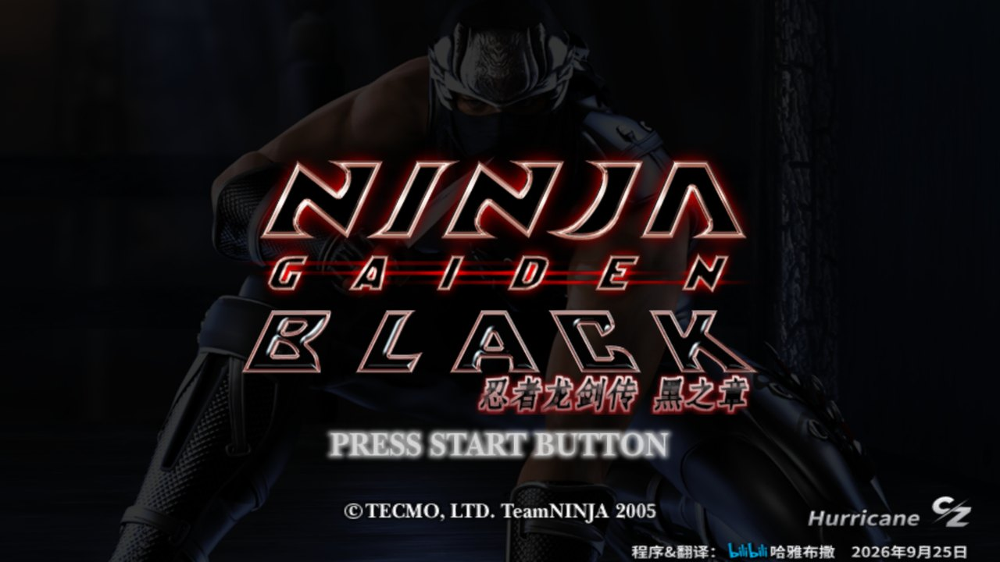 | 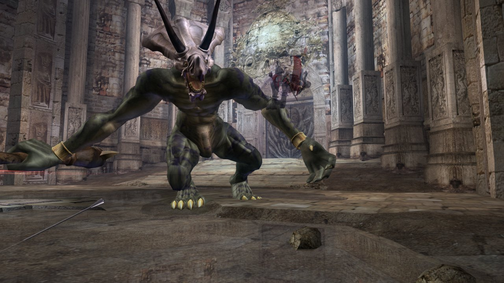 |
| 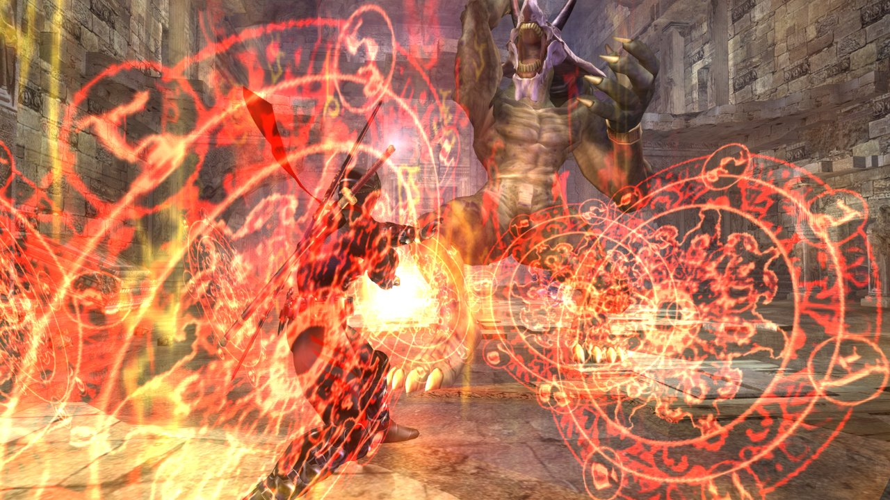 | 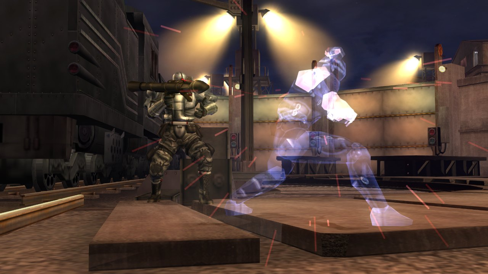 |

**不同显示比例**（黑之章，同一画面）：4:3、16:9、16:10、21:9。16:10 / 21:9 的画面加宽，血条等界面放在两侧。

| 4:3 | 16:9 |
|---|---|
| 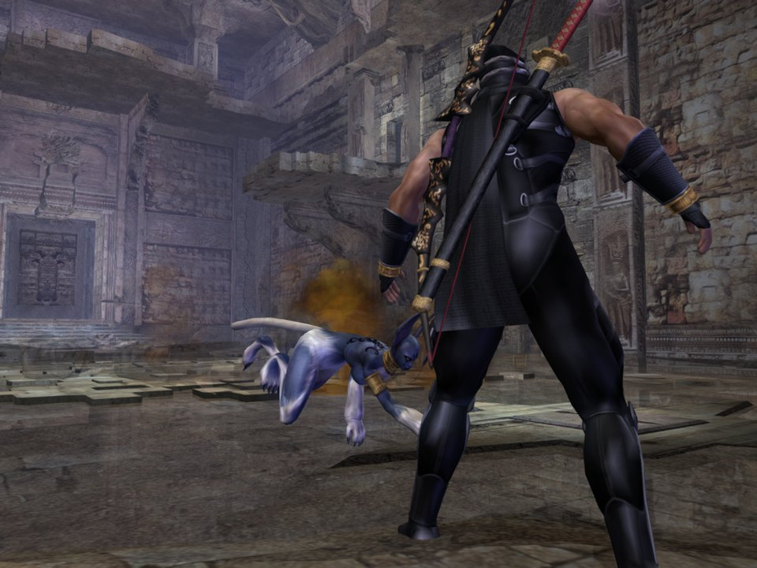 | 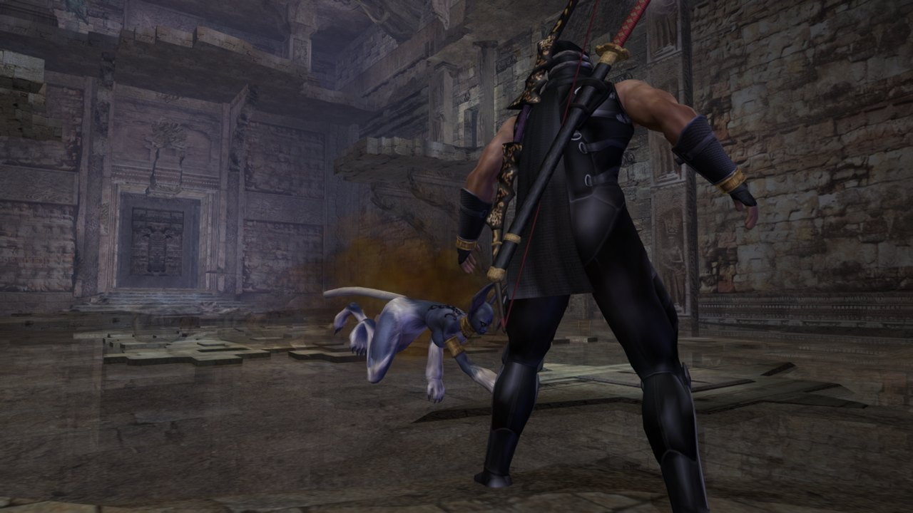 |

| 16:10 | 21:9 |
|---|---|
| 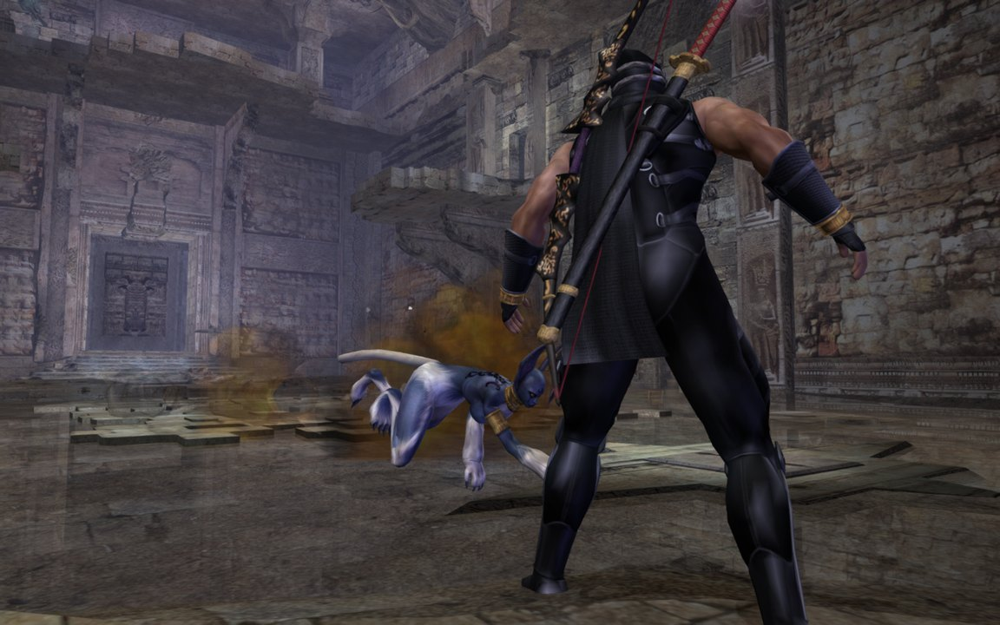 | 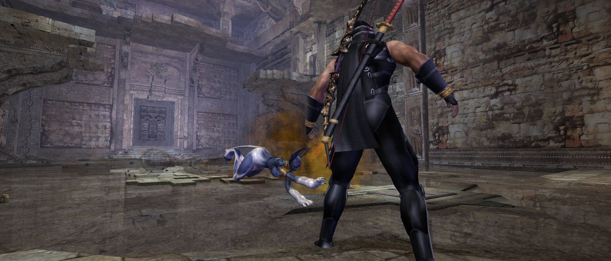 |

**忍者龙剑传（2004）**：16:9、4:3、21:9 与菜单。

| 16:9 | 4:3 |
|---|---|
| 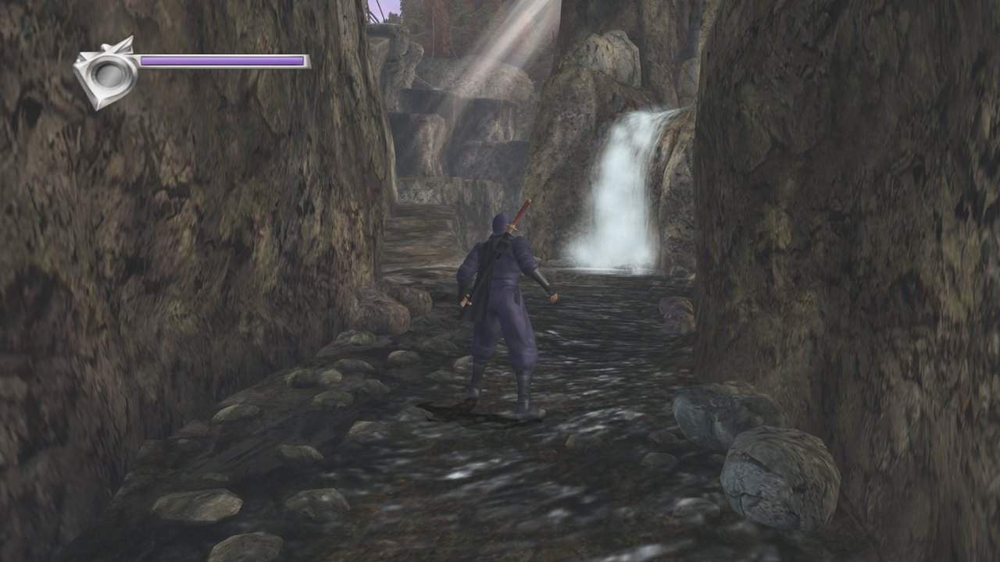 | 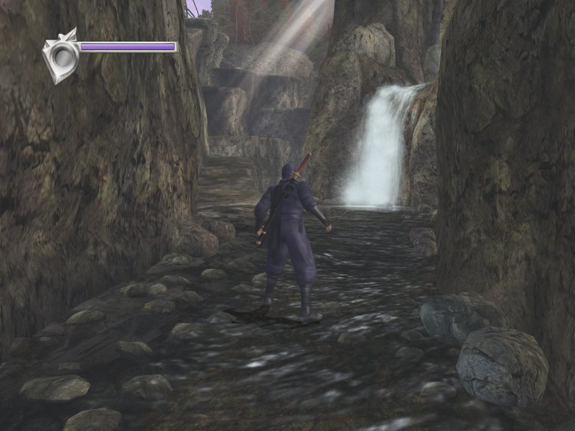 |

| 21:9 | 菜单 |
|---|---|
| 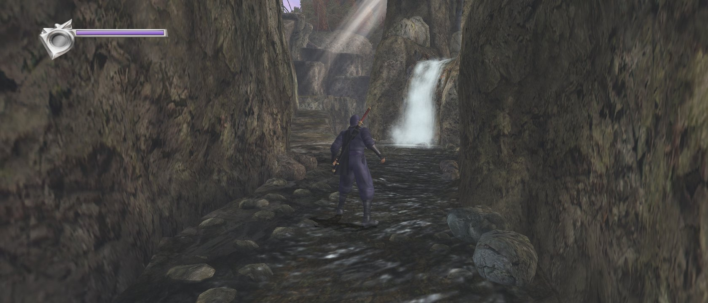 | 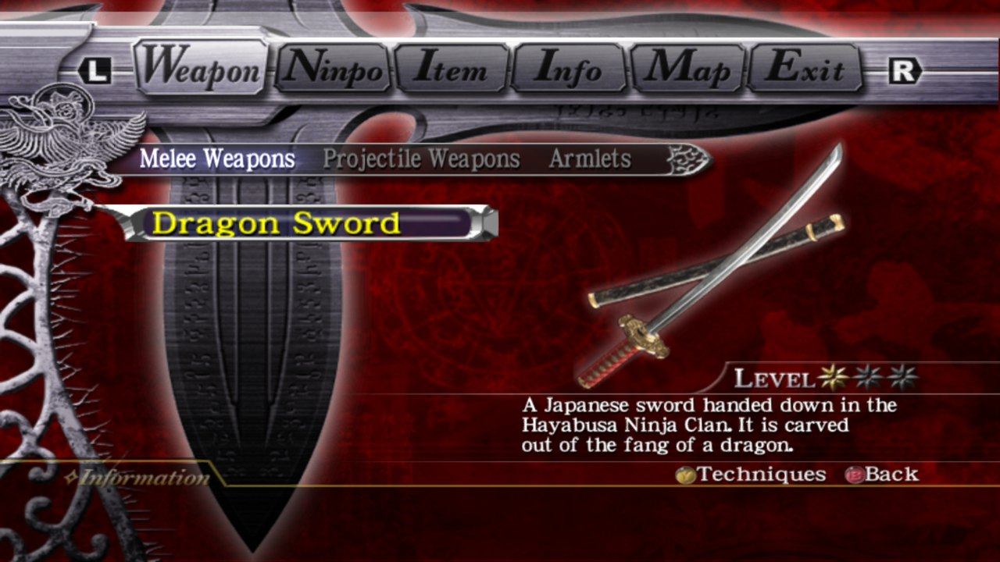 |

## 支持的版本

加载器按 XBE 的 SHA-256 识别版本，其他版本不运行。支持四种光盘镜像：美版原版，以及哈雅布撒在它基础上做的三个改版。

| 主程序 `default.xbe` | 语言 | 附带程序 | SHA-256 |
|---|---|---|---|
| 美版原版 NINJA GAIDEN BLACK（NTSC-U） | 英文 | 街机版 2 个 | `df1d2af0154d771f42b77ec4df03a862417ac457ff0d39fec846c40cb55ffbda` |
| 基本版 va-zh-x2 | 中英 | 街机版 2 个 | `00cef52546618eb0149d7895f9042403e95f361b5483aac38933e799c67a50e1` |
| 飓风版 vb-zh-x2.1 | 中英 | 街机版 + SFC 共 4 个 | `aa3c5bec2923f83ccb37fe6a63ea5516b26d477b53c679a1620d19e4a8e4e8f6` |
| 飓风版 vb-jp-x2.1 | 日英 | 街机版 + SFC 共 4 个 | `535778c8a4623195c8f320b85d2d139f20ff13c020d40150adaed54cfdeffc38` |

三个改版都是在美版 `default.xbe` 上打的补丁：各段地址相同，Direct3D、DirectSound 等库逐字节相同，改动的地方都不碰加载器用到的
地址，所以四个版本共用同一套表和修复。附带程序在各版本里完全相同：

| 附带程序 | SHA-256 |
|---|---|
| `NinjaTomoe.xbe`（原版附带程序，日版） | `2aff93ad098b3b5762d294d9c17a44c36d04bfa31843e413cf5e2963f14282ff` |
| `NinjaTrilogy.xbe`（原版附带程序，美版） | `31f8efd073abba2ac339ee44f4b13011844afc470b166f826dc12f6b79ff5621` |
| `NinjaFCJ.xbe`（SFC 三部曲，日版，飓风版加入） | `b5b8754e6008f3b2e773c1eb9afe50ee9decebf0eadb945a9953369b1b9f4f31` |
| `NinjaFCU.xbe`（SFC 三部曲，美版，飓风版加入） | `9fac4bb5162b8a99c65c0fbb6289ee81db4c42bdbd253807e74261a68e3399b1` |

附带程序从主菜单的"街机版忍者龙剑传"和"SFC忍者龙剑传"进入：游戏调用 `XLaunchNewImage`，加载器以同样的参数重启并
载入目标 XBE。

## 忍者龙剑传（2004）

2.0.0 起也支持初代《忍者龙剑传》（2004，美版光盘 1.02.04）和它的飓风包。启动器左上角切换到「2004」，游戏装在另一个目录，
和黑之章互不影响。

| 程序 | 说明 | SHA-256 |
|---|---|---|
| `default.xbe` 光盘版 1.02.04 | 没装飓风包时运行 | `bea2a85eea7e6e0ba6c3e201966a46b24b27e25b3307a29bc3de5b4254791308` |
| `$u\default.xbe` 更新版 1.06.04 | 随飓风包安装；装了就自动运行它（和原机一样） | `86475ba502c0e7f147334b167041c3fd310f8fb34f9e77b0ee6e6866e0764ee3` |
| `downloader.xbe` 光盘版 / 更新版 | 大师锦标赛「NEW NOTICE!」的 Xbox Live 下载程序 | `fcce4a17…`（光盘）/ `a99574a8…`（更新） |
| `NinjaTomoe.xbe` / `NinjaTrilogy.xbe` | 附带的 SFC 三部曲 | `d2aeab80…` / `18eaadc5…` |

Redump 的「Ninja Gaiden (USA, Asia) (En,Ja)」也支持：同一个 1.02.04，只是各程序里 XDK 启动检查处的 1 个字节保持签名时的原样（上表那套在这里被改成了跳过检查）。它的 `default.xbe` 是 `86c23d787ecf9f6400b9378544a49b62cfdd478dc04d6ef01ceed2a6429e84c0`，下载程序、三部曲、更新程序也各有对应的一份；联网更新到 1.06 同样可用。

- **飓风包**：启动器「安装」页的飓风包卡片选择安装包文件夹（「Ninja Gaiden DLC Installer」），一键装到游戏硬盘；装好后
  开始游戏就是 1.06 更新版。同一张卡片的「卸载内容」列出硬盘上已装的东西（更新 1.06、飓风包 1 / 2、在游戏里下载的通知等），
  选一项确认后删除。「导出」把已装的更新和全部内容按安装包的结构导出到一个文件夹，别的玩家在这张卡片里选这个文件夹
  就能安装。
- **联网更新到 1.06**：没装飓风包时进入忍者大师锦标赛，游戏会提示更新；确认后运行光盘上的 Xbox Live 更新程序，从 Insignia
  下载并装上 1.06 更新，完成后自动回到游戏（2.0.1 起）。更新程序要用 Xbox 系统字体，第一次运行时从「联网」页登记的 xemu
  硬盘镜像里复制。更新失败时按 OK 回到游戏。
- **忍者大师锦标赛**：需要联网（和黑之章一样用 Insignia，见下文「联网」）。飓风包内容在游戏启动时按这台电脑重新签名，
  所以别处装的也能用。
- **NEW NOTICE!**：大师锦标赛里的「NEW NOTICE!」会进入 Xbox Live 下载程序，可以从 Insignia 下载通知等内容，退出后回到游戏。
  下载程序没有声音。
- **退出游戏**：标题菜单最下面多了一项 EXIT GAME（字形取自游戏自己的菜单字），用游戏自己的确认框问「Exit the game?」。
- 宽屏、21:9 下 CG 保持 16:9、读盘计时修正等黑之章的修复，2004 版本也有。

## 现状

逐项结论与证据见 `project/docs/06_功能验证矩阵.md`。

- **汉化**：标题、主菜单、存读档页、暂停菜单 / 武器 / 招式表、章节标题卡、开场 CG 与实时过场字幕、结算画面、道具 /
  商店 / 地图 / 对白，均已验证。
- **飓风版功能**：交差之法两种模式、宁静腕轮、扳机选服装、妖刀鬼彻扣血、带金圣甲虫二周目、还魂护符开关、弓箭准星 /
  视角、任务模式，均已实际游玩验证。
- **附带程序**：街机版与 SFC 版从主菜单进入可以游玩。
- **退出游戏**：主菜单最下面多了一项「退出游戏」，选中后用游戏自己的确认框问「要退出游戏吗？」，Ⓐ是退回桌面，Ⓑ否回到菜单。
- **联网排行榜（可选）**：用 Insignia 的主机与账号，在游戏的「排行榜」里登录并查看真实榜单（已实测）。主机可以从 xemu
  导入，也可以在移植版里新建并注册，不用 xemu（2.2.0 起）。默认关闭，打开方法见下文「联网」。
- **存档**：存档、读档、存后读回同一格均已验证。存档是标准 Xbox 格式，复制到 xRevive 的存档目录后可以直接读取（已实测）。
  开不开联网，存档都用同一把主机钥匙签名，不会再因为切换联网显示 Damaged Game。启动器「存档」页的「一键重签」把别的 Xbox、
  xemu、别的玩家的存档，以及旧版本开着联网时存的档，重新签成这台电脑的（先自动备份）。
- **声音**：软件 DirectSound 混音器，经 XAudio2 输出，带混响。
- **性能**：第 1 章战斗场景在 Intel Iris Xe 核显上平均帧时间 10.45 ms（60 fps 的预算是 16.68 ms；r178，
  `project/docs/05_音频输入存档.md`）。
- **输入**：Xbox 与其他 XInput 手柄，以及 PS3 / PS4 / PS5 手柄、Switch Pro 手柄、Joy-Con、DirectInput 手柄（经 SDL3）；震动都有。
- **系统语言**：启动器「显示」页的「主机设置」里可以选初代 Xbox 的 9 种系统语言（默认 English），游戏按它决定默认的菜单文字等；对黑之章和 2004 的所有镜像都生效。汉化版请保持 English。
- **音频设置**：同一张「主机设置」卡片里有初代 Xbox 仪表盘的全部音频选项：单声道 / 立体声（默认）/ 杜比环绕（后方声道编码进两路，接 Pro Logic 功放可解出），以及数字输出 Dolby Digital、DTS（开启后按 5.1 声道输出：前左、前右、中置、低音、后左、后右；音箱不足 6 声道时由 Windows 往下混）。黑之章原版开 5.1 时背景音乐和过场声音几乎听不见（音量多乘了 10），移植版已修正。

### 修过的原版缺陷

以下问题原机上同样存在，移植版修掉了。每项修正都可以用开关即时切回原样对照（`project/docs/07_证据盘点.md`）：

- 第 2 章水面：边缘的黑 / 白锯齿；镜头贴着水面时的拉长条纹（顶点上的除法改为逐像素除法）。
- 熔岩房间：右边的黑条（画面复制少画一列）、热浪效果的白斑、右边缘的模糊条。

## 已知问题

- 镜子：第一人称近看时，屏幕最右有一条带横纹的暗带。这是原版缺陷，反射镜头没有拍到镜子的这一块；已查明，决定不修
  （`project/docs/07_证据盘点.md`）。
- 3D 音效与混响是对 Xbox 的近似，尚未逐项核对（`project/docs/07_证据盘点.md` #9）。
- 2004 大师锦标赛里打开 Xbox Live 仪表盘、再回到游戏这条路还没实测（黑之章的排行榜已实测）。
- 2004 的 Xbox Live 下载程序没有声音。
- 不带启动数据直接运行 `NinjaFCJ.xbe` 会崩溃（玩家从主菜单进入不会走这条路）。
- 仍在核实中的模拟规则列在 `project/docs/07_证据盘点.md` 的核实进度里。

## 运行

**需要**：Windows 10 或 11（64 位系统即可，程序本身是 32 位），支持 Direct3D 9 的显卡（集成显卡也可以），以及你自己的
游戏镜像（上面四种之一）。不需要另外安装任何运行环境：用到的 Direct3D、XAudio2、XInput 都是 Windows 自带的，C++ 运行库已编进程序。

**用启动器（推荐）**：

1. 解压发布包。里面的 `NGB-Hurricane\` 文件夹放在哪里都可以：

   ```
   NGB-Hurricane\
     Ninja Gaiden Black Any Launcher.exe   启动器：从这里进
     Ninja Gaiden Black Any.exe            游戏程序，连同 blackrt.dll
     game\                                 游戏安装位置（启动器装进来）
     savedata\                             Xbox 硬盘：存档与游戏设定（第一次运行时自动建立）
   ```

2. 打开启动器，在「安装」页选你的游戏镜像（`.iso`），装到「游戏安装路径」（默认是启动器旁的 `game`）。装完会逐个核对游戏
   程序，也可以选择把镜像移到回收站。已经解包过的游戏，在同一页选那个文件夹即可。
   装好后直接双击 `Ninja Gaiden Black Any.exe` 也能开始游戏（它会找启动器装好的游戏）。
   从 1.1.12 或更早的版本升级：程序改名了（原来叫 `Ninja Gaiden Black Hurricane.exe` / `…Hurricane Launcher.exe`），覆盖解压后
   可以删掉这两个旧程序，桌面快捷方式要重新建。存档和设置不受影响。
3. 在「显示」「图形」「控制」页按需要调整（按「保存」才生效，每项旁的「?」有说明），回到「开始游戏」页开始。

「存档」页可以备份 / 还原存档、与 xRevive 互相导入导出；「关于」页有版本与法律声明；「支持作者」页有作者的微信、支付宝收款码，赞助全凭自愿。

**用 run.bat（开发用）**：仓库根目录的 `run.bat` 按下面的结构直接启动游戏，不经过启动器：

```
ngb-pc-native-port\
  run.bat
  build\RelWithDebInfo\Ninja Gaiden Black Any.exe   构建产物，连同 blackrt.dll（见"构建"）
  game\x21\default.xbe                                       你自己解包的 x2.1 镜像（整个镜像的文件）
  savedata\                                                  Xbox 硬盘
  logs\                                                      日志 black.log、截图 shots\、命令文件 presses.txt
```

核对 `default.xbe` 的哈希与上表一致：`Get-FileHash game\x21\default.xbe -Algorithm SHA256`。找不到程序或游戏时，`run.bat`
的窗口里会说明缺了什么。

游戏里按 **Alt+Enter** 切换窗口 / 全屏，设定会保存。全屏分两种：独占全屏（`black.ini` 里 `fullscreen = 2`）与无边框
（`fullscreen = 1`），可在启动器的「显示」页选择。

配置较低的电脑可以把「显示」页的**全屏分辨率**选成「窗口大小」（`fullscreen_res = window`，默认 `screen`）：全屏与无边框时
画面按「窗口大小」输出（保持屏幕的比例，按窗口大小等比缩小），再线性放大铺满屏幕，每帧最后几道全屏处理要算的像素少了；
渲染分辨率选「跟随窗口」时，3D 画面本身也按这个尺寸画。显示器的分辨率不变：无边框由系统放大，独占全屏由显卡在交付前
放大。集成显卡实测（1920×1200 屏幕、渲染 3 倍、窗口 1280×720）：无边框平均帧时间 9.37 → 8.47 毫秒。

**显卡**：默认用独立显卡，没有独显时用集成显卡。程序第一次运行时，若 Windows 的图形设置里还没有它的偏好，就替它登记为
"高性能"；之后想换，在启动器的「图形」页，或 Windows 设置 > 系统 > 屏幕 > 显示卡（图形）里改，程序不会覆盖你的选择。日志里 `host: Direct3D 9
device ... on '显卡名'` 一行记着实际用的是哪张卡。

**放在别的位置**：把 `default.xbe` 拖到 `run.bat` 上启动；或者在命令行里先设好路径再运行：

```bat
set EXE=D:\ngb\Ninja Gaiden Black Any.exe
set GAME=D:\ngb\x21\default.xbe
set HDD=D:\ngb\savedata
set LOGDIR=D:\ngb\logs
run.bat
```

**存档**在 `savedata\Partition1\`：`UDATA\5443000d\` 是各存档格，`TDATA\5443000d\system.dat` 是系统存档。备份时复制整个
`savedata` 文件夹即可。

**截图**：往 `logs\presses.txt` 追加一行 `shot:名字`，下一帧存为 `logs\shots\名字.png`。更多命令见"诊断工具"。

**图形设定**（启动器「图形」页，或 `black.ini`）：`shadow` 阴影贴图倍数（1 = Xbox 原版 128×128，默认 4 = 512×512，最高
16）；`vsync = 1` 垂直同步（只在独占全屏下起作用，防撕裂；窗口和无边框全屏本来不撕裂；实测几乎不影响速度；默认关）；`perfhud = 1` 在画面右上角显示 FPS、平均帧间隔与最大帧间隔、输入到 Present 延迟、GPU/CPU/RAM/磁盘的型号与总使用率、游戏自身使用率、最大执行绪和系统最忙核心；面板为固定大小，不随窗口缩放（默认关）；`aniso` 各向异性纹理过滤（1 = 关，2–16）。命令行也可用 `--vsync`、`--perfhud`、`--aniso N`；命令行的值只用于
这一次，不会写回 `black.ini`。

**画面比例**：`widescreen = 1` 时 `aspect = 16:9`（默认）、`16:10` 或 `21:9`（实验性），命令行 `--aspect W:H`；`widescreen = 0`
为 4:3。21:9 时 3D 视野左右变宽（上下不变），16:10 时左右略窄；HUD、文字、菜单、标题画面与片头视频保持 16:9 比例（21:9
左右留黑边，16:10 上下留黑边）；21:9 下商店、游戏结束等画面尚未逐一检查。只对忍龙主程序生效，内置的 SFC / 街机程序保持 16:9。
带鱼屏多数不正好是 21:9：启动器「画面比例」里直接有 `64:27`（5120×2160、2560×1080）、`43:18`（3440×1440）、`12:5`
（3840×1600）三项，选对应的一项 3D 画面正好铺满（HUD 与菜单仍是中间的 16:9）；「跟随显示器」按这台电脑主显示器的比例写入
`aspect`。比 16:9 宽的比例都是实验性的；支持 1.5:1 到 2.5:1，32:9 等更宽的不支持。

**键盘与手柄**：游戏本身只认手柄；键盘的每个键直接按下手柄上的一个输入（默认 WASD 移动、方向键视角、J / K 攻击、空格跳、
Esc 为 Start……），在启动器的「控制」页可改，也可把手柄按钮重新映射。`black.ini` 里是 `kb_<输入> = 键[,键]` 与
`padmap_<输入> = <输入>`。按住 Alt 时按键不会送进游戏。

**支持的手柄**：Xbox 手柄和其他 XInput 手柄由 Windows 的 XInput 读；其余手柄由内置的 SDL3（zlib 许可，静态编进
`blackrt.dll`）读，不用装 DS4Windows 之类的工具：PS4 / PS5 手柄（USB 或蓝牙）、Switch Pro 手柄、Joy-Con（一对合成一个
手柄，也可只用一只横握）、DirectInput 手柄与 PS1 / PS2 手柄的 USB 转接器（转接器能否震动看转接器本身）。PS3 手柄要先装
驱动（如 DsHidMini）。按键按位置对应 Xbox 布局：最下面的键是 A、右边是 B、左边是 X、上面是 Y，所以 Switch 手柄上标着 B
的键是 A；PS 手柄的触摸板按下等于 Back。几个手柄可以同时插着，都控制同一个角色。只想用 XInput 时加 `--no-sdl-pads`。

**着色器缓存**：程序第一次遇到某个着色器时要现场编译，会卡一下；编译结果存在程序旁的 `cache\shaders\`，下次启动时一次读进
内存，之后就不再卡。启动器「图形」页最下面的「清理着色器缓存」可以主动清空（确认后执行）；删掉这个文件夹没有坏处，只是会重新编译一遍。

`run.bat` 实际执行的命令（也可以自己手动输入）：

```
"Ninja Gaiden Black Any.exe" --windowed --hdd savedata --log logs\black.log --screenshot logs\shots --shot-every 100000000 --press-file logs\presses.txt game\x21\default.xbe
```

- `--shot-every 100000000` 让定时截图实际上不发生，只在你用 `shot:` 要求时才截。默认值 60 是每秒截一张，会造成卡顿。
- `"Ninja Gaiden Black Any.exe" --help` 列出全部选项。其中一部分（视野、自动瞄准、PC SETTINGS 菜单等）是 BLACK 专用的，对忍龙不起作用。

**联网（Insignia 排行榜，可选）**

移植版在存档文件夹（`savedata\`）里有一台自己的「主机」：`online_eeprom.bin` 是主机身份，`online_accounts.bin` 是它的网络
设置、主机账号和玩家账号。游戏联网只用这两个文件，不读 xemu 的。游戏自己的联网代码原样运行，和在真 Xbox 上登录一样。
拿到一台能联网的主机有两条路，都在启动器「联网」页做（「注册步骤」按钮里有同样的分步说明）：

**A. 以前在 xemu 里联网玩过：从 xemu 导入**（最省事）

1. 关掉 xemu。
2. 在「从 xemu 导入」卡里用「选择文件…」选 xemu 的 EEPROM（`eeprom.bin`）和硬盘镜像（`xbox_hdd.qcow2`）。两个文件只读，
   不会被修改。
3. 按「从 xemu 导入」。第一次会把 xemu 那台主机连同账号一起搬过来；以后再导入，只补进本机还没有的账号（本机已有 A、D，
   xemu 里有 A、B、C，导入后是 A、B、C、D）。别的主机上的账号也能导入，会改成用本机的钥匙加密。
   以前的版本里开过联网的玩家，第一次用 2.2.0 开联网时会自动导入一次。

**B. 没用过 xemu：在移植版里新建并注册一台主机**

要准备：

- Insignia 官网的注册程序 `Insignia-Setup.iso`。
- 微软的 Xbox 仪表板（升级到 Insignia 要求的 5960 版）。移植版从中读出 Xbox Live 仪表盘的文件，只读、不修改。这是微软的文件，
  移植版不能附带，下面三种来源任选一种：
  - 装过官方仪表板的 xemu 硬盘镜像 `xbox_hdd.qcow2`（不必注册过 Insignia）；
  - 从自己的 Xbox 导出的硬盘镜像（XboxHDM、FATXplorer 等工具做的）；
  - 用 FTP 从改机 Xbox 拷出的整个 C 盘文件夹：选择文件时选其中的 `xboxdash.xbe`，移植版会取出同一文件夹里的 `xodash`、
    `fonts` 和 `xboxdash.xbe`。

  注意：xemu 官网提供的预制硬盘镜像里没有微软仪表板（装的是一个简易的替代品），不能用。

1. 「本机主机」一行按「新建主机」：在存档文件夹里生成一台新主机（随机主机编号）。
2. 按「注册主机」，选 `Insignia-Setup.iso`。注册程序打开后选 Register Xbox，成功后选 Quit 退出。
3. 按「Xbox Live 仪表盘」（第一次会让你选上面的硬盘镜像或 `xboxdash.xbe`）。在仪表盘里进 NETWORK SETUP 做一次联网测试：通过后本机才有
   「主机账号」，才能登录。开着代理的 TUN 时这一步会失败，见下文「连不上时」。
4. 还在仪表盘里，选 NEW ACCOUNT 新建玩家代号（按 Insignia 官网的说明填写）。

**进游戏**：「联网」选「开」，按「保存」。主菜单选「排行榜」，选自己的玩家代号即可登录，然后查看榜单。连上时画面右下角会
提示「联网：已连接 Insignia」。排行榜里要去 Xbox 仪表板的选项（新建账号、网络设置、修复玩家代号）会打开同一个 Xbox Live
仪表盘，退出后回到游戏。

这一页写的是游戏程序旁边的 `black.ini`（`online = 1` 等），也可以直接改这个文件。

**账号文件的备份**：每次运行第一次改动 `online_accounts.bin` 之前，旧的一份先存为 `online_accounts.bak`；
`online_accounts.bin` 丢失或损坏时自动从它读回。备份时复制整个 `savedata` 文件夹即可。主机文件坏到读不回来时，「本机主机」
一行会出现「重建主机」：旧文件改名为 `.old` 留着，再新建一台，要重新注册。

**xemu 开着时**：从 xemu 导入的主机和 xemu 里的是同一台，xemu 开着时游戏不联网（同一台主机不能同时登录两次）；在移植版里
新建的主机不受影响。

**要不要开 InsigniaDNS.exe？** 默认不用。先分清两个名字很像的东西：

- **Insignia 公网 DNS**：Insignia 架在网上的 DNS 服务器（`46.101.64.175`），什么都不用装。
- **本地 InsigniaDNS.exe**：从 Insignia 下载、在你电脑上运行的小程序，在这台电脑的局域网地址上回答查询。

「联网」页的 DNS「查询方式」就是在这两个里选：

- **Insignia 公网 DNS**（默认，推荐）：游戏的所有 DNS 查询都由移植版转给它（地址可用 `online_dns = …` 改），不管 xemu 里
  怎么设定的，也不用开 InsigniaDNS.exe。只在移植版里生效，不改主机文件。
- **本地 InsigniaDNS.exe**：所有查询转给一台运行 InsigniaDNS.exe 的电脑，地址在「InsigniaDNS.exe 地址」里填。点「找本机」
  会找这台电脑上正在运行的 InsigniaDNS.exe 并填上它的地址。它只在局域网地址（`192.168.x.x`）上监听，填 `127.0.0.1` 不行。
  这个地址存在移植版的设置里，不看 xemu 里填的 DNS，所以换了电脑或网络只要在这里改。开着代理 TUN 时用这个（见下）。

「当前 DNS」一行显示游戏实际会用的 DNS：「自动 46.101.64.175（Insignia 公网 DNS）」或「手动 192.168.x.x（本地 InsigniaDNS.exe）」，随上面的选择变化。
xemu 主机设定里填的 DNS 不用，也不再显示：移植版会把游戏的每个 DNS 查询都改发到这里显示的地址。

**连不上时：**

- 先按「联网」页的「检查网络」。它会用当前的查询方式问一次 `AS.XBOXLIVE.COM`：
  - 答出地址：DNS 正常；
  - 答出 `198.18.x.x`：代理软件（Clash 等）的 TUN / fake-ip 模式截走了 DNS；
  - 没有回应：检查网络，或那台电脑上的 InsigniaDNS.exe。

  被 TUN 截走时，不想关 TUN 也行：**先关 TUN，启动 InsigniaDNS.exe，再开 TUN**，然后查询方式选「本地 InsigniaDNS.exe」。
  局域网地址（`192.168.x.x`）上的 InsigniaDNS.exe 不会被 TUN 截走。也可以直接关掉 TUN，用 Insignia 公网 DNS。
- 开着 TUN、用 Insignia 公网 DNS 时，「注册主机」照样会成功（它走 HTTPS，经过代理也能到），但仪表盘的联网测试过不了，
  建不出主机账号。所以启动器打开仪表盘前会先检查一次 DNS，被截走时不打开并提示；仪表盘关掉后还没有主机账号，也会提示。
- 游戏里也会在右下角提示连不上的原因：DNS 被截走、DNS 没有回应、xemu 正在运行、文件无效等。
- 游戏的「无法连接 / 修复玩家代号」框里，Ⓐ 打开 Xbox Live 仪表盘；还没有仪表盘的文件时（没按过启动器的「Xbox Live
  仪表盘」，也没选 xemu 硬盘镜像），Ⓐ 和 Ⓑ 一样是取消。
- 日志 `black.log` 里搜 `online:` 和 `[net]`，能看到身份是否读成功、DNS 问到了什么。

**联网是怎么做到的（通俗版）**

初代 Xbox 的官方联网服务 Xbox Live 早已关闭。Insignia 是玩家社区搭的替代服务器，专门扮成当年的 Xbox Live，让老游戏重新
能联网。移植版要连上它，办了四件事：

1. **联网功能用游戏原来的那一套。** 游戏里本来就有完整的联网代码（登录、排行榜、加密通信），移植版一行没重写，让它原样
   运行。对游戏来说，它就是在像当年一样连 Xbox Live。
2. **给它一块「假网卡」。** 真 Xbox 里有网卡，PC 上没有。移植版用软件模拟了一块 Xbox 网卡：游戏往网卡发的数据，移植版交给
   Windows 送上网；服务器的回信，再塞回这块网卡给游戏。就像游戏把信投进自家信箱，移植版当邮递员。
3. **带一台「已登记的主机」的身份。** Insignia 只认登记过的 Xbox。移植版在存档文件夹里放了一台自己的虚拟主机：身份证
   （主机编号和密钥）在 `online_eeprom.bin`，账号在 `online_accounts.bin`。这台主机可以从你在 xemu 里注册过的那台搬过来，
   也可以新建一台，再用 Insignia 自己的注册程序去登记。从 xemu 搬来的主机不能同时在 xemu 和移植版里登录，就像一张身份证
   不能同时在两处刷。
4. **换一本「电话簿」（DNS）。** 联网第一步是查「Xbox Live 的服务器在哪」，这叫 DNS，相当于查电话簿。普通电话簿里 Xbox Live
   的号码早停机了；Insignia 的电话簿把这些名字指到 Insignia 自己的服务器。不管游戏去查哪本，移植版都换成 Insignia 的：
   「Insignia 公网 DNS」查 Insignia 放在网上的那本；「本地 InsigniaDNS.exe」查你电脑上那个小程序手里的那本，给代理软件截走查询时用。

结果：游戏以为自己连上了当年的 Xbox Live，Insignia 以为来的是一台真 Xbox（你注册的那台），两边对上，就能登录、看排行榜。

一句话：游戏原封不动，移植版给它造了一块网卡，配了一台注册过的主机身份，再把查服务器地址的电话簿换成 Insignia 的。

细节与证据见 `project/docs/09_联网_Insignia.md`。

## 构建

本项目用 Visual Studio 2017（x86 C++ 工具）与 CMake 构建，产出 32 位程序：

```
cmake -S loader -B build -G "Visual Studio 15 2017" -A Win32
cmake --build build --config RelWithDebInfo
```

得到 `build\RelWithDebInfo\Ninja Gaiden Black Any.exe` 与 `blackrt.dll`。`loader/CMakePresets.json` 里另有上游的 Visual Studio
2022 / 2026 预设。

**SDL3**：配置时 CMake 会下载 SDL3 3.4.18 的源码包（校验 SHA256）并与程序一起编译；已有解压好的源码时用
`-DNGB_SDL3_DIR=<路径>`，不再下载。

**图标**：两个程序默认带 `launcher/art/icon.ico`（龙剑，见"法律声明"）。要换别的图标或不要图标，配置时用
`-DPORT_ICON=<.ico 路径>` 或 `-DPORT_ICON=`。

**发布包**：运行 `tools\make_release.ps1 -Bin <构建目录>\RelWithDebInfo`，得到 `dist\ngb-hurricane-pc-<版本>-win32.zip`
（启动器、游戏程序、`blackrt.dll`、中英文 README、LICENSE）与符号包。脚本会检查游戏程序带有图标。

## 诊断工具

用 `--press-file <文件>` 启动后，往这个文本文件里追加一行命令，游戏会即时执行：

| 命令 | 作用 |
|---|---|
| `shot:名字` | 截下一整帧，存为 `名字.png` |
| `trace` / `trace:N` | 记录下一帧（或之后 N 帧）的每个绘制：状态、贴图、顶点、调用者、顶点程序读到的常数，并转储渲染目标 |
| `cfg:pixwatch:X,Y` | 在追踪帧里逐个绘制回读屏幕上的一点，记下改动它的绘制 |
| `cfg:pixwatchrt:地址` | 同上，但盯某张渲染贴图（按数据地址） |
| `cfg:skipcaller:地址` | 跳过调用栈里含该返回地址的绘制，用来找是谁画了某个东西 |
| `cfg:<开关>:0` / `:1` | 即时关闭 / 打开各项修正，对照原样，例如 `rhwedge`、`edgemirror`、`vsdivide`、`rhwoffset` |

启动参数 `--debug-frame N` 可以直接指定要追踪的帧。

## 目录

| 位置 | 内容 |
|---|---|
| `loader/` | 加载器源码：`kernel/` 内核 HLE；`d3d/` Direct3D 8 → 9，NV2A 顶点程序与寄存器合成器译为 HLSL；`audio/` DirectSound 混音；`input/` 输入；`ngb/` 忍龙专用的地址表与补丁 |
| `project/docs/` | 过程文档：输入清单、工具链、静态分析、加载器与内核、图形、音频输入存档、功能验证矩阵、证据盘点 |
| `project/tools/` | 分析与比对脚本：XBE 普查、函数表、图像比对、xemu 存档导出等 |
| `launcher/` | 启动器（开发中，见 `project/docs/08_PC启动器计划.md`）：从镜像安装、选择游戏安装路径、启动游戏；`art/` 为界面背景图 |
| `notes/` | 上游 BLACK 的分析结果 |

反编译与反汇编输出、游戏文件、测试运行目录都只留在本地，不进仓库。

## 原理

`Ninja Gaiden Black Any.exe` 是一个链接在 XBE 基址的小程序，抢在 Windows 往这段地址放别的东西之前占住它。`blackrt.dll` 把
`default.xbe` 映射进这段地址，提供游戏导入的 Xbox 内核函数，并在 Xbox 库（Direct3D 8、DirectSound、XAPI）的入口
打补丁，转到 PC 上的实现。

忍龙主程序是 LTCG 构建（寄存器传参、函数内联），库函数地址表是逐个核对的；附带程序是普通 D3D8，地址表由
XbSymbolDatabase 的识别结果生成。每一条模拟规则都要有依据：原版程序、xemu / 文档、硬件规格或实测对照。依据记在
`project/docs/07_证据盘点.md`。

## 法律声明

本项目与 Koei Tecmo、Team NINJA 及 Microsoft 无关，也未获其认可。Ninja Gaiden 是 Koei Tecmo 的商标，Xbox 是
Microsoft 的商标。仓库不含游戏代码或数据，也不含 Microsoft Xbox 开发包的代码。请使用自己合法取得的游戏。

例外是 `launcher/art/` 里的图：启动器的背景图取自作者自己的网站，其中隼龙的主视觉版权属于 Koei Tecmo；程序图标是游戏里
龙剑的贴图。两者都只作为本非商业粉丝移植的界面使用，出处见 `launcher/art/SOURCES.md`。另有作者本人的两张收款码。

本项目是自由软件，以 GNU 通用公共许可证第 2 版或（由你选择）任何更新的版本发布，见 `LICENSE`。

## 致谢

- [black-pc](https://github.com/Spark198rus/black-pc)（Spark198rus）：本项目所基于的加载器。
- [ngbrecomp](https://github.com/gamboozino/ngbrecomp)：忍龙主程序的 D3D 符号表。
- [xemu](https://xemu.app) 与 [Cxbx-Reloaded](https://github.com/Cxbx-Reloaded/Cxbx-Reloaded)：Xbox 内核与 NV2A
  行为的参考（未复制代码）。
- [genma-pc](https://github.com/w1284603830/genma-pc)：同类的 Xbox 原生移植，CLIPPLANE 等行为的参照。
- [XbSymbolDatabase](https://github.com/Cxbx-Reloaded/XbSymbolDatabase)：识别游戏里的 Xbox 库函数。
- [SDL3](https://libsdl.org)（zlib 许可，静态编进 `blackrt.dll`）：读 XInput 以外的手柄与它们的震动。

开发：哈雅布撒（b 站），与 Claude Code 合作。
